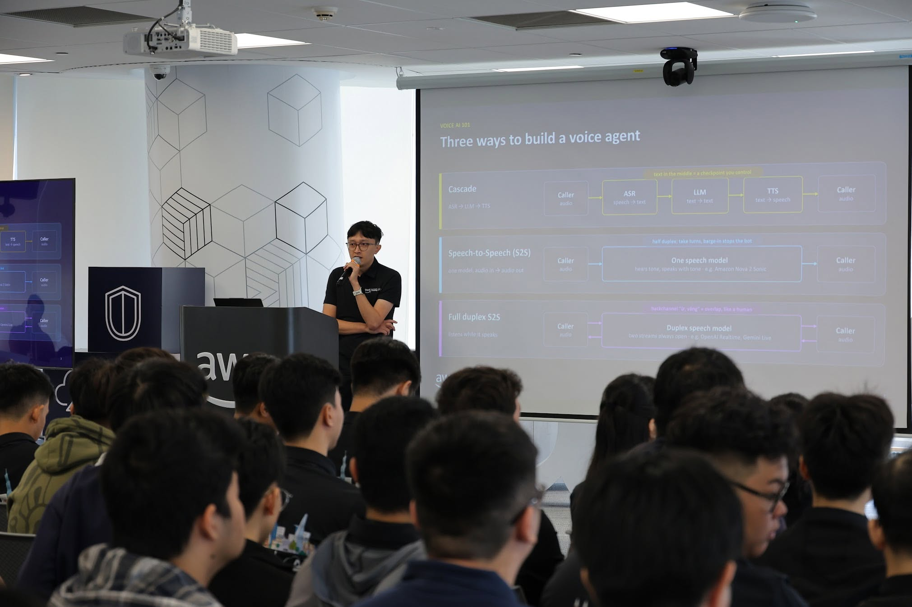
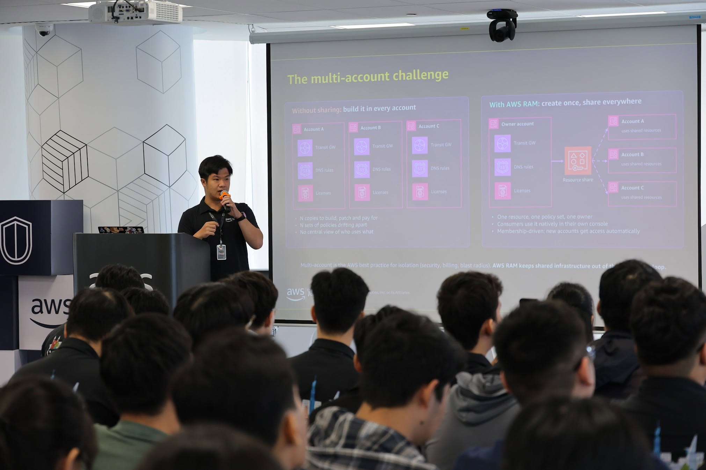
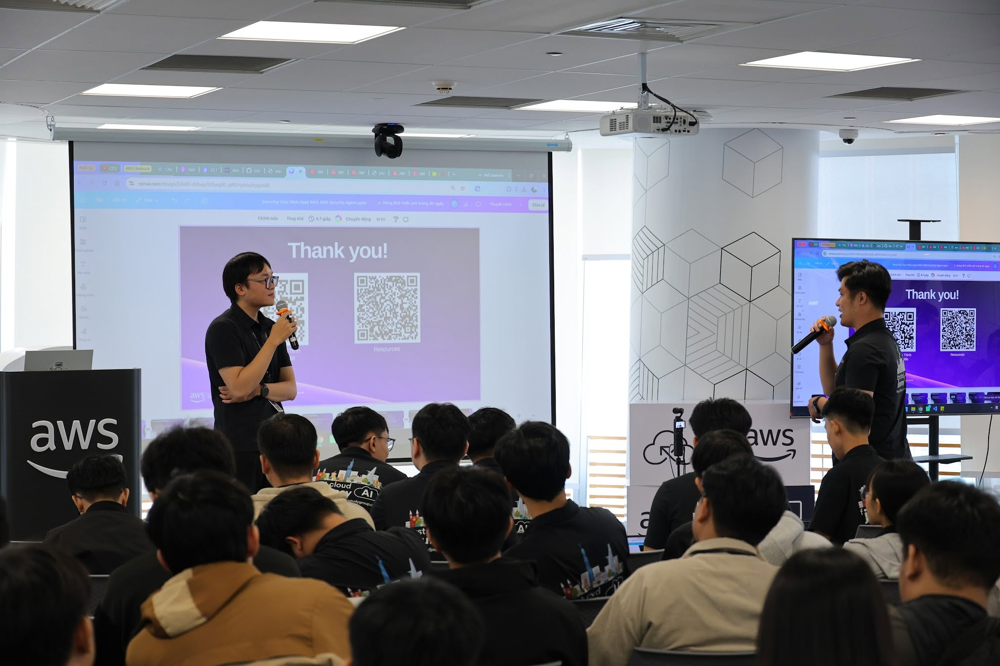
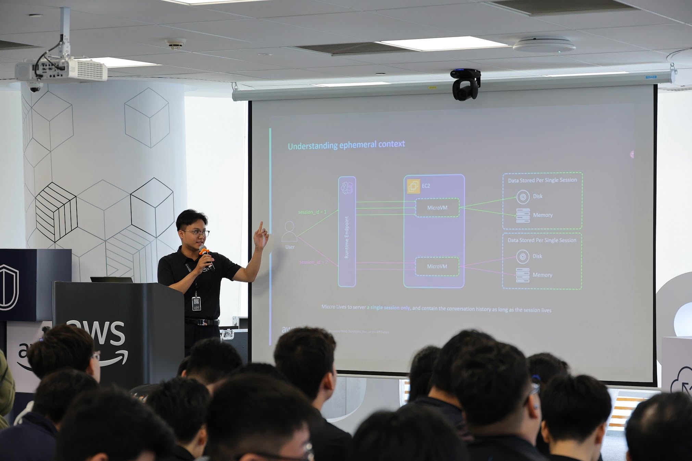
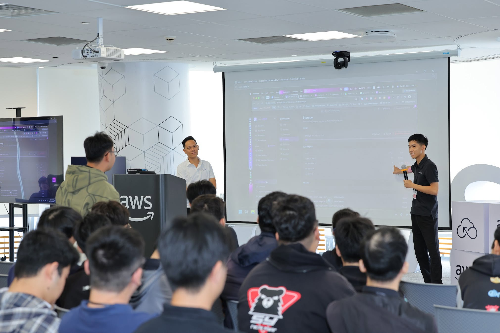
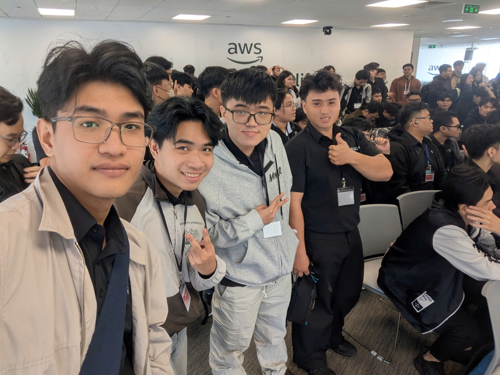
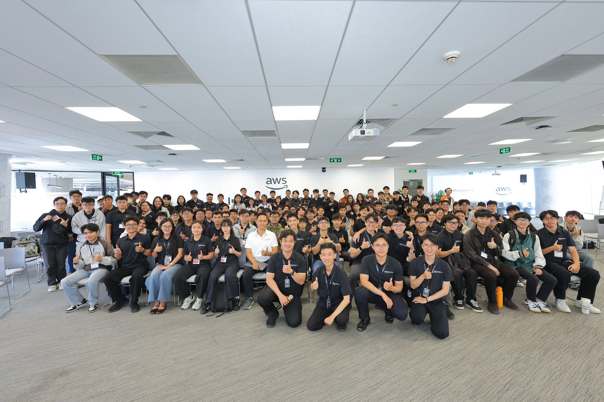
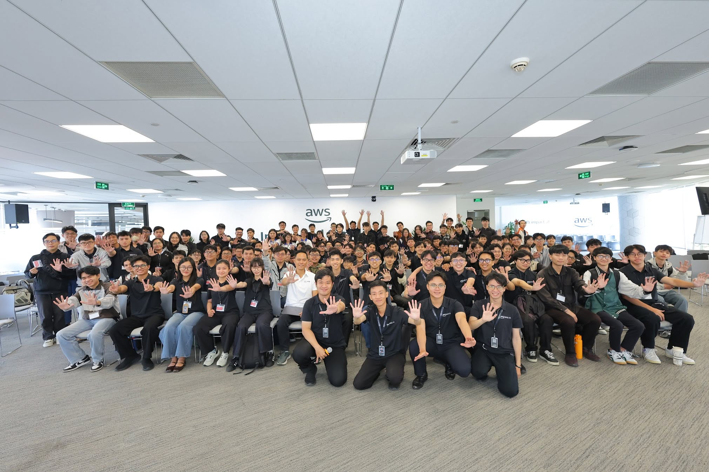

# Bài thu hoạch: Buổi Meetup "First Cloud AI Journey" (24/10/2026)

### 📌 Thông Tin Tổng Quan Sự Kiện

* **Tên sự kiện:** First Cloud AI Journey Meetup: Xu Hướng & Thực Tiễn Triển Khai Cloud & AI Agent
* **Thời gian tổ chức:** 09:00 – 12:00, Sáng Thứ Bảy, ngày 24/10/2026
* **Địa điểm:** Văn phòng AWS Việt Nam, Lầu 26, Tòa nhà Bitexco Financial Tower, số 02 Hải Triều, Phường Bến Nghé, Quận 1, TP. Hồ Chí Minh
* **Đơn vị tổ chức:** First Cloud Journey (FCJ) phối hợp cùng AWS Community Builders và AWS Student Builder Groups
* **Vai trò tham dự:** Thành viên tham dự (Attendee) & Thực tập sinh First Cloud Journey
* **Thành phần tham dự:** Hơn 100 kỹ sư công nghệ, bao gồm các Tech Lead, Cloud Solutions Architect, DevOps/Security Engineer từ các doanh nghiệp, các AWS Community Builders cùng đông đảo sinh viên và thực tập sinh đam mê Điện toán đám mây và Trí tuệ nhân tạo (AI Agent).

---

### 🎯 Mục Đích & Kỳ Vọng Khi Tham Gia

1. **Khám phá các mô hình kiến trúc AI Agent trên thực tế:** Tìm hiểu cách các doanh nghiệp và chuyên gia hàng đầu đang kết hợp dịch vụ hạ tầng AWS với Generative AI để đưa các Agent tự chủ lên môi trường Production.
2. **Tiếp cận các bài toán chuyên sâu từ doanh nghiệp:** Nắm bắt các thách thức thực tế và giải pháp kỹ thuật cụ thể: tối ưu độ trễ cho Voice AI, chia sẻ tài nguyên mạng đa tài khoản với AWS RAM, tự động hóa kiểm thử an toàn hạ tầng bằng AI Pentest, và quản trị bộ nhớ ngữ cảnh (Context Window & Memory) cho Agent.
3. **Mở rộng kết nối cộng đồng (Networking):** Gặp gỡ, học hỏi trực tiếp từ các Tech Lead, AWS Community Builders và các anh chị kỹ sư giàu kinh nghiệm, từ đó trau dồi định hướng nghề nghiệp và phong thái kỹ sư đám mây chuyên nghiệp.

---

### 🎤 Nội Dung Chi Tiết 5 Phiên Chia Sẻ Chuyên Sâu

Buổi Meetup mang lại lượng kiến thức kỹ thuật rất cô đọng và thực chiến thông qua 5 phiên trình bày (sessions) chất lượng cao:

#### 1. Session 1: Hear, Think, Speak - Xây dựng Voice-AI Contact Center Tiếng Việt trên AWS

*Anh Kiệt Trần (Founder & AI Engineer tại Revve AI) phân tích trực quan sơ đồ 3 kiến trúc xây dựng Voice Agent: Cascade, Speech-to-Speech (S2S) và Full-duplex S2S.*

* **Diễn giả:** **Anh Kiệt Trần** – Founder & AI Engineer tại Revve AI.
* **Nội dung trọng tâm:**
  * **3 mô hình xây dựng Voice Agent hiện nay:**
    1. *Cascade (Tuần tự):* Ghép nối chuỗi gồm ASR (Speech-to-Text) ➔ LLM (Text-to-Text) ➔ TTS (Text-to-Speech). Điểm mạnh là có "checkpoint" văn bản ở giữa để kiểm soát nội dung và gắn Guardrail chặt chẽ.
    2. *Speech-to-Speech (S2S):* Sử dụng một mô hình giọng nói duy nhất (như Amazon Nova 2 Sonic), tiếp nhận audio đầu vào và xuất trực tiếp audio đầu ra. Cơ chế bán song công (half-duplex): khi người dùng nói chen ngang (barge-in), bot sẽ lập tức dừng lại.
    3. *Full-duplex S2S:* Luồng âm thanh hai chiều luôn mở liên tục (tương tự OpenAI Realtime, Gemini Live), cho phép bot phản hồi tự nhiên, biết chêm lời đệm ("dạ", "vâng", "ừm") và nói chồng tiếng tự nhiên như giao tiếp giữa người với người.
  * **Bốn bài học xương máu từ thực tế triển khai (Four Lessons We Paid For):**
    * *Độ chính xác nhận diện ngữ điệu tiếng Việt (79% vs 94%):* Thuật toán nhận diện lượt nói (Turn detection) và ngắt câu tiếng Việt rất khác tiếng Anh do hiện tượng nuốt âm và dấu thanh ➔ Bắt buộc phải đo đạc (benchmark) trên chính ngữ liệu tiếng Việt.
    * *Hiện tượng đọc thô chữ số ("500K" ➔ "ca" thay vì "năm trăm nghìn"):* Mô hình TTS đọc text thô sẽ bị nhầm lẫn hoặc đọc từ viết tắt thành "phẩy" ➔ Bắt buộc phải có bước chuẩn hóa văn bản số (Text Normalization) trước khi đưa vào TTS.
    * *Kiểm soát an toàn từng câu (Guardrail per sentence):* Cơ chế stream âm thanh nếu để trễ sẽ khiến người gọi nghe thấy nửa đầu câu nói vi phạm (5/6 trường hợp lọt). Giải pháp là dùng một mô hình đánh giá nhỏ (Small Judge Model) kiểm tra từng câu trước khi đẩy sang TTS, đưa tỷ lệ câu lỗi về 0/6.
    * *Ngân sách độ trễ (Latency Budget):* Đích đến là đưa độ trễ toàn trình xuống ~1.8s để hội thoại không bị sượng; trong đó độ trễ trung vị của LLM (như self-hosted Gemma) chỉ được dao động quanh mức 0.24s – 1.15s.
* **Live Demo:** Trình diễn trực tiếp cuộc gọi điện thoại tự động của Voice AI phỏng vấn sơ tuyển ứng viên vị trí Cloud Engineer hoàn toàn bằng tiếng Việt với giọng điệu, phản hồi ngữ cảnh và xử lý ngắt câu cực kỳ mượt mà.

#### 2. Session 2: AWS Resource Access Manager (RAM) - Create Once, Share Everywhere

*Anh Long Huỳnh (Solutions Engineer tại Styl Solution) trình bày giải pháp chia sẻ tài nguyên qua AWS RAM, tối ưu chi phí và quản trị tập trung trong mô hình Multi-Account.*

* **Diễn giả:** **Anh Long Huỳnh** – Solutions Engineer tại Styl Solution.
* **Nội dung trọng tâm:**
  * **Thách thức kiến trúc đa tài khoản (The Multi-Account Challenge):**
    * Khi doanh nghiệp mở rộng quy mô với nhiều AWS Accounts (Account A, B, C cho các phòng ban hoặc môi trường Dev/Staging/Prod), việc cấu hình lặp lại các tài nguyên mạng như Transit Gateway, VPC Subnets, Route 53 Resolver Rules hay License Manager dẫn đến tình trạng: tốn chi phí x3 lần, lệch chuẩn cấu hình (configuration drift), vá lỗi phân tán và không có tầm nhìn quản trị tập trung.
  * **Giải pháp với AWS RAM:**
    * Áp dụng nguyên lý: *"Khởi tạo một nơi, chia sẻ toàn tổ chức" (Create once, share everywhere)*.
    * Tài nguyên chỉ được khởi tạo một lần tại Owner Account (tài khoản quản trị trung tâm) và chia sẻ an toàn qua Resource Share tới các Member Accounts trong AWS Organizations.
    * Các Consumer Accounts nhìn thấy và sử dụng tài nguyên một cách tự nhiên (natively) trên chính AWS Console của họ mà không cần phân quyền phức tạp.
  * **Mô hình bảo vệ kép (IAM Policies kết hợp SCPs):**
    * Tận dụng sự kết hợp chặt chẽ giữa IAM Resource Policy (cấp quyền cụ thể cho từng role) và Service Control Policies (SCPs) áp trần bảo mật từ cấp tổ chức, đảm bảo các tài khoản thành viên không thể vượt quyền hay cấu hình sai lệch hạ tầng dùng chung.

#### 3. Session 3: AWS Pentest with AWS Continuum / Security Agent

*Anh Nguyễn Tuấn Thịnh (Security Engineer tại Styl Solution) giải đáp các câu hỏi kỹ thuật về việc ứng dụng AI Agent tự động rà soát an toàn IaC và pentest tự động trên SIT/UAT.*

* **Diễn giả:** **Anh Nguyễn Tuấn Thịnh** – Security Engineer tại Styl Solution.
* **Nội dung trọng tâm:**
  * **Triết lý Shift-Left Security:** Đưa các tiêu chuẩn an toàn thông tin vào ngay từ các khâu đầu tiên của chu trình phát triển phần mềm (SDLC), không chờ đến khi deploy lên production mới kiểm tra.
  * **Tự động hóa đánh giá mã nguồn hạ tầng (IaC Security Review):**
    * Tích hợp bot kiểm tra an toàn tự động vào trực tiếp các Pull Request (PR) trên GitLab và GitHub.
    * Phân tích tĩnh (Static Code Analysis) toàn bộ mã nguồn Terraform để bắt các lỗi phổ biến như: mở cổng 0.0.0.0/0 không kiểm soát, thiếu mã hóa lưu trữ EBS/S3, hoặc gán quyền IAM quá rộng (`*`).
  * **Frontier Security Agent (Tác tử bảo mật tự chủ):**
    * Ứng dụng mô hình nền tảng Amazon Bedrock kết hợp khả năng suy luận tự chủ (Autonomous Reasoning) để lập kế hoạch và thực thi các bài kiểm thử bảo mật mà không cần can thiệp thủ công.
    * Đóng vai trò kẻ tấn công (Attacker) thực tế để tự động thực hiện Penetration Testing trên các môi trường thử nghiệm (SIT/UAT), phát hiện các lỗ hổng logic nghiệp vụ và cấu hình sai lệch trước khi ứng dụng được phát hành chính thức.

#### 4. Session 4: Amazon Bedrock AgentCore - Nền tảng Đưa Agent lên Môi Trường Thực Tế

*Anh Xuân An (Leader AWS Student Builder Group HCMUTE) thuyết trình về kiến trúc MicroVM trên EC2 Spot và mô hình ngữ cảnh phiên làm việc độc lập của Agent.*

* **Diễn giả:** **Anh Xuân An** – Leader AWS Student Builder Group HCMUTE.
* **Nội dung trọng tâm:**
  * **Sơ đồ hệ sinh thái Agent (Ecosystem Diagram):** Phân tích mô hình kết nối đồng bộ từ Lớp ứng dụng (App) ➔ Lớp thực thi tác tử (Agent Runtime) ➔ Các mô hình nền tảng (Foundation Models).
  * **Agent Runtime và bài toán tối ưu chi phí hạ tầng:**
    * Thay vì duy trì các máy chủ đắt tiền chạy liên tục, Agent Runtime được thiết kế để khởi chạy các máy ảo MicroVM (môi trường ảo hóa siêu nhẹ) độc lập cho từng phiên làm việc trên các cụm máy ảo **Amazon EC2 Spot Instances**.
    * Nguyên lý hoạt động: *"Micro lives to serve a single session only"* – MicroVM chỉ tồn tại trong suốt thời lượng của một phiên hội thoại duy nhất và lưu trữ lịch sử tương tác tại chỗ (Disk & Memory). Khi phiên kết thúc, tài nguyên tự động được thu hồi, giúp tiết kiệm từ 70% đến 90% chi phí vận hành máy chủ.
  * **Hệ thống bộ nhớ phân tầng (Dual Memory Architecture):**
    * *Short-term Memory (Bộ nhớ ngắn hạn):* Xử lý đồng bộ (synchronous) ngay trong phiên hội thoại để duy trì mạch đối thoại tức thời giữa người dùng và tác tử.
    * *Long-term Memory (Bộ nhớ dài hạn):* Xử lý bất đồng bộ (asynchronous), tự động trích xuất các thông tin cốt lõi (sở thích, hồ sơ cá nhân, các quyết định quan trọng) và lưu vào Vector Database để tái sử dụng và hiểu sâu ngữ cảnh người dùng qua các phiên làm việc sau.

#### 5. Session 5: Kiro Crew - Trợ Lý AI Đồng Hành Toàn Diện Cho Kỹ Sư Công Nghệ

*Anh Danh Hoàng Hiệu Nghi (AWS Community Builder) và anh Kiều Nguyễn Đăng Khoa (Tech Lead ACB) live demo giao diện Kiro Crew, phân tích chi tiết vùng lưu trữ Storage và quản trị token.*

* **Diễn giả:** **Anh Kiều Nguyễn Đăng Khoa** (Technical Lead – Digital Transformation tại Ngân hàng ACB) & **Anh Danh Hoàng Hiệu Nghi** (AWS Community Builder).
* **Nội dung trọng tâm & Demo thực chiến:**
  * **Mô hình Agent 24/7:** Giới thiệu nền tảng Kiro Crew đóng vai trò người bạn đồng hành (All-In-One Companion) trực tiếp hỗ trợ kỹ sư review code, kiểm tra tuân thủ tiêu chuẩn kiến trúc và giám sát tình trạng hệ thống liên tục.
  * **Khả năng tự động tạo giao diện Artifacts:**
    * Kiro Crew có khả năng tự động cào (crawl) dữ liệu việc làm Cloud & AI thực tế trên thị trường, sau đó tổng hợp và kết xuất trực tiếp thành biểu đồ thống kê trực quan (UI chart artifacts) ngay trong khung trò chuyện để người dùng tương tác tức thì.
  * **Quản trị bộ nhớ ngữ cảnh (Context Window Management):**
    * *Cơ chế Auto Compact:* Khi lượng ngữ cảnh hội thoại chạm ngưỡng cảnh báo (70% – 90% giới hạn token của model), hệ thống tự động tóm tắt cô đọng các đoạn chat cũ để giải phóng không gian bộ nhớ mà không làm mất luồng thông tin chính.
    * *Tính năng Break down context:* Cho phép kỹ sư kiểm tra chi tiết lượng token tiêu thụ của từng thành phần: System Prompt, Khai báo công cụ (Tools/Functions Schema), Bộ nhớ (Memory) và Lịch sử câu hỏi của người dùng, từ đó tối ưu chi phí gọi API.
  * **Quản lý vùng lưu trữ (Storage & Memory Cleanup) và Thiết lập Guardrails:**
    * Dọn dẹp có chọn lọc các khóa bộ nhớ cũ (Keys cleanup) trong phần Developer Storage để tránh hiện tượng phình dữ liệu lưu trữ.
    * Xây dựng lớp rào chắn an toàn (Guardrails): Đảm bảo Agent không bao giờ tự ý thực thi các lệnh nguy hiểm (như xóa bảng CSDL, dừng máy chủ hạ tầng) hoặc vô tình để lộ các thông tin bí mật (API Keys, IAM Credentials) trong quá trình phản hồi.

---

### 💡 Những Giá Trị & Bài Học Thu Nhận Được

1. **Tư duy cân bằng giữa Tính năng và Độ trễ (FinOps & Latency Budget):**
   * Trong các hệ thống Voice AI và Real-time Agent, mỗi mili-giây đều có giá trị. Việc lựa chọn mô hình (Cascade vs S2S, Cloud API vs Self-hosted Open Source) phải căn cứ vào ngân sách độ trễ và chi phí hạ tầng, không chạy theo mô hình lớn nhất một cách mù quáng.
2. **Nguyên tắc "Tạo một lần, dùng nhiều nơi" trong Quản trị Đám mây:**
   * Việc sử dụng AWS RAM kết hợp chặt chẽ giữa IAM và SCP giúp các kỹ sư hiểu rõ cách tổ chức hạ tầng cấp doanh nghiệp: tập trung hóa quản trị, tối ưu hóa ngân sách và giảm thiểu rủi ro bảo mật phân mảnh.
3. **Chuyển dịch an toàn thông tin sang cánh trái (Shift-Left Security):**
   * Bảo mật không còn là khâu kiểm tra cuối cùng mà trở thành một phần của quy trình CI/CD hàng ngày. Sự xuất hiện của các Security Agent giúp tự động hóa việc rà soát mã nguồn IaC và thử nghiệm thâm nhập định kỳ.
4. **Kỹ thuật quản trị Agent nâng cao:**
   * Hiểu rõ cơ chế quản trị Context Window (Auto Compact, Token Breakdown) và phân tầng bộ nhớ (Short-term vs Long-term) chính là chìa khóa để vận hành các trợ lý AI thông minh, ổn định và tiết kiệm chi phí dài hạn.

---

### 🚀 Định Hướng Ứng Dụng Vào Quá Trình Thực Tập & Dự Án

* **Áp dụng cơ chế Guardrail vào quy trình tự động hóa:** Trong các tác vụ quản trị và triển khai AWS, luôn thiết lập cơ chế kiểm tra chéo (dry-run, confirmation) để ngăn chặn việc xóa nhầm tài nguyên quan trọng.
* **Tối ưu hóa tài nguyên mạng:** Vận dụng các kiến thức về VPC Subnets, Route Tables và chia sẻ tài nguyên an toàn cho các bài thực hành kiến trúc nhiều tầng và đa dịch vụ trong các tuần tiếp theo.
* **Nâng cao tinh thần kết nối cộng đồng:** Tích cực tham gia các buổi sinh hoạt chuyên môn của AWS Community để liên tục cập nhật công nghệ mới, rèn luyện kỹ năng đặt câu hỏi và mở rộng góc nhìn thực tế từ doanh nghiệp.

---

### 📸 Hình Ảnh Thực Tế & Minh Chứng Tham Gia Sự Kiện

#### 1. Minh chứng tham gia sự kiện & Check-in tại Văn phòng AWS

*Hình 1: Tác giả cùng các bạn thực tập sinh First Cloud Journey check-in với thẻ đeo sự kiện tại văn phòng AWS Việt Nam, Lầu 26 Tòa nhà Bitexco Financial Tower.*

#### 2. Toàn cảnh hội trường & Ảnh lưu niệm tập thể cùng cộng đồng

*Hình 2: Khoảnh khắc chụp ảnh lưu niệm tập thể của hơn 100 thành viên gồm các diễn giả, ban tổ chức, các AWS Community Builders và các bạn thực tập sinh tại hội trường lầu 26.*

*Hình 3: Toàn thể hội trường cùng vẫy tay chào mừng một buổi Meetup thành công rực rỡ và tràn đầy năng lượng kết nối.*

---

> **Đúc kết:** Buổi Meetup *"First Cloud AI Journey"* thực sự là một ngày thứ Bảy bùng nổ kiến thức và cảm hứng. Những câu chuyện triển khai thực tế từ các diễn giả không chỉ giúp người học củng cố nền tảng điện toán đám mây vững chắc, mà còn mở ra tầm nhìn rộng lớn về làn sóng ứng dụng AI Agent trong tương lai. Sự kiện tiếp thêm động lực mạnh mẽ để mỗi bạn sinh viên, thực tập sinh không ngừng chủ động trau dồi, dám thử nghiệm và tự tin tiến bước trên hành trình trở thành những Cloud Engineer thực thụ.
