# Summary Report: "Enterprise AI Agent Architecture, Memory & Security on AWS" (FCAJ AgentCore Deep-Dive)

### 📌 Event Overview

* **Event Title:** FCAJ Deep-Dive Workshop: Enterprise AI Agent Architecture, Memory & Security on AWS.
* **Date & Time:** 09:00 – 12:00, November 14, 2026.
* **Location:** AWS Vietnam Office, 26th Floor, Bitexco Financial Tower, 02 Hai Trieu Street, Ben Nghe Ward, District 1, Ho Chi Minh City.
* **Organizers:** First Cloud Journey (FCJ) in collaboration with AWS Community Builders.
* **Attendees:** Cloud Solutions Architects, Enterprise Tech Leads, AWS Mentors, and Cloud & AI Intern Builders of the First Cloud AI Journey program.
* **Role:** Attendee & Cloud Intern Builder.

---

### 🎯 Objectives & Strategic Context

As Artificial Intelligence evolves from basic Large Language Models (LLMs) into **Autonomous AI Agents**, engineering teams confront severe production challenges: how to deploy agents at enterprise scale while maintaining high availability, bulletproof security, persistent multi-tier memory, and strict access governance.

This deep-dive technical workshop focused on bridging this production gap across four key agenda pillars:
1. **The Gap:** Disconnect between localized prototyping and production-grade resilient deployment.
2. **The Four Pillars:** Essential criteria for sustainable operations (Security, Scalability, Reliability, and Cost Optimization).
3. **The AWS Answer:** AWS reference architecture leveraging **AgentCore** (Memory & Gateway).
4. **The Road Ahead:** Production standards and career roadmaps for modern cloud engineers.

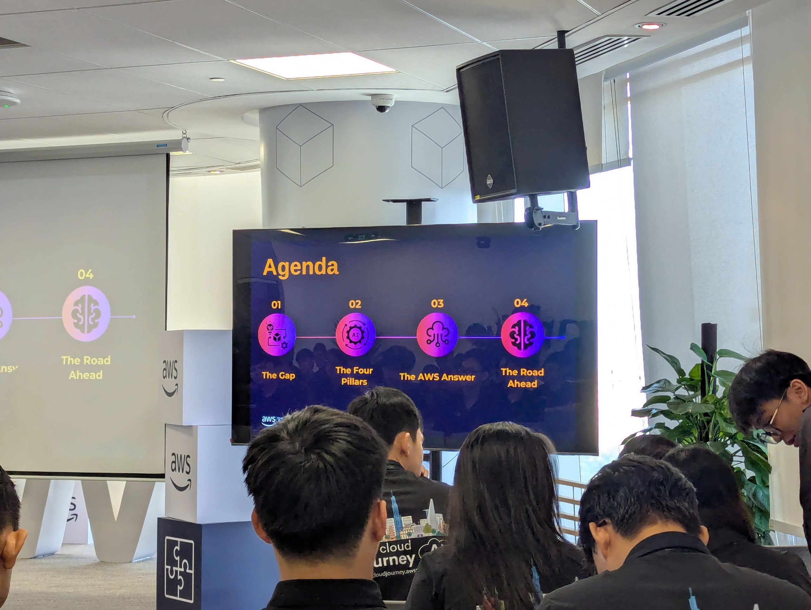

---

### 🎤 Key Technical Takeaways

#### 1. The Role of Cloud in Enterprise AI

The opening session dissected the fundamental operational contrast between running ad-hoc AI workloads and orchestrating on **AWS Cloud**:

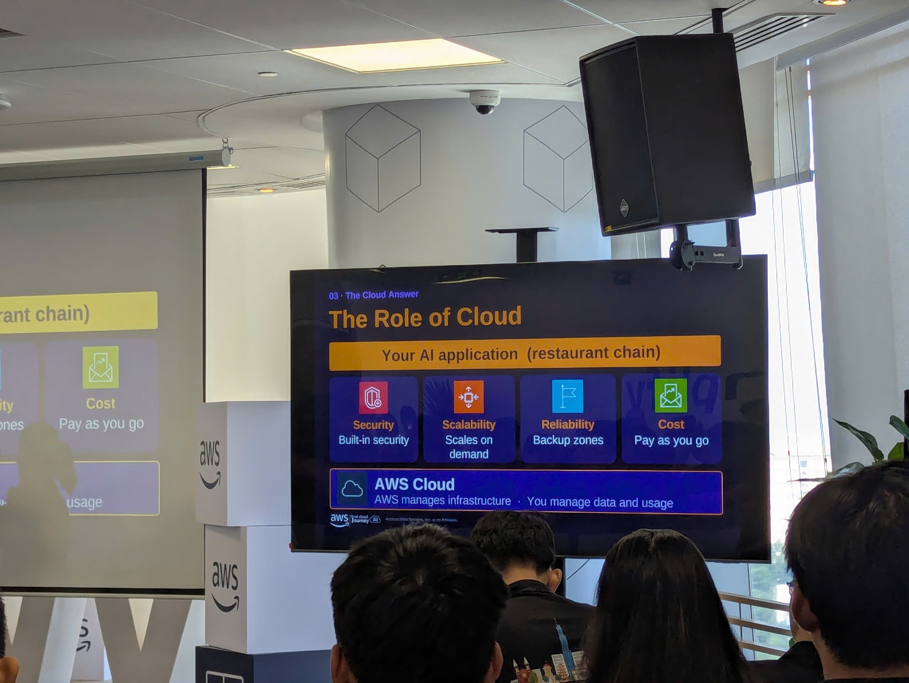

* **Shared Responsibility Model:** AWS manages core physical and compute infrastructure across Multi-AZ regions, freeing engineering teams to focus exclusively on business domain logic, proprietary data, and agent workflows.
* **Four Foundational Value Drivers:**
  * *Security:* Pre-configured regulatory compliance (SOC, ISO 27001, PCI-DSS) and zero-trust perimeter isolation.
  * *Scalability:* Dynamic auto-scaling to absorb abrupt agent invocation spikes during peak business operations.
  * *Reliability:* High-availability architectures deployed across multiple Availability Zones with seamless failover.
  * *Cost Efficiency:* Consumption-based pricing (Pay-as-you-go) eliminating heavy upfront capital expenditure on dedicated compute hardware.

#### 2. The Four Pillars: KMS, IAM & Bedrock Guardrails

Securing agentic systems demands a defense-in-depth model combining foundational cloud access control with generative AI risk mitigations:

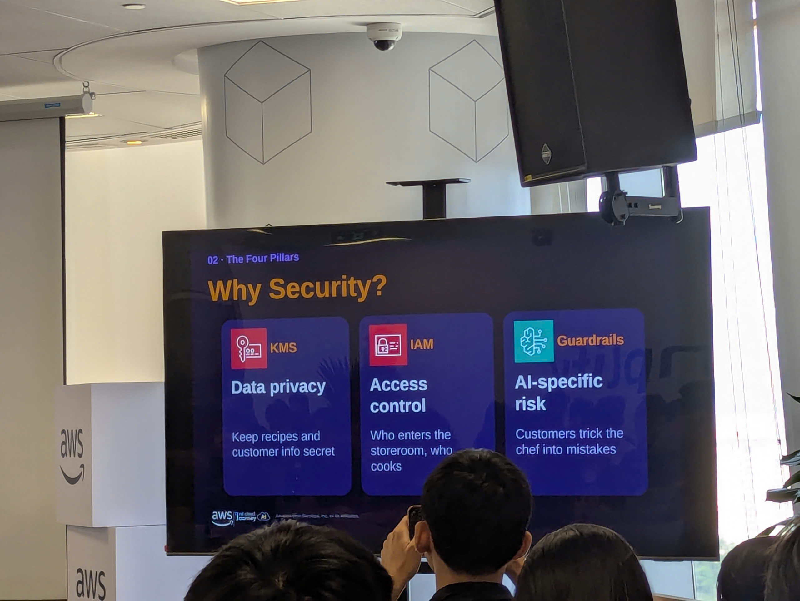

* **AWS KMS (Data Privacy):** Enforces envelope encryption for data at rest and in transit. Protects proprietary business workflows, recipes, and sensitive customer information.
* **AWS IAM (Access Control):** Adheres strictly to the Principle of Least Privilege: *"Who enters the storeroom, and who is authorized to cook"*. Each agent process receives only the granular permissions strictly required for its task.
* **Amazon Bedrock Guardrails (AI-specific Risk):** Proactively blocks prompt injections, jailbreaks, and social engineering attempts aimed at tricking agents into unauthorized actions or data disclosures.

#### 3. Production AI Agent Architecture on AWS

The workshop unveiled a complete end-to-end production architecture containerized and hosted natively on AWS services:

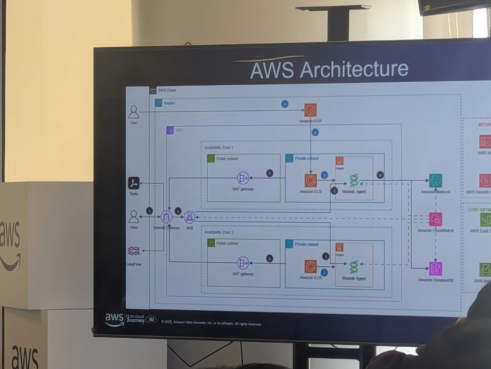

* **Continuous Deployment Workflow:**
  * Developers build and push versioned agent container images to private **Amazon ECR** repositories.
* **Network & Compute Isolation:**
  * Agent runtimes (Strands Agents) execute on **Amazon ECS Fargate** inside private subnets across multiple Availability Zones.
  * Egress traffic routes through high-availability **NAT Gateways**, while inbound traffic enters through an **Application Load Balancer (ALB)** residing in public subnets.
* **Core Service Integrations:**
  * Foundation model invocations route via **Amazon Bedrock** APIs.
  * Real-time conversation state and ephemeral sessions persist with single-digit millisecond latency on **Amazon DynamoDB**.
  * Structured telemetry, traces, and metrics stream into **Amazon CloudWatch**.
  * Sensitive credentials and keys remain safeguarded within **AWS Secrets Manager** and **AWS KMS**.

#### 4. Contextual Persistence with AgentCore Memory

Overcoming the standard statelessness of LLM interactions requires tiered contextual memory:

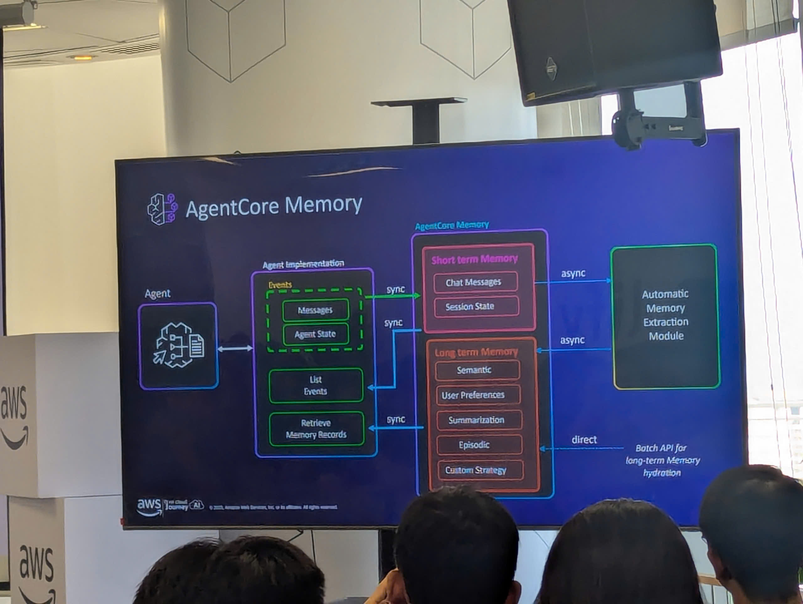

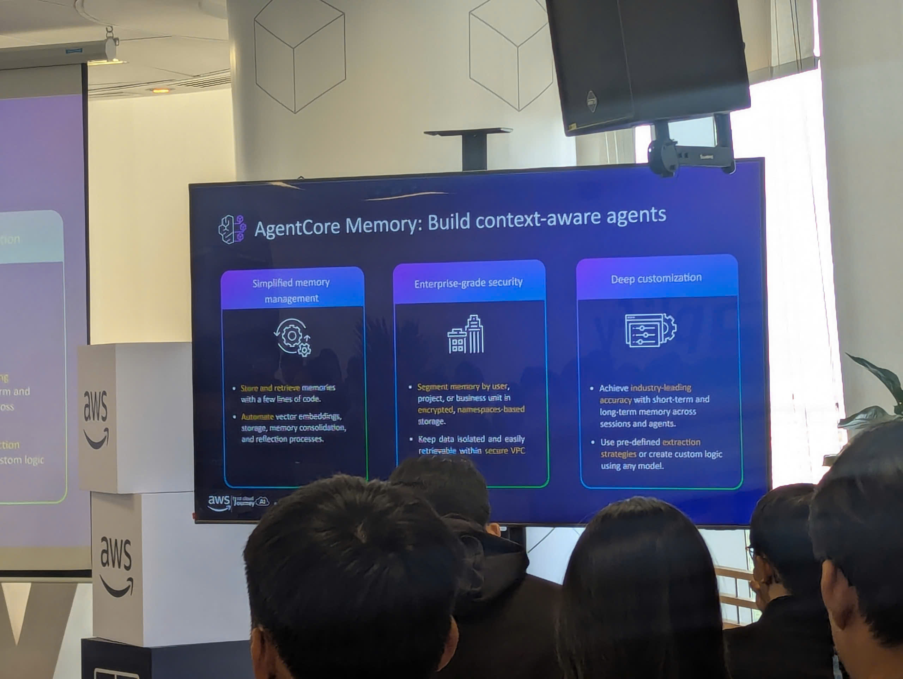

* **Short-term Memory:** Manages active chat message threads and ephemeral session states for coherent multi-turn reasoning within a single session.
* **Long-term Memory:**
  * *Semantic Memory:* Vector embeddings of technical documentation and domain facts for targeted RAG retrieval.
  * *User Preferences:* Preserves personalized user styles, historical selections, and recurring workflows.
  * *Summarization Memory:* Asynchronously condenses prior interactions to hydrate context windows without exceeding token limits.
  * *Episodic Memory:* Stores structured action histories and successful resolution paths for future reference.
* **Automatic Memory Extraction Module:** Runs asynchronously in the background, harvesting key facts from conversations without adding latency to real-time response generation.
* **Batch API Hydration:** Pre-populates agent memory directly from enterprise transactional databases upon session initiation.

#### 5. Two-Door Security Model: Inbound vs Outbound Auth & AgentCore Gateway

The session's standout security architectural principle established: **"Two different doors. Two different locks"**:

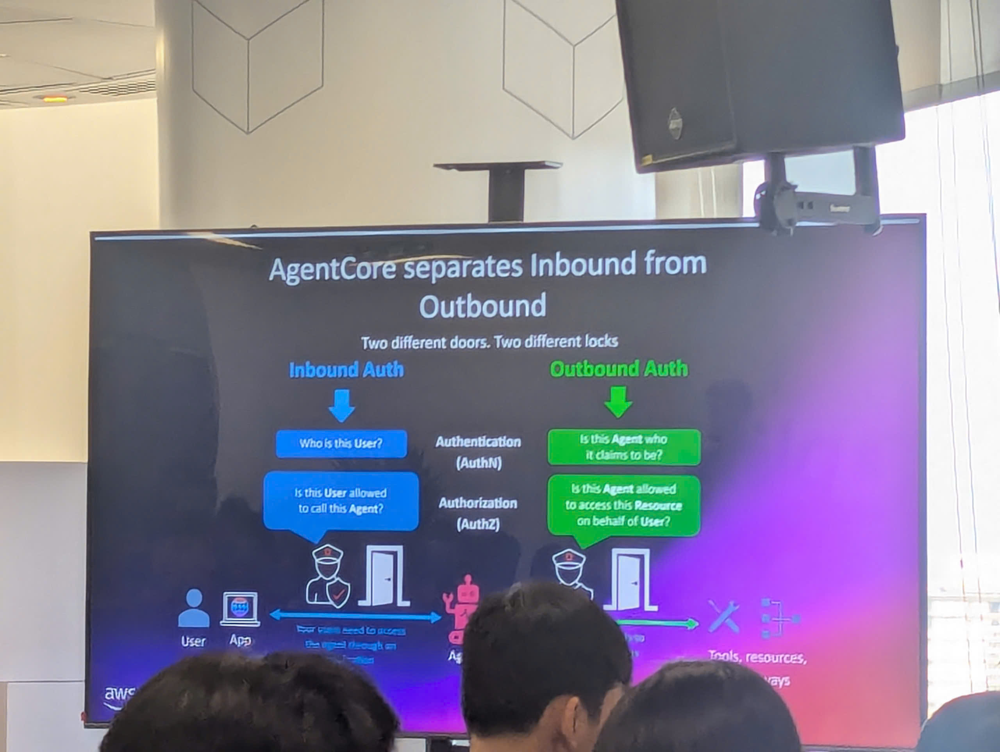

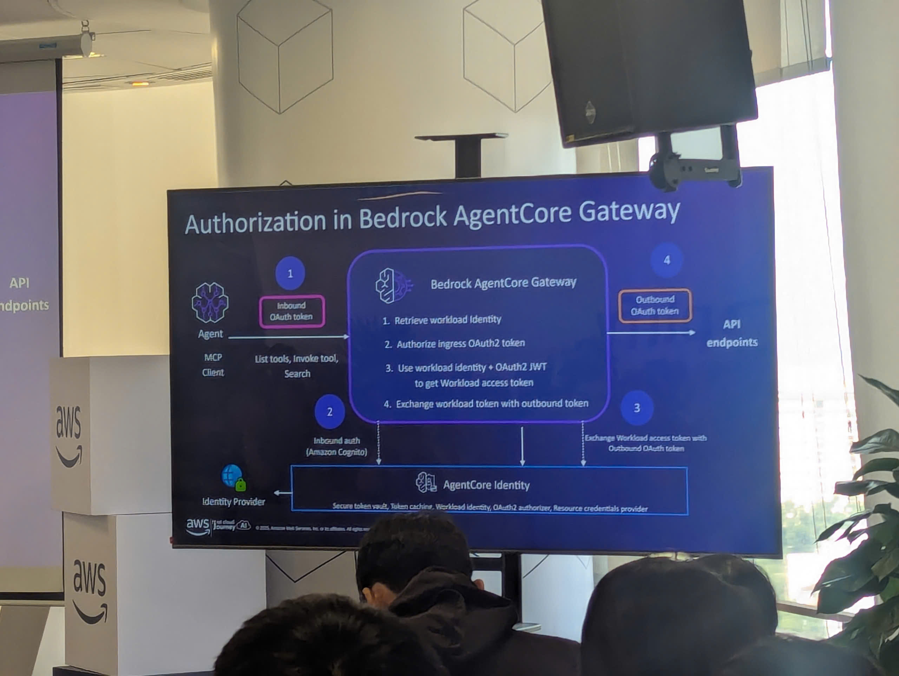

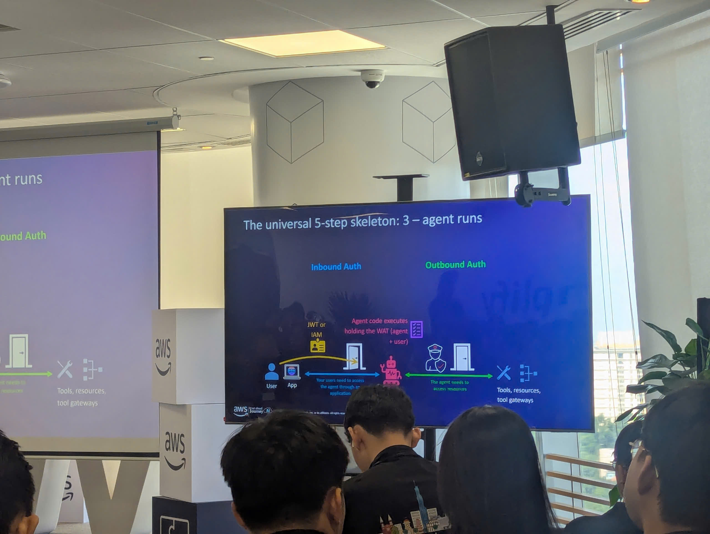

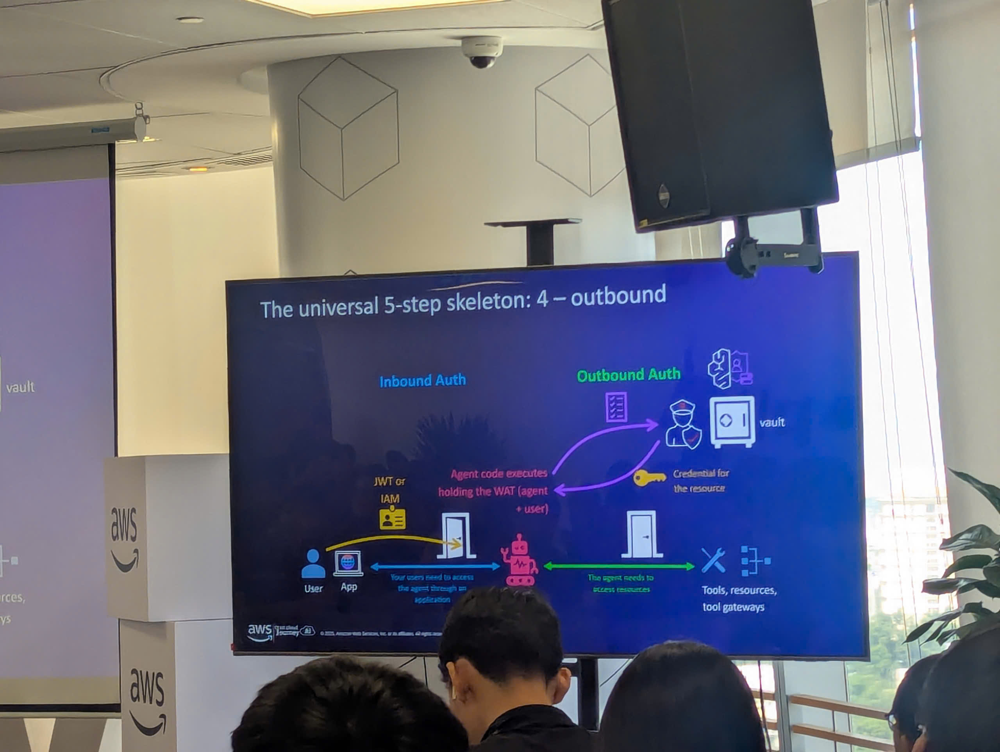

* **Inbound Auth (User Invoking Agent):**
  * *Authentication (AuthN):* Verifies user identity via JWT tokens issued by Amazon Cognito or enterprise IdPs.
  * *Authorization (AuthZ):* Evaluates whether the authenticated user has permission to trigger this specific agent.
* **Outbound Auth (Agent Accessing Tools & Upstream Systems on User's Behalf):**
  * *Authentication (AuthN):* Validates that the agent is legitimately registered and uncompromised.
  * *Authorization (AuthZ):* Determines whether the agent is authorized to interact with internal databases or APIs **strictly on behalf of the user**.
* **Workload Access Token (WAT) Mechanism:**
  * Agents never hold static database credentials or administrative API keys.
  * Instead, the agent receives a scoped **Workload Access Token (WAT)** binding both agent and user identities.
  * When invoking downstream tools, the agent passes the WAT to the **Bedrock AgentCore Gateway**, which validates it against the **AgentCore Identity Token Vault** and issues short-lived, least-privilege tokens for target API endpoints.

---

### 💡 Engineering Takeaways & Capstone Project Alignment

1. **Enterprise Architectural Mindset:** AI agents in production cannot simply be raw scripts making LLM API calls. They require containerized compute isolation (ECS Fargate in private subnets), load balancing, comprehensive telemetry, and defense-in-depth security.
2. **Preventing Privilege Escalation:** Decoupling Inbound and Outbound authentication guarantees that agents cannot be coerced into exceeding the operational permissions granted to the requesting user.
3. **Capstone Proposal Application:** Implementing tiered short-term and long-term memory patterns enables building intelligent, context-aware assistants while actively optimizing token consumption on AWS.

---

### 📸 Verification Photo & Event Check-in

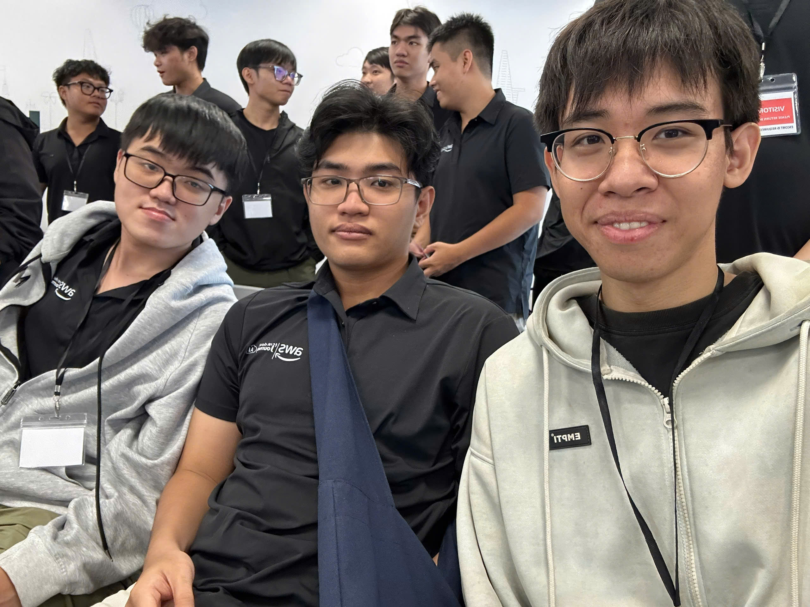
*Figure 1: Author and fellow First Cloud Journey intern builders at the AWS Vietnam Office, 26th Floor, Bitexco Financial Tower.*

---

* **Event Community Post:** [Facebook AWS Study Group](https://www.facebook.com/groups/awsstudygroupfcj/permalink/2340764136688545/)
