# Bài thu hoạch: "Kiến trúc & Bảo mật AI Agent Cấp Doanh nghiệp trên AWS" (FCAJ AgentCore Deep-Dive)

### 📌 Thông Tin Tổng Quan Sự Kiện

* **Tên sự kiện:** FCAJ Deep-Dive Workshop: Enterprise AI Agent Architecture, Memory & Security on AWS.
* **Thời gian tổ chức:** 09:00 – 12:00, Ngày 07/11/2026.
* **Địa điểm:** Văn phòng AWS Việt Nam, Lầu 26, Tòa nhà Bitexco Financial Tower, số 02 Hải Triều, Phường Bến Nghé, Quận 1, TP. Hồ Chí Minh.
* **Đơn vị tổ chức:** First Cloud Journey (FCJ) phối hợp cùng AWS Community Builders.
* **Thành phần tham dự:** Các chuyên gia giải pháp đám mây, Tech Lead doanh nghiệp, các Mentor AWS cùng toàn thể thực tập sinh Cloud & AI Agent thuộc chương trình First Cloud AI Journey.
* **Vai trò tham dự:** Thành viên tham dự (Attendee) & Thực tập sinh First Cloud Journey.

---

### 🎯 Mục Đích & Bối Cảnh Sự Kiện

Khi làn sóng Trí tuệ Nhân tạo phát triển từ các mô hình ngôn ngữ lớn (LLM) đơn thuần sang **Hệ thống AI Agent tự chủ (Autonomous AI Agents)**, các doanh nghiệp phải đối mặt với bài toán lớn về mặt kỹ thuật: Làm thế nào để đưa Agent ra môi trường Production mà vẫn đảm bảo tính sẵn sàng, an toàn dữ liệu, khả năng nhớ ngữ cảnh dài hạn và kiểm soát quyền truy cập chặt chẽ?

Buổi workshop chuyên sâu này tập trung giải quyết triệt để bài toán đưa AI Agent lên quy mô doanh nghiệp thông qua 4 trụ cột chính:
1. **The Gap:** Khoảng cách giữa việc xây dựng demo Agent trên máy cá nhân và triển khai thực tế trên môi trường Production.
2. **The Four Pillars:** 4 trụ cột cốt lõi bảo đảm hệ thống vận hành bền vững (Bảo mật, Khả năng co giãn, Độ tin cậy và Tối ưu chi phí).
3. **The AWS Answer:** Bộ giải pháp hạ tầng AWS và kiến trúc **AgentCore** (Memory & Gateway).
4. **The Road Ahead:** Lộ trình phát triển và các chuẩn mực thực tế cho kỹ sư đám mây.

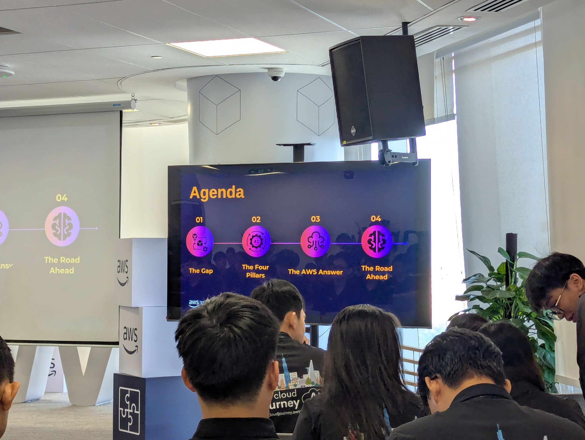

---

### 🎤 Nội Dung Chuyên Môn Trọng Tâm

#### 1. Vai trò của Nền tảng Đám mây (The Role of Cloud in Enterprise AI)

Mở đầu buổi workshop, diễn giả phân tích sự khác biệt cốt lõi khi doanh nghiệp tự vận hành AI so với việc tận dụng sức mạnh của **AWS Cloud**:

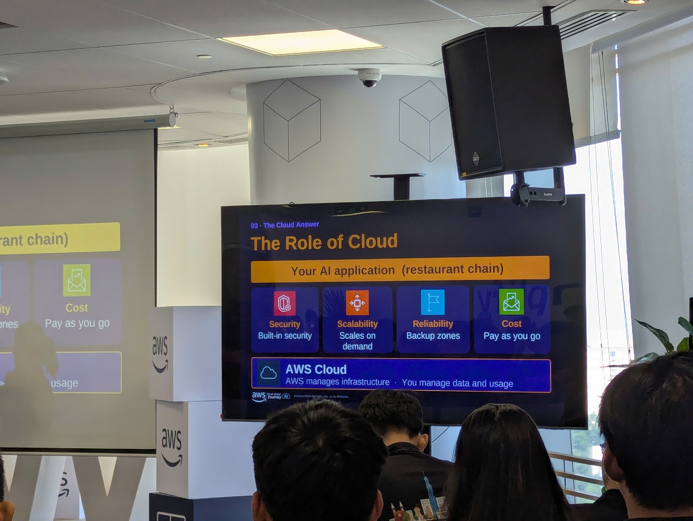

* **Mô hình trách nhiệm chia sẻ:** AWS chịu trách nhiệm quản trị và bảo trì hạ tầng nền tảng (Compute, Storage, Networking, Multi-AZ Data Centers), cho phép đội ngũ kỹ sư tập trung 100% vào dữ liệu và nghiệp vụ của Agent.
* **4 lợi ích hạ tầng trực tiếp:**
  * *Bảo mật (Security):* Bảo mật tích hợp sẵn theo các chuẩn chứng chỉ quốc tế khắt khe nhất (SOC, ISO 27001, PCI-DSS).
  * *Khả năng co giãn (Scalability):* Tự động mở rộng tài nguyên tính toán theo nhu cầu thực tế khi lượng truy cập Agent tăng đột biến.
  * *Độ tin cậy (Reliability):* Dự phòng đa vùng (Backup across Availability Zones) chống sự cố gián đoạn.
  * *Chi phí (Cost):* Trả tiền theo mức độ sử dụng thực tế (Pay as you go), loại bỏ chi phí mua sắm phần cứng máy chủ đắt đỏ ban đầu.

#### 2. Trụ cột Bảo mật Toàn diện: KMS, IAM & Bedrock Guardrails

Bảo mật trong hệ thống AI Agent đòi hỏi góc nhìn đa tầng, kết hợp giữa an toàn dữ liệu truyền thống và phòng chống rủi ro đặc thù của LLM:

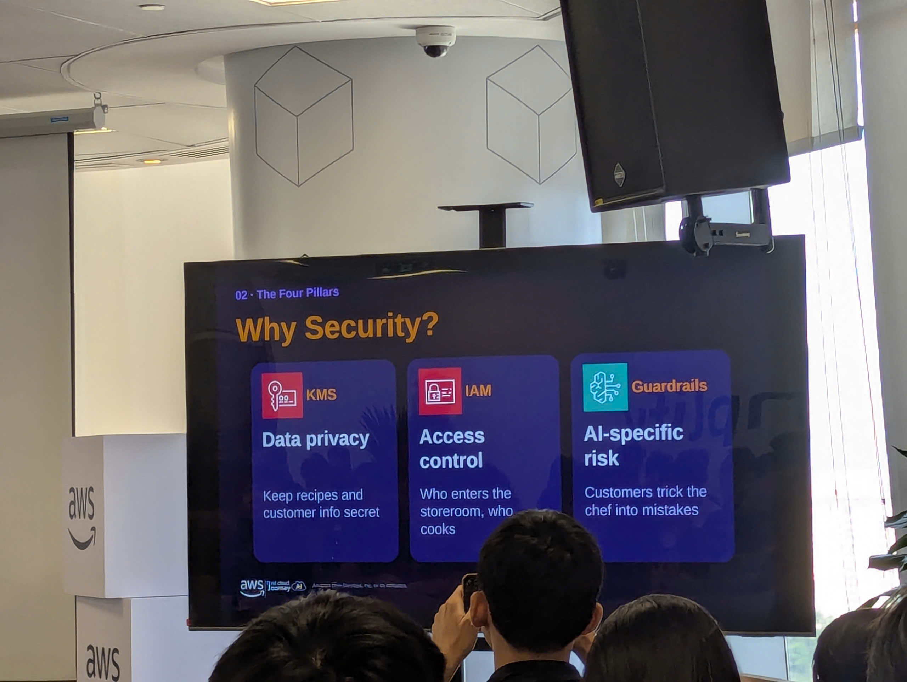

* **AWS KMS (Data Privacy):** Mã hóa toàn bộ dữ liệu lưu trữ (Data at rest) và dữ liệu truyền tải (Data in transit). Giữ kín tuyệt đối các tài liệu độc quyền, bí quyết kinh doanh và thông tin nhạy cảm của khách hàng.
* **AWS IAM (Access Control):** Nguyên tắc đặc quyền tối thiểu (Least Privilege). Diễn giả sử dụng hình ảnh ẩn dụ thực tế: *"Ai được phép vào phòng kho nguyên liệu, ai là đầu bếp được phép đứng nấu"*. Từng thành phần phần mềm chỉ được cấp đúng quyền thực thi cần thiết.
* **Amazon Bedrock Guardrails (AI-specific Risk):** Lớp phòng thủ chuyên biệt chống lại các cuộc tấn công phi kỹ thuật, bẻ khóa ngữ cảnh (Prompt Injection, Jailbreaking) hoặc ngăn chặn việc người dùng đánh lừa Agent tiết lộ dữ liệu ngoài phạm vi cho phép.

#### 3. Thiết kế Kiến trúc Hạ tầng AI Agent Trên AWS

Diễn giả trình bày sơ đồ kiến trúc hạ tầng Production hoàn chỉnh được đóng gói và vận hành hoàn toàn trên dịch vụ AWS:

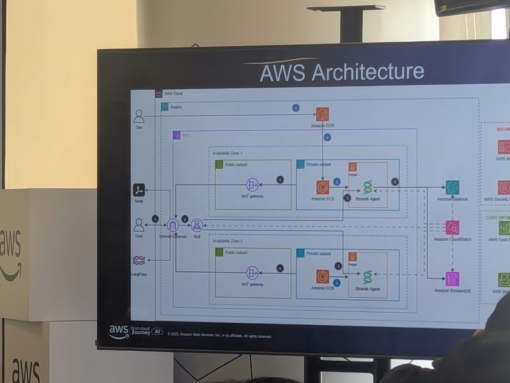

* **Luồng triển khai mã nguồn (CI/CD Flow):**
  * Kỹ sư đẩy mã nguồn Agent đóng gói Docker Container lên kho lưu trữ riêng tư **Amazon ECR**.
* **Môi trường tính toán cô lập:**
  * Các tác vụ Agent (Strands Agent) được triển khai trên **Amazon ECS Fargate** chạy hoàn toàn trong các **Private Subnets** thuộc 2 Availability Zones khác nhau.
  * Hệ thống kết nối ra bên ngoài thông qua **NAT Gateway** và tiếp nhận lưu lượng người dùng thông qua **Application Load Balancer (ALB)** đặt tại Public Subnet.
* **Tích hợp dịch vụ cốt lõi:**
  * Agent gọi suy luận mô hình thông qua **Amazon Bedrock** API.
  * Trạng thái phiên làm việc và lịch sử hội thoại được lưu trữ độ trễ mili-giây trên **Amazon DynamoDB**.
  * Toàn bộ nhật ký hoạt động và chỉ số hiệu năng được giám sát tập trung tại **Amazon CloudWatch**.
  * Quản trị khóa và thông tin nhạy cảm qua **AWS KMS** và **AWS Secrets Manager**.

#### 4. Đột Phá Bộ Nhớ Ngữ Cảnh Với AgentCore Memory

Một trong những hạn chế lớn nhất của Agent hiện nay là "hay quên" khi phiên trò chuyện kết thúc. Buổi workshop đã giới thiệu giải pháp phân tầng bộ nhớ **AgentCore Memory**:

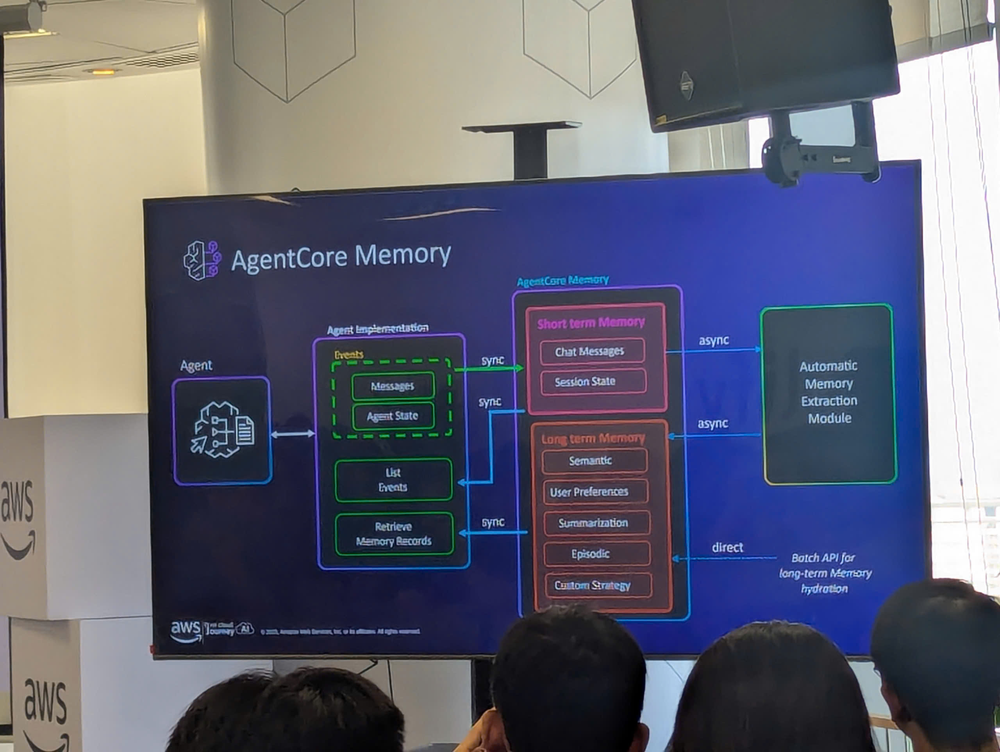

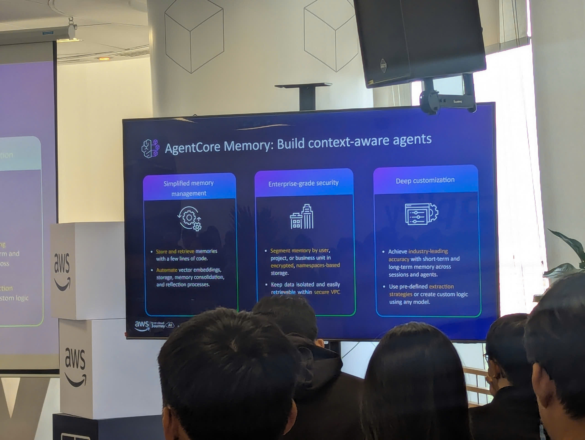

* **Bộ nhớ ngắn hạn (Short-term Memory):** Lưu trữ toàn bộ tin nhắn trò chuyện (Chat Messages) và trạng thái ngữ cảnh tức thời (Session State) phục vụ các lượt phản hồi liên tục trong cùng một phiên.
* **Bộ nhớ dài hạn (Long-term Memory):**
  * *Ký ức ngữ nghĩa (Semantic Memory):* Vector hóa kiến thức chuyên môn phục vụ truy xuất RAG.
  * *Sở thích người dùng (User Preferences):* Ghi nhớ thói quen, cách xưng hô và sở thích cá nhân của từng khách hàng.
  * *Ký ức tóm tắt (Summarization):* Tự động tổng hợp nội dung các cuộc trao đổi cũ để nạp nhanh vào context window mà không gây tràn token.
  * *Ký ức sự kiện (Episodic Memory):* Lưu lại các chuỗi hành động và bài học xử lý tình huống thành công trong quá khứ.
* **Cơ chế trích xuất tự động (Automatic Memory Extraction Module):** Hoạt động bất đồng bộ (async), tự động bóc tách thông tin giá trị từ cuộc hội thoại để cập nhật vào bộ nhớ dài hạn mà không làm tăng độ trễ của câu trả lời trực tiếp.
* **Batch API Hydration:** Cho phép nạp trước dữ liệu người dùng hàng loạt từ cơ sở dữ liệu doanh nghiệp vào Agent ngay khi phiên mới được khởi tạo.

#### 5. Cơ Chế Xác Thực Hai Cửa (Inbound vs Outbound Auth) & AgentCore Gateway

Điểm ấn tượng nhất của buổi tọa đàm là tư duy an ninh mạng chuẩn xác: **"Hai cánh cửa khác nhau. Hai ổ khóa hoàn toàn khác nhau" (Two different doors. Two different locks)**:

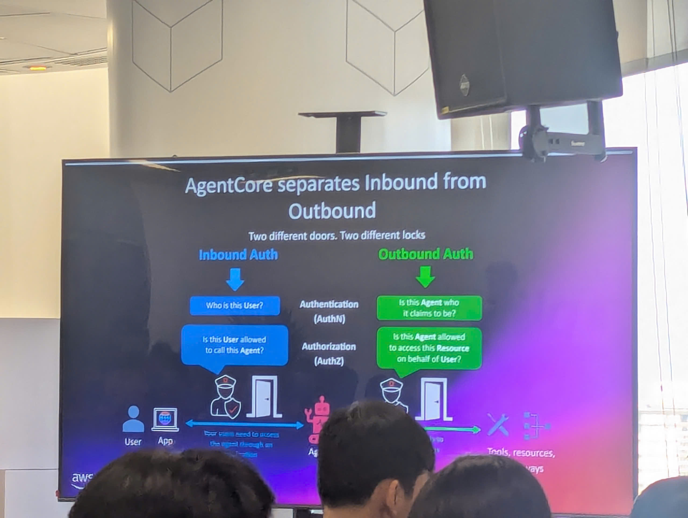

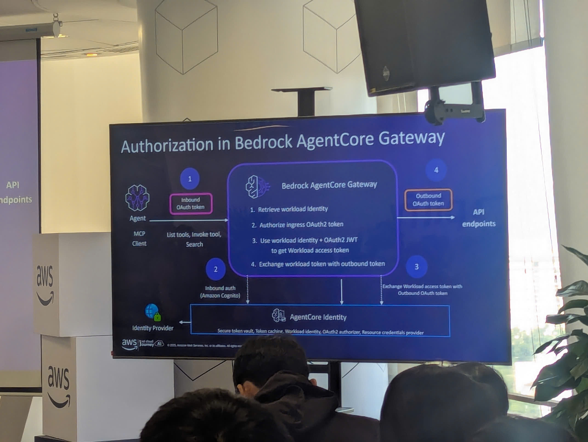

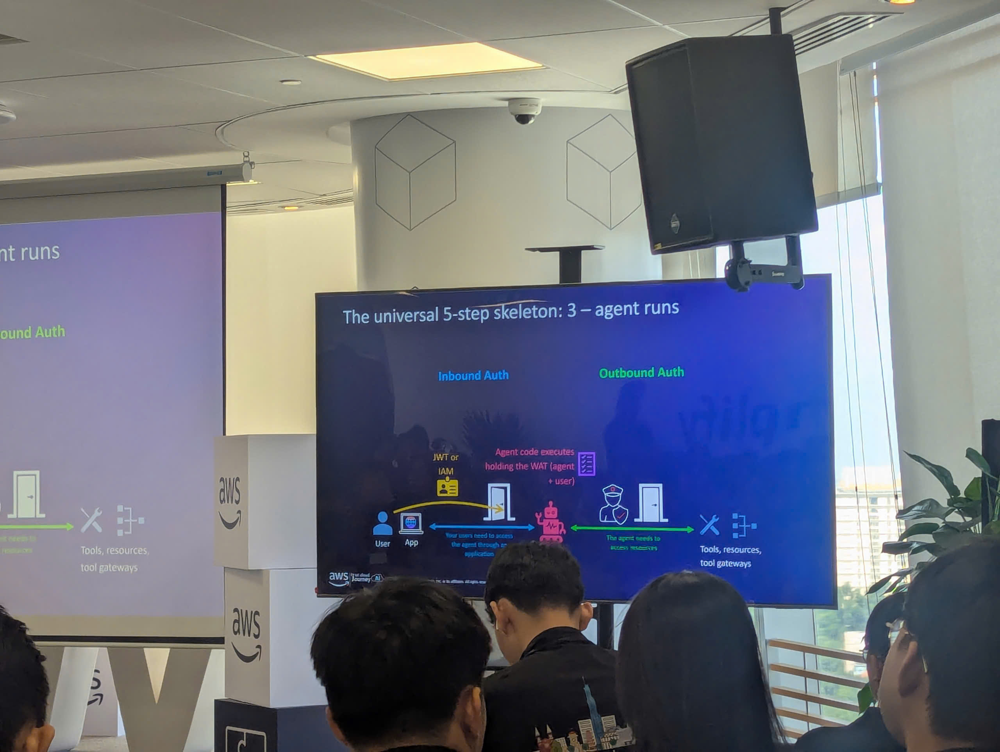

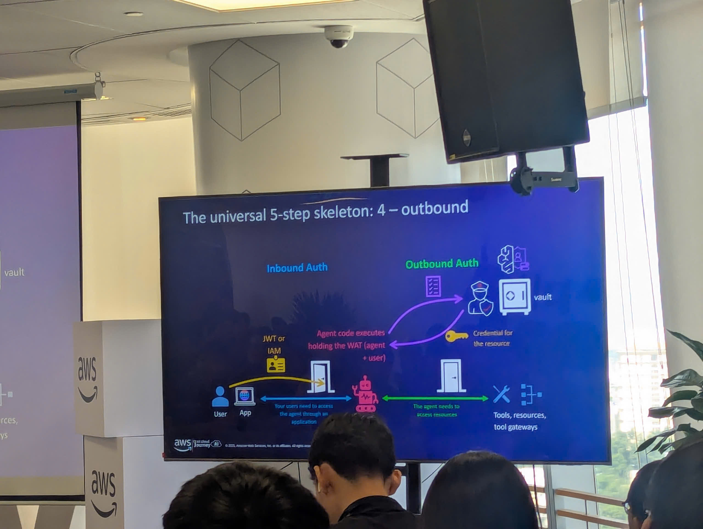

* **Cửa vào (Inbound Auth - Người dùng gọi Agent):**
  * *Xác thực (AuthN):* Người dùng này là ai? (Sử dụng JWT Token từ Amazon Cognito hoặc IdP nội bộ).
  * *Phân quyền (AuthZ):* Người dùng này có quyền tương tác với Agent này không?
* **Cửa ra (Outbound Auth - Agent gọi công cụ/hệ thống nội bộ thay mặt người dùng):**
  * *Xác thực (AuthN):* Agent này có đúng là định danh được cấp phép không?
  * *Phân quyền (AuthZ):* Agent này có được phép truy cập tài nguyên/công cụ này **nhân danh người dùng** hay không?
* **Cơ chế Token Workload (WAT - Workload Access Token):**
  * Agent tuyệt đối không được nắm giữ trực tiếp mật khẩu hay API Key của hệ thống đích.
  * Thay vào đó, Agent nắm giữ token **WAT (kết hợp định danh của Agent + User)**. Khi cần gọi công cụ bên ngoài, Agent gửi WAT qua **Bedrock AgentCore Gateway**.
  * Gateway kiểm tra định danh tại **AgentCore Identity & Token Vault**, sau đó trao đổi lấy token Outbound ngắn hạn để gọi các API endpoints nội bộ an toàn.

---

### 💡 Bài Học & Định Hướng Ứng Dụng Thực Tế

1. **Tư duy thiết kế AI Agent cấp doanh nghiệp:** Không thể coi Agent chỉ là một đoạn mã Python gọi OpenAI hay Bedrock đơn giản. Một Agent sẵn sàng cho Production bắt buộc phải chạy trên hạ tầng container cô lập (ECS Fargate trong Private Subnet), có cân bằng tải, giám sát chỉ số và bảo mật đa lớp.
2. **Loại bỏ nguy cơ rò rỉ quyền hạn (Privilege Escalation):** Cơ chế phân tách rạch ròi Inbound Auth và Outbound Auth giúp kỹ sư nhận thức rõ ranh giới an toàn: Agent chỉ được thao tác đúng phạm vi dữ liệu mà người dùng đang ra lệnh được phép xem, triệt tiêu nguy cơ Agent bị lợi dụng để chiếm đoạt dữ liệu toàn hệ thống.
3. **Ứng dụng vào Đồ án thực tập (Proposal / Capstone Project):** Vận dụng trực tiếp mô hình phân tầng bộ nhớ ngắn hạn và dài hạn để xây dựng trợ lý AI có khả năng duy trì ngữ cảnh người dùng thông minh, đồng thời tối ưu hóa chi phí token trên AWS.

---

### 📸 Hình Ảnh Minh Chứng Tham Gia Sự Kiện

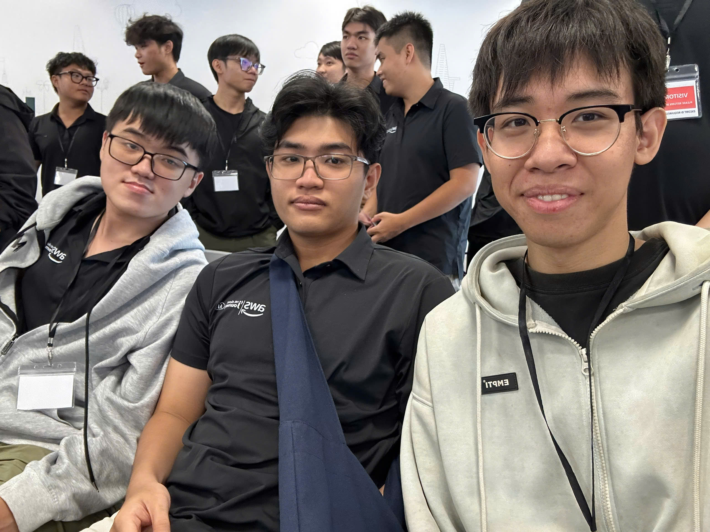
*Hình 1: Tác giả cùng các bạn thực tập sinh First Cloud Journey tại hội trường văn phòng AWS Việt Nam, Lầu 26 Tòa nhà Bitexco Financial Tower.*
