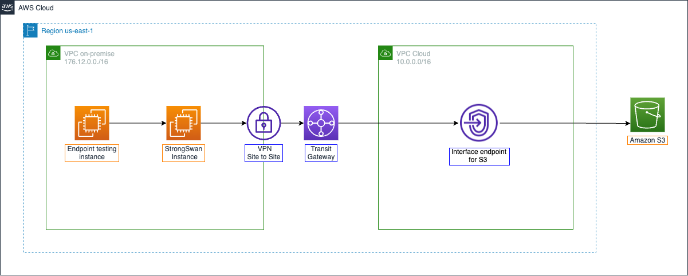

#### 1. VPC Endpoint Core Mechanics

A VPC Endpoint is a managed virtual networking component that facilitates private communication between your AWS VPC and supported AWS services without exposing traffic to public IP addresses, Internet Gateways, or NAT devices.

| Attribute | Gateway Endpoint | Interface Endpoint (AWS PrivateLink) |
| :--- | :--- | :--- |
| **Supported Services** | Amazon S3, Amazon DynamoDB | Most AWS services (S3, SSM, EC2, CloudWatch), SaaS endpoints |
| **Routing Mechanism** | Injects an AWS Prefix List (`pl-xxxx`) directly into VPC Route Tables | Provisions Elastic Network Interfaces (ENIs) with private IP addresses |
| **Access Reach** | VPC-internal only (bound to Route Table) | VPC-internal AND on-premises (via Site-to-Site VPN / Direct Connect) |
| **Pricing** | Free of charge | Hourly rate per ENI + Data processing charges (per GB) |

---

#### 2. Network Topology & Hybrid Simulation

The architecture consists of two isolated VPCs designed to emulate a realistic hybrid enterprise environment:

1. **VPC Cloud (`10.0.0.0/16`):**
   - Represents the primary AWS cloud production environment.
   - Hosts the `Test-Gateway-Endpoint` EC2 instance located inside an isolated private subnet with no Internet Gateway attached.
   - Configured with an S3 Gateway Endpoint to validate private object transfer.

2. **VPC On-Premises (`192.168.0.0/16`):**
   - Simulates an on-premises enterprise data center.
   - Deploys an EC2 instance running **StrongSwan IPsec VPN** configured to establish an automated Site-to-Site VPN tunnel with an **AWS Transit Gateway (TGW)**.
   - Hosts the `Test-Interface-Endpoint` EC2 instance used to test secure S3 access through the VPN tunnel.

> [!NOTE]
> For cost optimization during hands-on practice, this lab provisions a single StrongSwan VPN instance. In enterprise production environments, always deploy redundant VPN appliances across multiple Availability Zones or pair AWS Direct Connect with an automated IPsec backup tunnel for high availability and fault tolerance.
