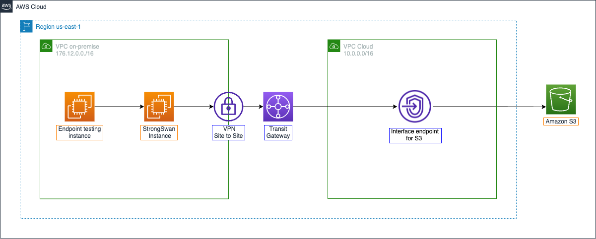

#### 1. Cơ chế Hoạt động của VPC Endpoint

VPC Endpoint là thành phần mạng ảo được quản lý hoàn toàn bởi AWS, cho phép thiết lập kết nối riêng tư giữa VPC với các dịch vụ AWS hỗ trợ mà không yêu cầu gán địa chỉ Public IP, Internet Gateway hay thiết bị NAT.

| Tiêu chí              | Gateway Endpoint                                           | Interface Endpoint (AWS PrivateLink)                                  |
| :-------------------- | :--------------------------------------------------------- | :-------------------------------------------------------------------- |
| **Dịch vụ hỗ trợ**    | Amazon S3, Amazon DynamoDB                                 | Hầu hết dịch vụ AWS (S3, SSM, EC2, CloudWatch...), dịch vụ bên thứ ba |
| **Cơ chế định tuyến** | Cập nhật Prefix List (`pl-xxxx`) trực tiếp vào Route Table | Khởi tạo Elastic Network Interface (ENI) mang IP Private trong Subnet |
| **Phạm vi truy cập**  | Chỉ nội bộ VPC sở hữu Route Table                          | Cả nội bộ VPC và mở rộng ra On-Premises (qua VPN / Direct Connect)    |
| **Chi phí**           | Hoàn toàn miễn phí                                         | Tính phí theo giờ chạy ENI + dung lượng dữ liệu xử lý (GB processed)  |

---

#### 2. Mô hình Giả lập Hạ tầng Mạng (Topology)

Hạ tầng thực hành sử dụng 2 VPC độc lập để mô phỏng chính xác kịch bản Hybrid Cloud thực tế:

1. **VPC Cloud (Dải mạng `10.0.0.0/16`):**
   - Đại diện cho môi trường Cloud của doanh nghiệp.
   - Chứa máy chủ EC2 `Test-Gateway-Endpoint` nằm trong Private Subnet không có Internet Gateway.
   - Gắn Gateway Endpoint để kiểm tra lưu lượng upload S3 nội bộ.

2. **VPC On-Premises (Dải mạng `192.168.0.0/16`):**
   - Mô phỏng hệ thống máy chủ đặt tại Datacenter của doanh nghiệp.
   - Triển khai một máy ảo EC2 cài đặt phần mềm **StrongSwan IPsec VPN** để thiết lập đường hầm bảo mật Site-to-Site VPN tới **AWS Transit Gateway (TGW)**.
   - Chứa máy chủ EC2 `Test-Interface-Endpoint` để gửi dữ liệu tới S3 qua VPN mà không đi qua đường truyền internet công cộng.

> [!NOTE]
> Để tối ưu chi phí thực hành, mô hình lab chỉ triển khai 1 máy ảo VPN StrongSwan. Trong môi trường Production thực tế, hệ thống luôn khuyến nghị triển khai tối thiểu 2 thiết bị VPN ở 2 Availability Zones khác nhau hoặc sử dụng AWS Direct Connect kèm đường VPN dự phòng để đảm bảo tính sẵn sàng cao (High Availability).
