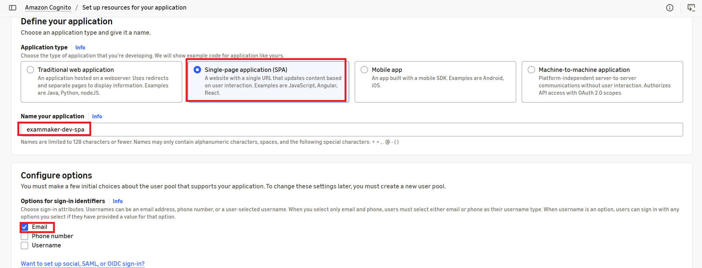
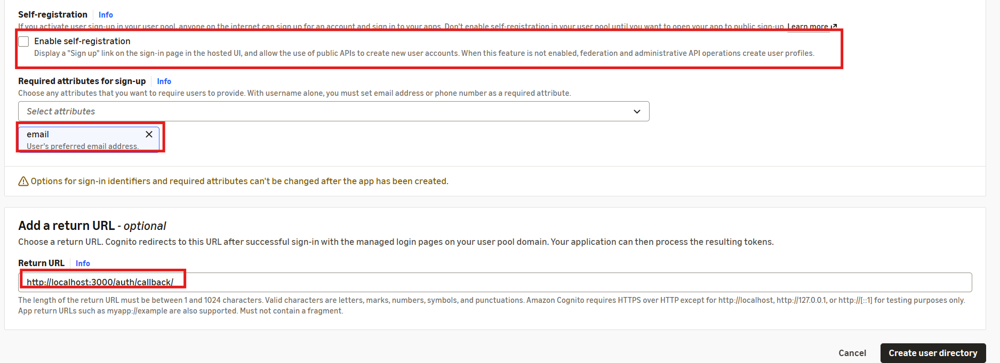

#### Step 1: Create the User Pool and SPA App Client

1. Open **Amazon Cognito** in `ap-southeast-1` → select **User pools** → click **Create user pool**.
2. Configure the initial application details:
  * *Application type:* `Single-page application (SPA)` (Public client without a browser-exposed Client Secret).
  * *Name your application (App client):* `exammaker-dev-spa`.
  * *User pool name:* `exammaker-dev-users` (`ESSENTIALS` tier — Free Tier ≤ 10,000 MAU).
  * *Options for sign-in identifiers:* select `Email` (case-insensitive).

#### Step 2: Disable Self-registration & Configure Return URL

1. Under **Configure options**:
  * *Self-registration:* **Unchecked / Disabled** (`AllowAdminCreateUserOnly = true`) — only school administrators can provision teacher accounts, preventing unauthorized public sign-ups from abusing Amazon Bedrock quotas.
  * *Required attributes for sign-up:* select `email`.
  * *Return URL:* enter `http://localhost:3000/auth/callback/` (matching Next.js `trailingSlash: true`).
2. Click **Create user directory** to complete creation.

