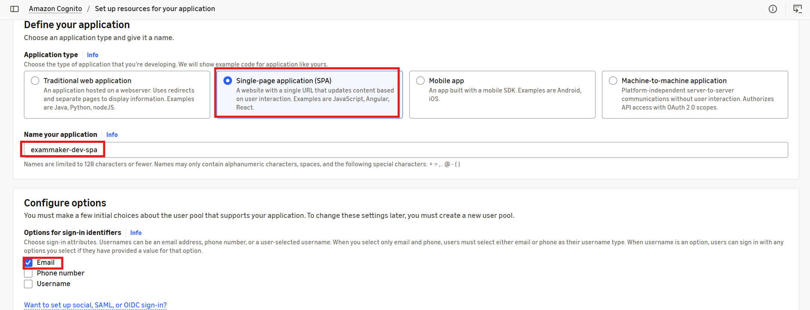
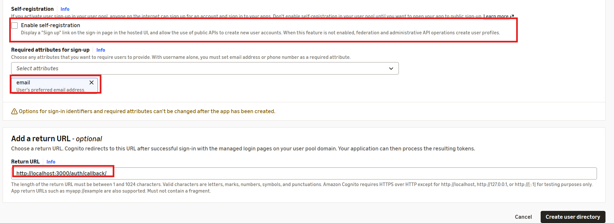

#### Bước 1: Tạo User Pool và App Client SPA

1. Mở **Amazon Cognito** tại region `ap-southeast-1` → chọn **User pools** → bấm **Create user pool**.
2. Cấu hình thông tin ứng dụng ban đầu:
  * *Application type:* `Single-page application (SPA)` (Public client, không sinh Client Secret trên trình duyệt).
  * *Name your application (App client):* `exammaker-dev-spa`.
  * *User pool name:* `exammaker-dev-users` (Phân tầng `ESSENTIALS` — Free Tier ≤ 10.000 MAU).
  * *Options for sign-in identifiers:* chọn `Email` (không phân biệt chữ hoa/thường).

#### Bước 2: Tắt Self-registration & Cấu hình Return URL

1. Tại mục **Configure options**:
  * *Self-registration:* **Tắt / Unchecked** (`AllowAdminCreateUserOnly = true`) — chỉ quản trị viên mới được cấp tài khoản giáo viên, ngăn người lạ tự đăng ký spam gọi Amazon Bedrock.
  * *Required attributes for sign-up:* chọn `email`.
  * *Return URL:* nhập `http://localhost:3000/auth/callback/` (khớp `trailingSlash: true` của Next.js Static Export).
2. Bấm **Create user directory** để hoàn tất khởi tạo.

