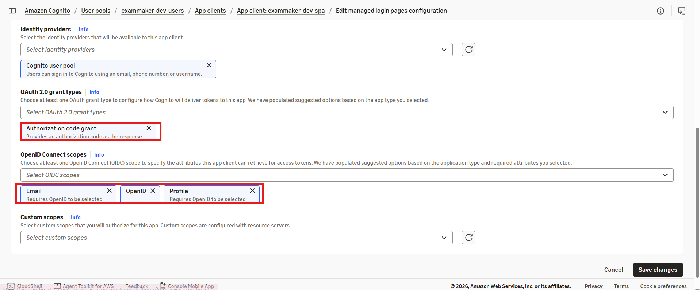

#### Bước 1: Cấu hình Callback URLs, Sign-out URLs & Identity Provider (Hình 2)

1. Mở User Pool **exammaker-dev-users** → menu trái chọn **Applications** → **App clients** → bấm vào **exammaker-dev-spa**.
2. Chuyển sang tab **Login pages** → bấm **Edit**.
3. Tại khung **Managed login pages**:
   - **Allowed callback URLs:** Khai báo http://localhost:3000/auth/callback/ (môi trường dev) và https://app.khaothiai.xyz/auth/callback/ (môi trường production).
   - **Allowed sign-out URLs:** Khai báo http://localhost:3000/ và https://app.khaothiai.xyz/.
   - **Identity providers:** Chọn **Cognito user pool**.

---

#### Bước 2: Cấu hình OAuth 2.0 Authorization Code Grant & OpenID Connect Scopes (Hình 2.2)

1. Kéo xuống mục **OAuth 2.0 grant types**:
   - Chỉ chọn **Authorization code grant** (luồng code kết hợp PKCE, tuyệt đối không bật Implicit grant).
2. Tại mục **OpenID Connect scopes**:
   - Chọn đủ 3 scopes chuẩn: **Email**, **OpenID**, **Profile**.
3. Bấm **Save changes**.

