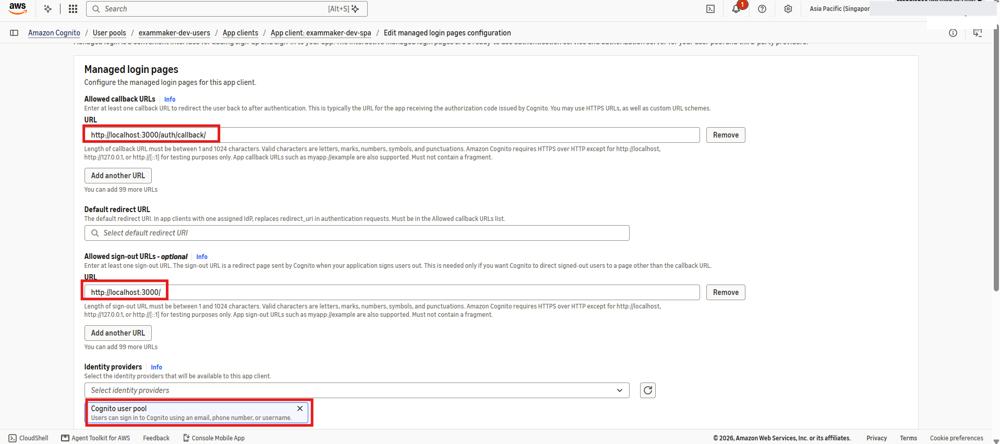

#### Step 1: Configure Callback & Sign-out URLs

1. Navigate to **App clients → `exammaker-dev-spa` → Login pages tab → Edit**.
2. Add the allowed URLs for both local development (`localhost`) and production (`app.khaothiai.xyz`):
  * *Allowed callback URLs:* 
     - `http://localhost:3000/auth/callback/`
     - `https://app.khaothiai.xyz/auth/callback/`
  * *Allowed sign-out URLs:* 
     - `http://localhost:3000/`
     - `https://app.khaothiai.xyz/`
  * *Identity providers:* `Cognito user pool`.

#### Step 2: Configure OAuth 2.0 Grant Types, Scopes & Token TTL

1. **OAuth 2.0 grant types:** Enable `Authorization code grant` only (with PKCE; keep legacy Implicit grant disabled).
2. **OpenID Connect scopes (3 scopes):** select `Email`, `OpenID`, and `Profile`.
3. **Token Expiration (TTL):**
  * *Access Token:* `60 minutes`
  * *ID Token:* `60 minutes`
  * *Refresh Token:* `7 days`
4. Click **Save changes**.

