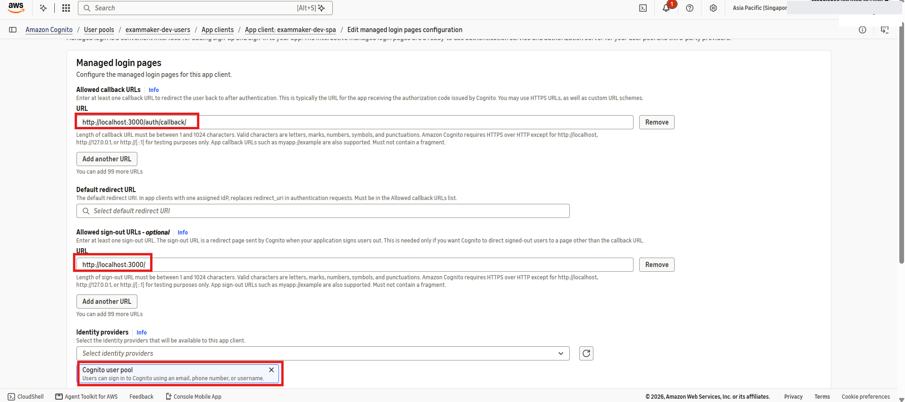
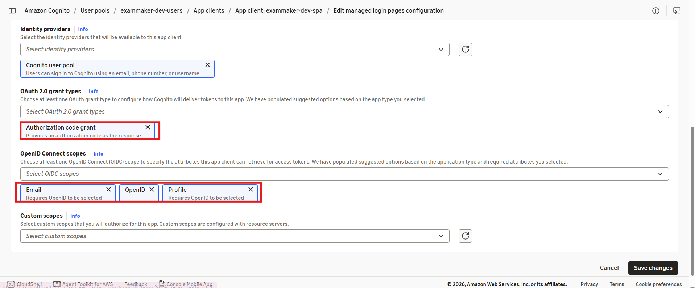

#### Bước 1: Cấu hình Callback & Sign-out URLs

1. Vào **App clients → `exammaker-dev-spa` → tab Login pages → Edit**.
2. Thiết lập danh sách URL hợp lệ cho cả môi trường phát triển (`localhost`) và môi trường sản phẩm (`app.khaothiai.xyz`):
  * *Allowed callback URLs:* 
     - `http://localhost:3000/auth/callback/`
     - `https://app.khaothiai.xyz/auth/callback/`
  * *Allowed sign-out URLs:* 
     - `http://localhost:3000/`
     - `https://app.khaothiai.xyz/`
  * *Identity providers:* `Cognito user pool`.

#### Bước 2: Cấu hình OAuth 2.0 Grant Types, Scopes & Token TTL

1. **OAuth 2.0 grant types:** Chỉ bật `Authorization code grant` (kết hợp PKCE, tắt hoàn toàn Implicit grant kém an toàn).
2. **OpenID Connect scopes (3 scopes):** chọn `Email`, `OpenID`, `Profile`.
3. **Token Expiration (TTL):**
  * *Access Token:* `60 phút`
  * *ID Token:* `60 phút`
  * *Refresh Token:* `7 ngày`
4. Bấm **Save changes**.

