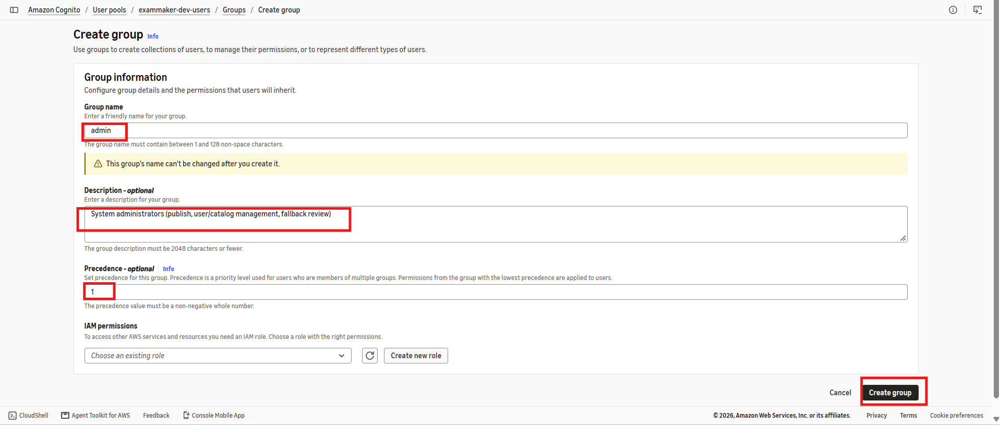
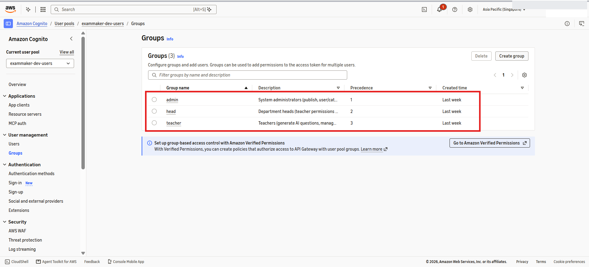

#### Step 1: Create the First Role Group (`admin`)

1. Inside the `exammaker-dev-users` User Pool, navigate to **User management → Groups → Create group**.
2. Enter the details for the `admin` group (lowercase group names to match the OpenAPI contract):
  * *Group name:* `admin`
  * *Description:* `System administrators (publish, user/catalog management, fallback review)`
  * *Precedence:* `1`

#### Step 2: Create `head`, `teacher` & Verify All 3 Groups

Repeat the creation flow for the remaining two groups:
- **Group 2 — `head`** (`Precedence = 2`): `Department heads (teacher permissions plus department review)`
- **Group 3 — `teacher`** (`Precedence = 3`): `Teachers (generate AI questions, manage own questions and exams)`

Verify that the **Groups** table displays all 3 role groups in precedence order `1 → 2 → 3`:

