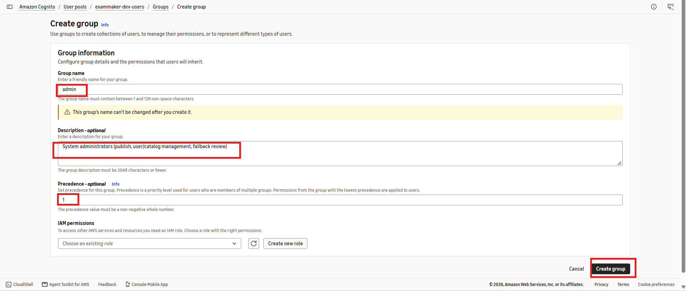
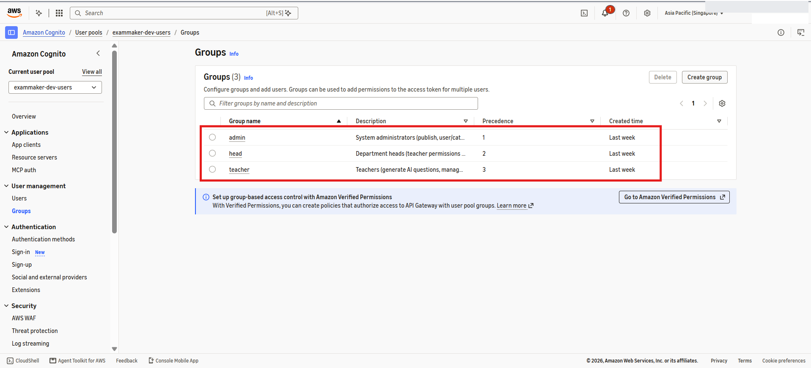

#### Bước 1: Tạo nhóm phân quyền đầu tiên (`admin`)

1. Trong User Pool `exammaker-dev-users`, vào menu trái **User management → Groups → Create group**.
2. Nhập thông tin cho nhóm `admin` (tên nhóm viết thường hoàn toàn để khớp OpenAPI contract):
  * *Group name:* `admin`
  * *Description:* `System administrators (publish, user/catalog management, fallback review)`
  * *Precedence:* `1`

#### Bước 2: Tạo tiếp `head`, `teacher` & Kiểm tra danh sách Groups

Lặp lại thao tác tạo 2 nhóm còn lại:
- **Group 2 — `head`** (`Precedence = 2`): `Department heads (teacher permissions plus department review)`
- **Group 3 — `teacher`** (`Precedence = 3`): `Teachers (generate AI questions, manage own questions and exams)`

Sau khi hoàn tất, kiểm tra bảng **Groups** hiển thị đầy đủ 3 nhóm theo đúng thứ tự ưu tiên `1 → 2 → 3`:

