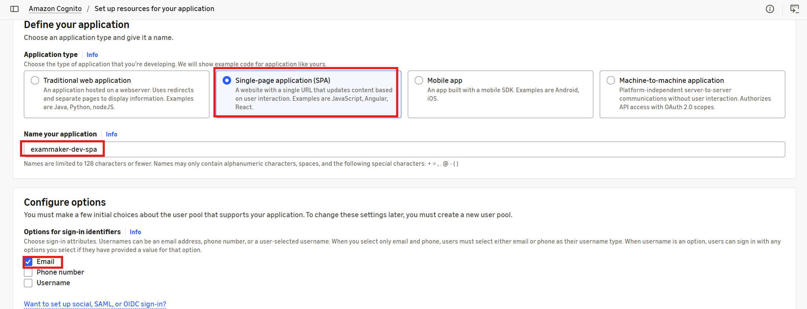
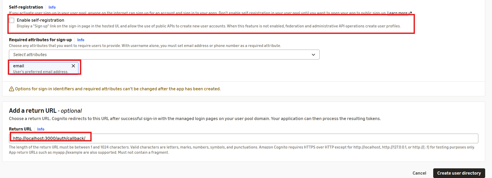
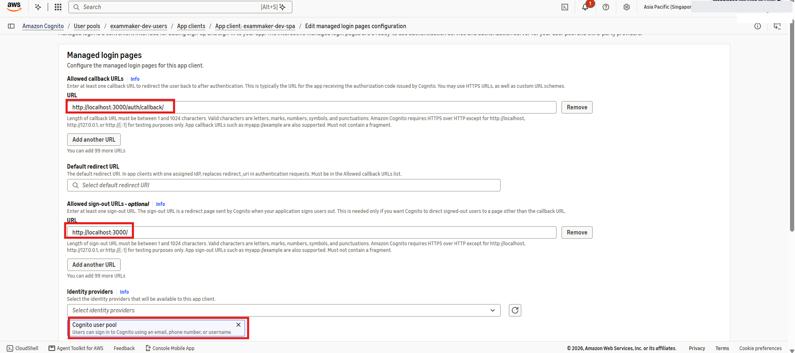
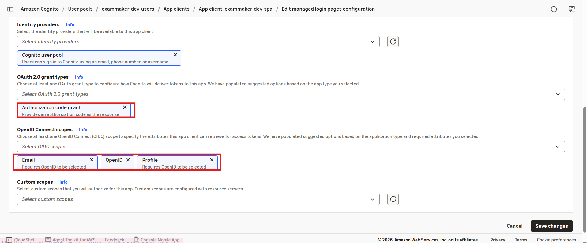
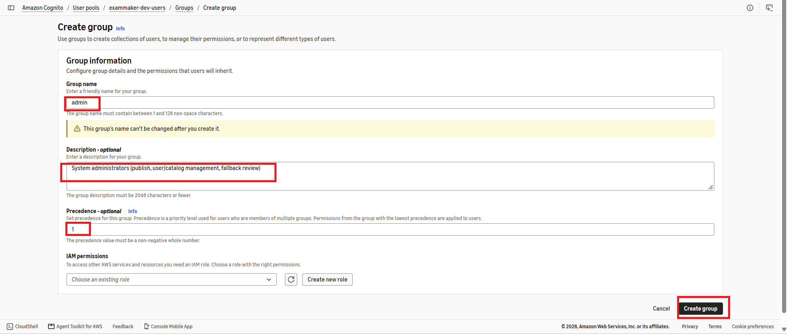
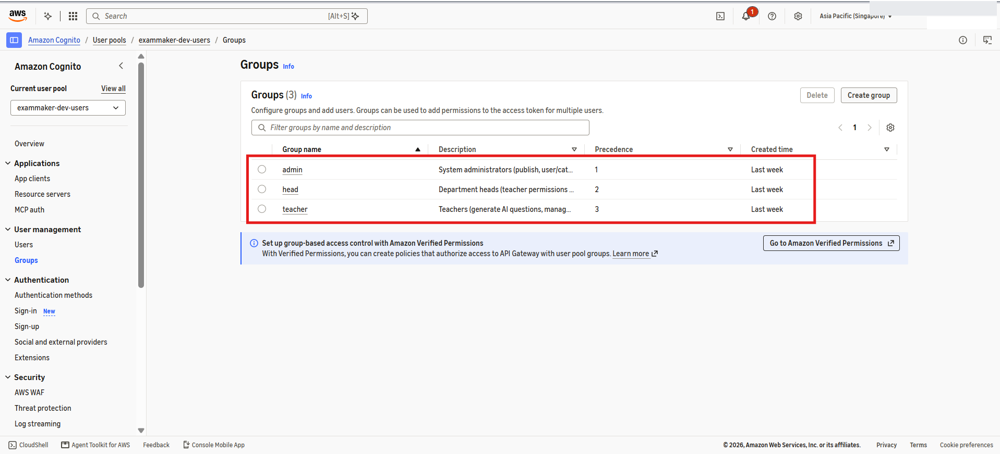

In this section, we configure the **Amazon Cognito User Pool** (`exammaker-dev-users`) on the **Essentials** tier (free up to ≤ 10,000 MAU), register a browser-based **Single-page application (SPA)** client (`exammaker-dev-spa`) using OAuth 2.0 Authorization Code + PKCE, and create 3 RBAC role groups (`admin`, `head`, `teacher`).

---

### 1. Create User Pool & SPA Application

#### Step 1: Create the User Pool and SPA App Client

1. Open **Amazon Cognito** in `ap-southeast-1` → select **User pools** → click **Create user pool**.
2. Configure the initial application details:
  * *Application type:* `Single-page application (SPA)` (Public client without a browser-exposed Client Secret).
  * *Name your application (App client):* `exammaker-dev-spa`.
  * *User pool name:* `exammaker-dev-users` (`ESSENTIALS` tier — Free Tier ≤ 10,000 MAU).
  * *Options for sign-in identifiers:* select `Email` (case-insensitive).

#### Step 2: Disable Self-registration & Configure Return URL

1. Under **Configure options**:
  * *Self-registration:* **Unchecked / Disabled** (`AllowAdminCreateUserOnly = true`) — only school administrators can provision teacher accounts, preventing unauthorized public sign-ups from abusing Amazon Bedrock quotas.
  * *Required attributes for sign-up:* select `email`.
  * *Return URL:* enter `http://localhost:3000/auth/callback/` (matching Next.js `trailingSlash: true`).
2. Click **Create user directory** to complete creation.

---

### 2. Configure Managed Login, PKCE & Scopes

#### Step 1: Configure Callback & Sign-out URLs

1. Navigate to **App clients → `exammaker-dev-spa` → Login pages tab → Edit**.
2. Add the allowed URLs for both local development (`localhost`) and production (`app.khaothiai.xyz`):
  * *Allowed callback URLs:* 
     - `http://localhost:3000/auth/callback/`
     - `https://app.khaothiai.xyz/auth/callback/`
  * *Allowed sign-out URLs:* 
     - `http://localhost:3000/`
     - `https://app.khaothiai.xyz/`
  * *Identity providers:* `Cognito user pool`.

#### Step 2: Configure OAuth 2.0 Grant Types, Scopes & Token TTL

1. **OAuth 2.0 grant types:** Enable `Authorization code grant` only (with PKCE; keep legacy Implicit grant disabled).
2. **OpenID Connect scopes (3 scopes):** select `Email`, `OpenID`, and `Profile`.
3. **Token Expiration (TTL):**
  * *Access Token:* `60 minutes`
  * *ID Token:* `60 minutes`
  * *Refresh Token:* `7 days`
4. Click **Save changes**.

---

### 3. Create 3 User Role Groups

#### Step 1: Create the First Role Group (`admin`)

1. Inside the `exammaker-dev-users` User Pool, navigate to **User management → Groups → Create group**.
2. Enter the details for the `admin` group (lowercase group names to match the OpenAPI contract):
  * *Group name:* `admin`
  * *Description:* `System administrators (publish, user/catalog management, fallback review)`
  * *Precedence:* `1`

#### Step 2: Create `head`, `teacher` & Verify All 3 Groups

Repeat the creation flow for the remaining two groups:
- **Group 2 — `head`** (`Precedence = 2`): `Department heads (teacher permissions plus department review)`
- **Group 3 — `teacher`** (`Precedence = 3`): `Teachers (generate AI questions, manage own questions and exams)`

Verify that the **Groups** table displays all 3 role groups in precedence order `1 → 2 → 3`:

