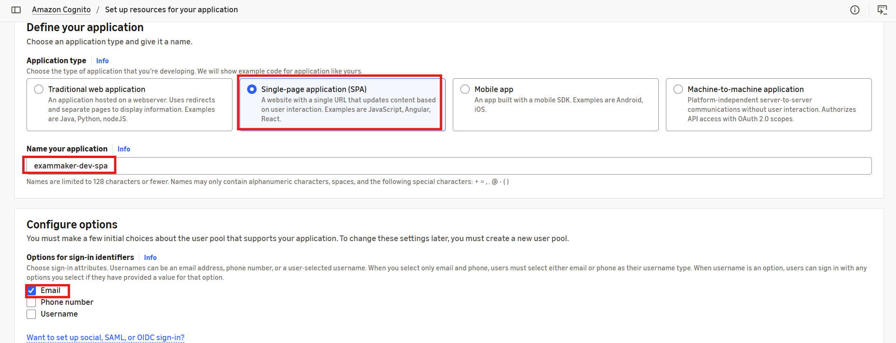
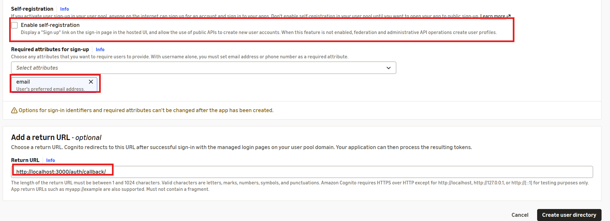
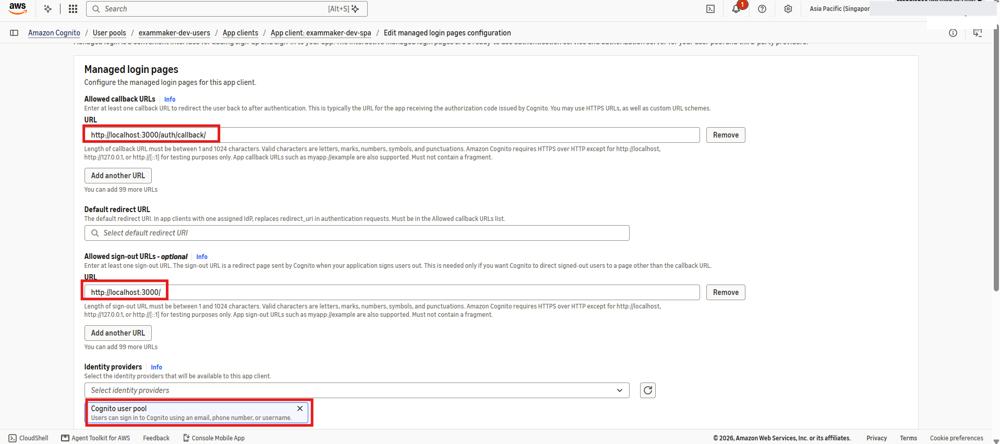
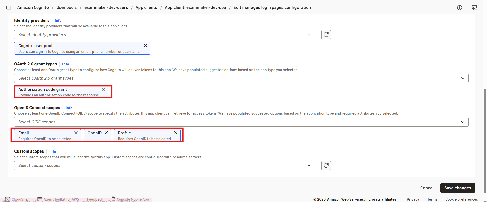
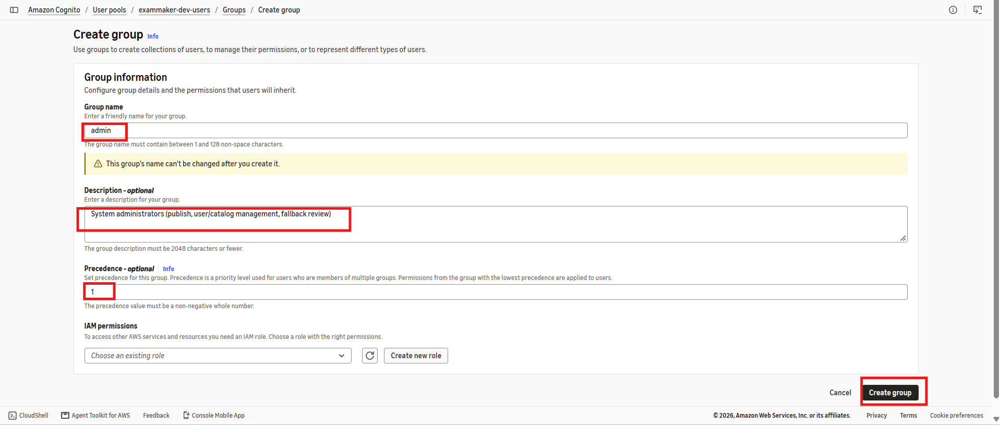
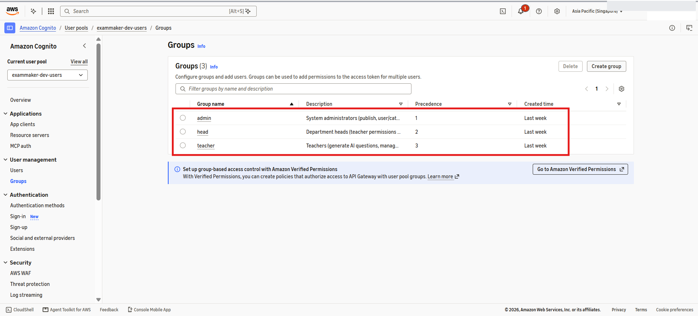

Trong phần này, chúng ta thiết lập dịch vụ định danh **Amazon Cognito User Pool** (`exammaker-dev-users`) ở phân tầng **Essentials** (miễn phí ≤ 10.000 MAU), cấu hình ứng dụng trình duyệt **Single-page application (SPA)** (`exammaker-dev-spa`) sử dụng luồng OAuth 2.0 Authorization Code + PKCE và khởi tạo 3 nhóm phân quyền RBAC (`admin`, `head`, `teacher`).

---

### 1. Khởi tạo User Pool & Ứng dụng SPA

#### Bước 1: Tạo User Pool và App Client SPA

1. Mở **Amazon Cognito** tại region `ap-southeast-1` → chọn **User pools** → bấm **Create user pool**.
2. Cấu hình thông tin ứng dụng ban đầu:
  * *Application type:* `Single-page application (SPA)` (Public client, không sinh Client Secret trên trình duyệt).
  * *Name your application (App client):* `exammaker-dev-spa`.
  * *User pool name:* `exammaker-dev-users` (Phân tầng `ESSENTIALS` — Free Tier ≤ 10.000 MAU).
  * *Options for sign-in identifiers:* chọn `Email` (không phân biệt chữ hoa/thường).

#### Bước 2: Tắt Self-registration & Cấu hình Return URL

1. Tại mục **Configure options**:
  * *Self-registration:* **Tắt / Unchecked** (`AllowAdminCreateUserOnly = true`) — chỉ quản trị viên mới được cấp tài khoản giáo viên, ngăn người lạ tự đăng ký spam gọi Amazon Bedrock.
  * *Required attributes for sign-up:* chọn `email`.
  * *Return URL:* nhập `http://localhost:3000/auth/callback/` (khớp `trailingSlash: true` của Next.js Static Export).
2. Bấm **Create user directory** để hoàn tất khởi tạo.

---

### 2. Cấu hình Managed Login, PKCE & Scopes

#### Bước 1: Cấu hình Callback & Sign-out URLs

1. Vào **App clients → `exammaker-dev-spa` → tab Login pages → Edit**.
2. Thiết lập danh sách URL hợp lệ cho cả môi trường phát triển (`localhost`) và môi trường sản phẩm (`app.khaothiai.xyz`):
  * *Allowed callback URLs:* 
     - `http://localhost:3000/auth/callback/`
     - `https://app.khaothiai.xyz/auth/callback/`
  * *Allowed sign-out URLs:* 
     - `http://localhost:3000/`
     - `https://app.khaothiai.xyz/`
  * *Identity providers:* `Cognito user pool`.

#### Bước 2: Cấu hình OAuth 2.0 Grant Types, Scopes & Token TTL

1. **OAuth 2.0 grant types:** Chỉ bật `Authorization code grant` (kết hợp PKCE, tắt hoàn toàn Implicit grant kém an toàn).
2. **OpenID Connect scopes (3 scopes):** chọn `Email`, `OpenID`, `Profile`.
3. **Token Expiration (TTL):**
  * *Access Token:* `60 phút`
  * *ID Token:* `60 phút`
  * *Refresh Token:* `7 ngày`
4. Bấm **Save changes**.

---

### 3. Khởi tạo 3 Nhóm Phân quyền Người dùng

#### Bước 1: Tạo nhóm phân quyền đầu tiên (`admin`)

1. Trong User Pool `exammaker-dev-users`, vào menu trái **User management → Groups → Create group**.
2. Nhập thông tin cho nhóm `admin` (tên nhóm viết thường hoàn toàn để khớp OpenAPI contract):
  * *Group name:* `admin`
  * *Description:* `System administrators (publish, user/catalog management, fallback review)`
  * *Precedence:* `1`

#### Bước 2: Tạo tiếp `head`, `teacher` & Kiểm tra danh sách Groups

Lặp lại thao tác tạo 2 nhóm còn lại:
- **Group 2 — `head`** (`Precedence = 2`): `Department heads (teacher permissions plus department review)`
- **Group 3 — `teacher`** (`Precedence = 3`): `Teachers (generate AI questions, manage own questions and exams)`

Sau khi hoàn tất, kiểm tra bảng **Groups** hiển thị đầy đủ 3 nhóm theo đúng thứ tự ưu tiên `1 → 2 → 3`:

