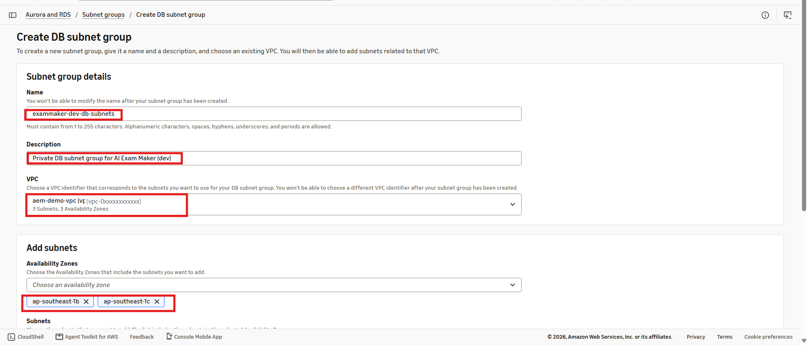
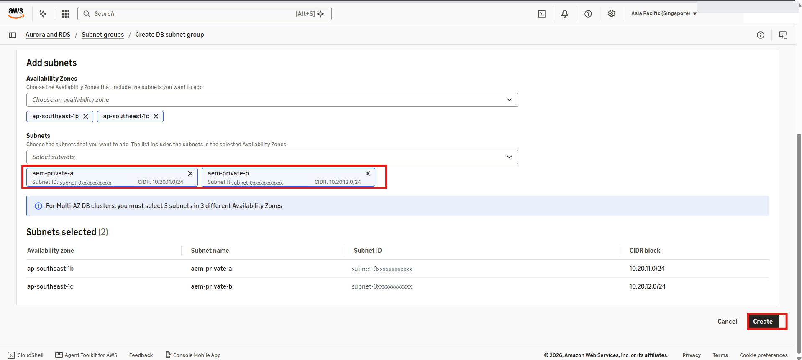

#### Step 1: Create a DB Subnet Group Across 2 Availability Zones

1. Open **Aurora and RDS** → select **Subnet groups → Create DB subnet group**.
2. Configure the subnet group settings:
  * *Name:* `exammaker-dev-db-subnets`
  * *Description:* `Private DB subnet group for AI Exam Maker (dev)`
  * *VPC:* `aem-demo-vpc` (`10.20.0.0/16` — 3 Subnets, 3 Availability Zones)
  * *Availability Zones:* select 2 AZs (`ap-southeast-1b` and `ap-southeast-1c`).

#### Step 2: Attach Only the 2 Private Subnets (Isolated from Internet)

Select strictly the **2 Private Subnets** with no Internet Gateway route (and zero NAT Gateways, saving over $32/month):
* *Private Subnet 1 (`aem-private-a`):* AZ `ap-southeast-1b` · CIDR `10.20.11.0/24`
* *Private Subnet 2 (`aem-private-b`):* AZ `ap-southeast-1c` · CIDR `10.20.12.0/24`

Click **Create** to finish.

