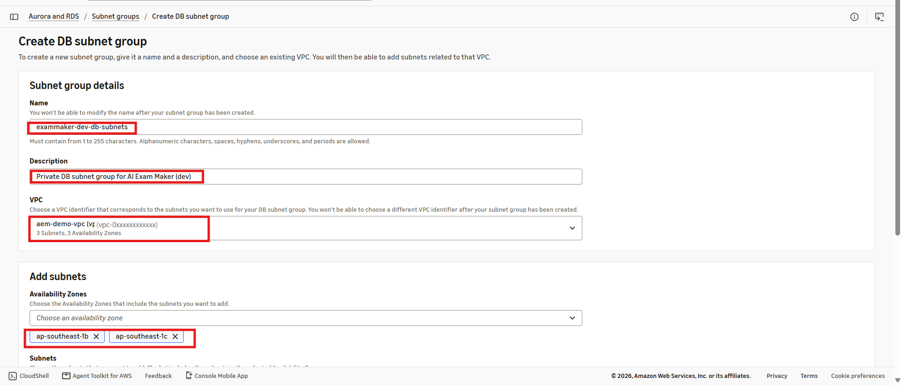
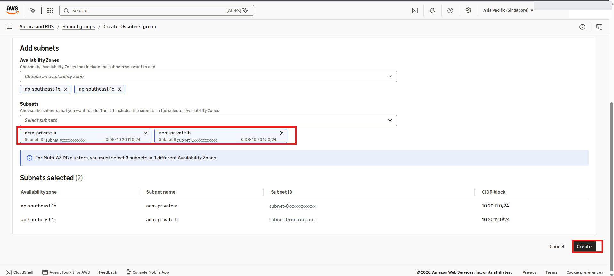

#### Bước 1: Tạo DB Subnet Group trải trên 2 Availability Zones

1. Mở **Aurora and RDS** → menu trái chọn **Subnet groups → Create DB subnet group**.
2. Cấu hình thông tin cơ bản:
  * *Name:* `exammaker-dev-db-subnets`
  * *Description:* `Private DB subnet group for AI Exam Maker (dev)`
  * *VPC:* `aem-demo-vpc` (`10.20.0.0/16` — 3 Subnets, 3 Availability Zones)
  * *Availability Zones:* chọn 2 AZ là `ap-southeast-1b` và `ap-southeast-1c`.

#### Bước 2: Gắn duy nhất 2 Private Subnets (Cô lập Internet)

Chọn chính xác **2 Private Subnets** không có route ra Internet Gateway (và không cần NAT Gateway để tiết kiệm hơn $32/tháng):
* *Private Subnet 1 (`aem-private-a`):* AZ `ap-southeast-1b` · CIDR `10.20.11.0/24`
* *Private Subnet 2 (`aem-private-b`):* AZ `ap-southeast-1c` · CIDR `10.20.12.0/24`

Bấm **Create** để hoàn tất.

