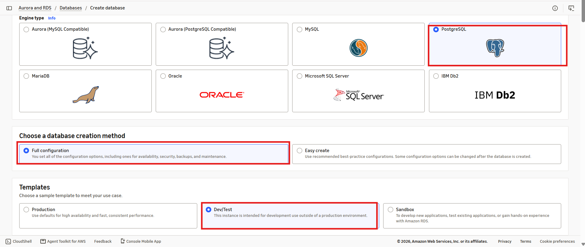
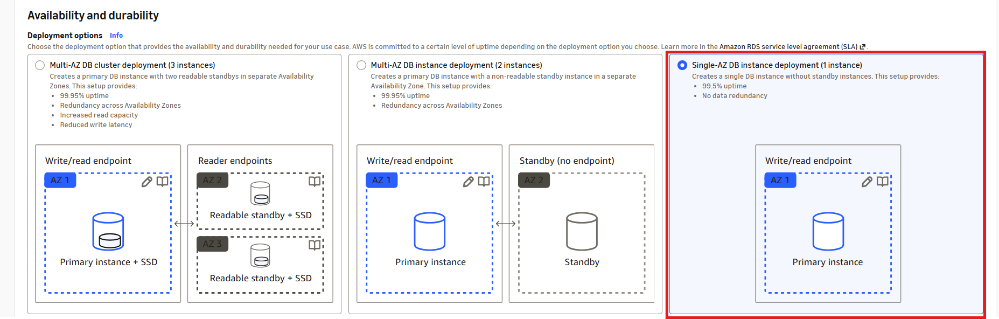
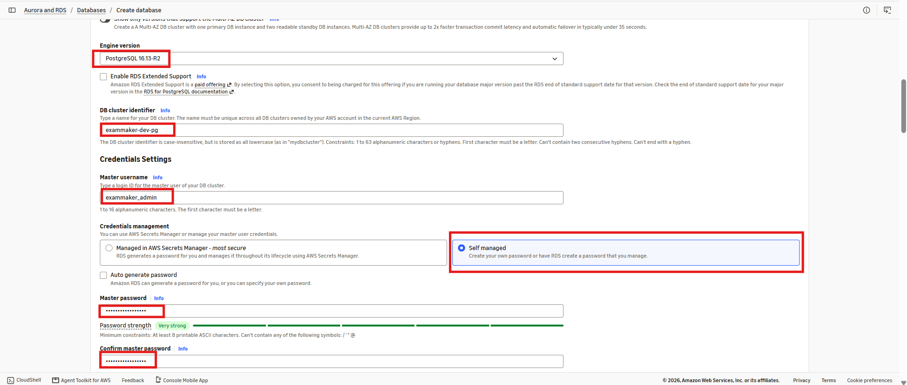

#### Bước 1: Chọn Engine PostgreSQL, Full Configuration & Template Dev/Test (Hình 5)

1. Trong **Aurora and RDS Console** → menu trái chọn **Databases** → bấm **Create database**.
2. Thiết lập 3 mục đầu tiên:
   - **Engine type:** Tích chọn **PostgreSQL** *(không chọn Aurora (PostgreSQL Compatible))*.
   - **Choose a database creation method:** Tích chọn **Full configuration**.
   - **Templates:** Tích chọn **Dev/Test**.

---

#### Bước 2: Chọn Chế độ Triển khai Single-AZ DB Instance Deployment (Hình 5.2)

Tại mục **Availability and durability**:
- **Deployment options:** Tích chọn **Single-AZ DB instance deployment (1 instance)** (MultiAZ = false — không sử dụng Multi-AZ để tránh nhân đôi chi phí compute và storage).

---

#### Bước 3: Chọn Phiên bản PostgreSQL 16.13-R2, Định danh DB & Tài khoản Quản trị (Hình 5.4)

1. Tại mục **Engine version**:
   - Chọn **PostgreSQL 16.13-R2** *(lưu ý: sau khi đổi Engine version về PostgreSQL 16.13-R2, kiểm tra giữ nguyên Single-AZ DB instance deployment để mở khóa dòng máy chủ Burstable classes / db.t4g.micro)*.
   - **Bỏ tích (Uncheck)** ô **Enable RDS Extended Support** để không phát sinh phí gia hạn ngầm.
2. Tại mục **Settings** và **Credentials Settings**:
   - **DB instance identifier:** Điền **exammaker-dev-pg**.
   - **Master username:** Điền **exammaker_admin**.
   - **Credentials management:** Chọn **Self managed** → nhập **Master password** và **Confirm master password**.

