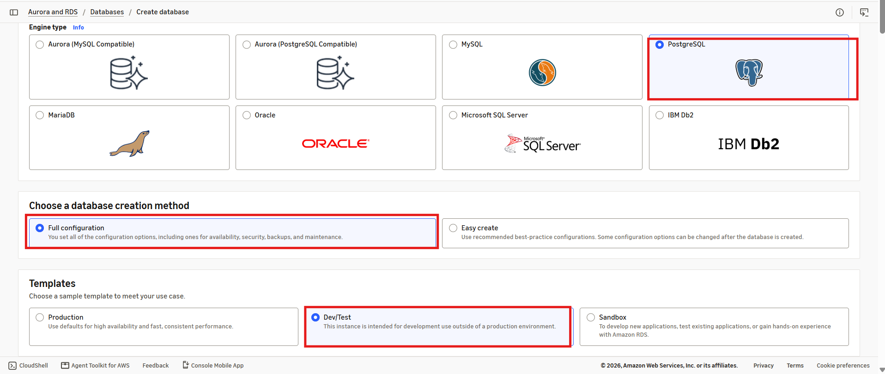
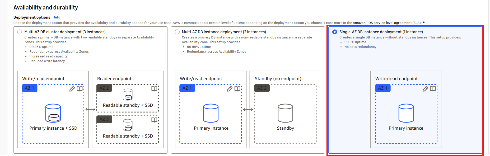
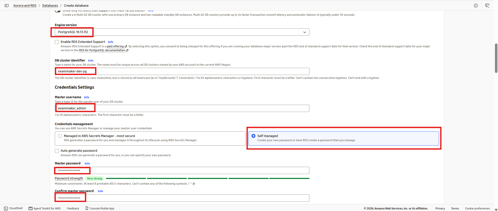

#### Bước 1: Chọn phương thức khởi tạo & Template

1. Vào **Aurora and RDS → Databases → Create database**.
2. Chọn:
  * *Database creation method:* `Full configuration`
  * *Engine type:* `PostgreSQL`
  * *Templates:* `Dev/Test`

#### Bước 2: Chọn chế độ Single-AZ tối ưu chi phí

Tại mục **Availability and durability**, chọn `Single-AZ DB instance deployment (1 instance)` (độ sẵn sàng **99.5% uptime**, `MultiAZ = false`) để tránh nhân đôi chi phí vận hành trong giai đoạn dev/demo.

#### Bước 3: Chọn phiên bản PostgreSQL 16 & Thông tin quản trị

* *Engine version:* `PostgreSQL 16.13-R2` (Tắt **RDS Extended Support** để không phát sinh phí gia hạn ngầm).
* *DB instance identifier:* `exammaker-dev-pg`
* *Master username:* `exammaker_admin`
* *Credentials management:* `Self managed` (mật khẩu được lưu bảo mật dưới dạng `SecureString` tại SSM Parameter Store).

