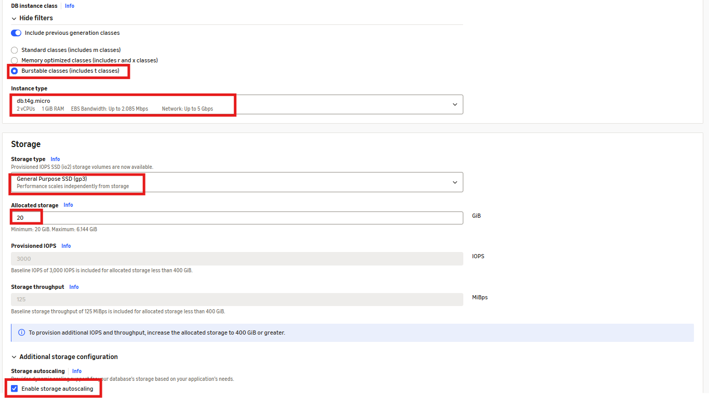
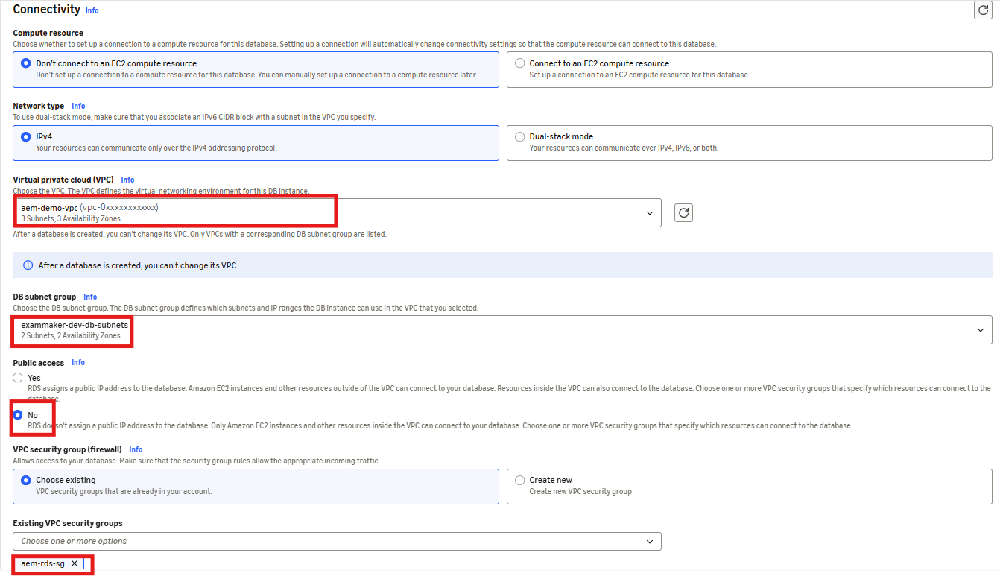

#### Step 1: Select `db.t4g.micro` Instance Class & `gp3` Storage

1. **DB instance class:** select `Burstable classes (includes t classes)` → `db.t4g.micro` (**2 vCPUs, 1 GiB RAM**, EBS Bandwidth up to **2,085 Mbps**, Network up to **5 Gbps**, ~$0.020/hour).
2. **Storage type & Capacity:** `General Purpose SSD (gp3)`, **Allocated storage = `20` GiB** (Baseline **3,000 IOPS**, **125 MiBps**).
3. **Storage autoscaling:** `Enabled`, capped at **Maximum storage threshold = `40` GiB** to prevent runaway storage costs.

#### Step 2: Configure Private Connectivity & Security Group

* *VPC:* `aem-demo-vpc`
* *DB subnet group:* `exammaker-dev-db-subnets`
* *Public access:* `No` (never expose the database with a Public IP).
* *VPC security group:* select `aem-rds-sg` (allows TCP port `5432` strictly from the backend EC2 Security Group).

