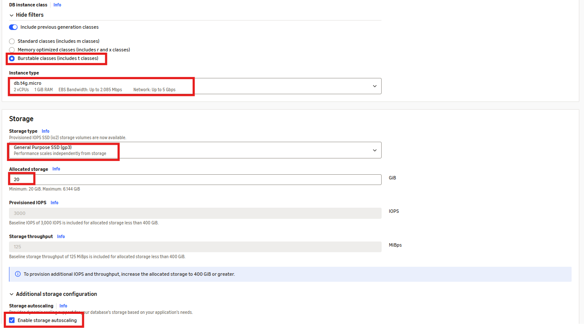
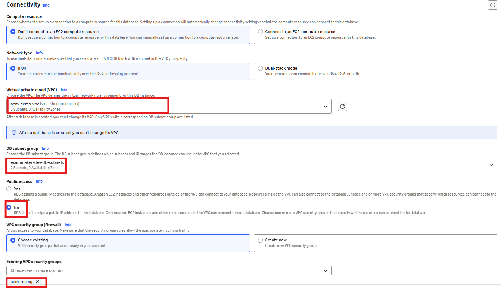

#### Bước 1: Chọn cấu hình máy chủ `db.t4g.micro` & Ổ cứng `gp3`

1. **DB instance class:** chọn `Burstable classes (includes t classes)` → `db.t4g.micro` (**2 vCPUs, 1 GiB RAM**, EBS Bandwidth lên đến **2,085 Mbps**, Network lên đến **5 Gbps**, chi phí chỉ ~$0.020/giờ).
2. **Storage type & Capacity:** `General Purpose SSD (gp3)`, **Allocated storage = `20` GiB** (Baseline **3,000 IOPS**, **125 MiBps**).
3. **Storage autoscaling:** `Enabled`, khóa trần **Maximum storage threshold = `40` GiB** để phòng tránh phình dung lượng ngoài kiểm soát.

#### Bước 2: Thiết lập kết nối Private & Security Group

* *VPC:* `aem-demo-vpc`
* *DB subnet group:* `exammaker-dev-db-subnets`
* *Public access:* `No` (tuyệt đối không gán Public IP cho cơ sở dữ liệu).
* *VPC security group:* chọn `aem-rds-sg` (chỉ mở duy nhất cổng TCP `5432` cho Security Group của máy chủ EC2 backend).

