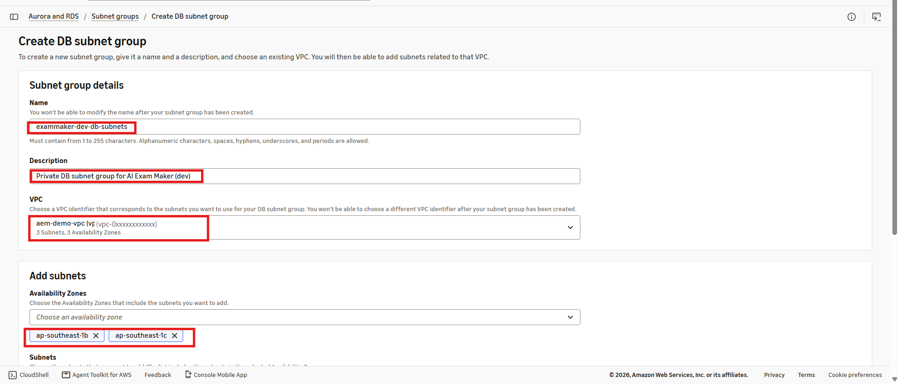
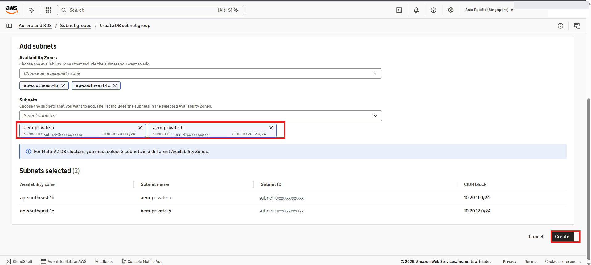
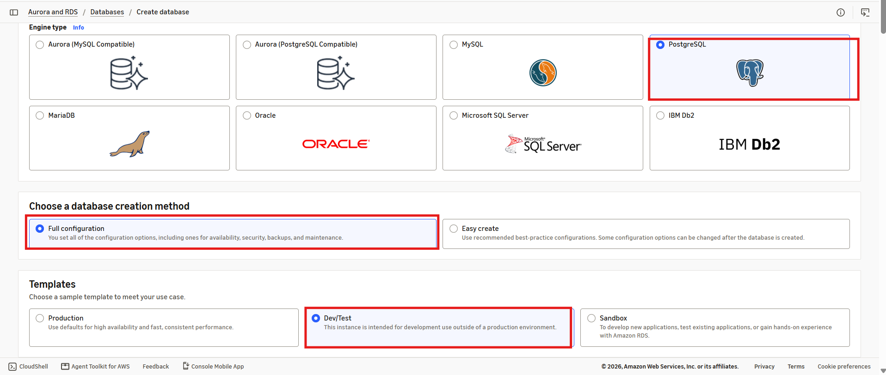
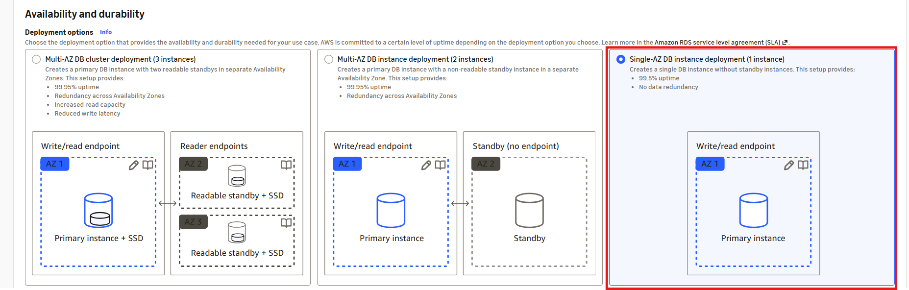
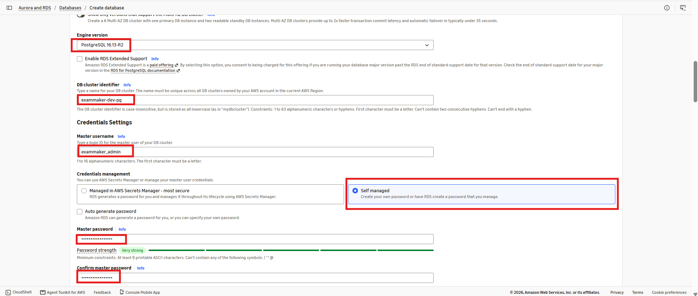
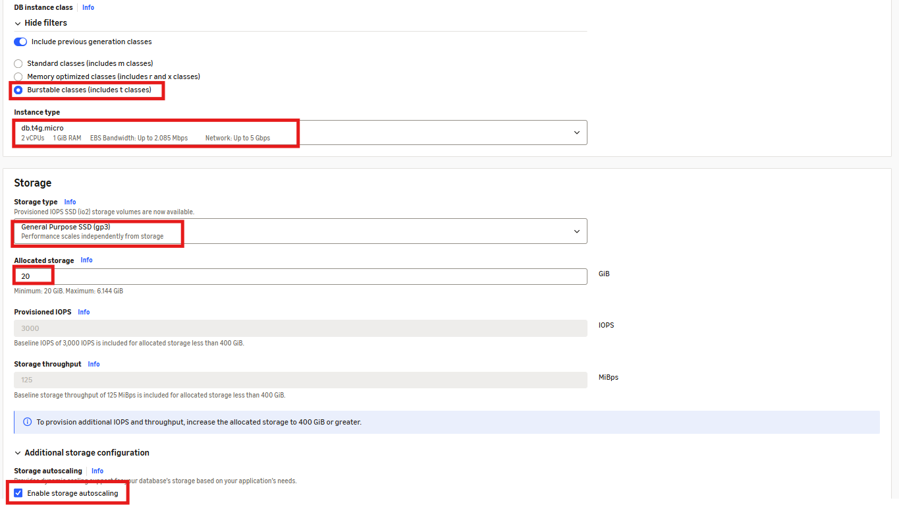
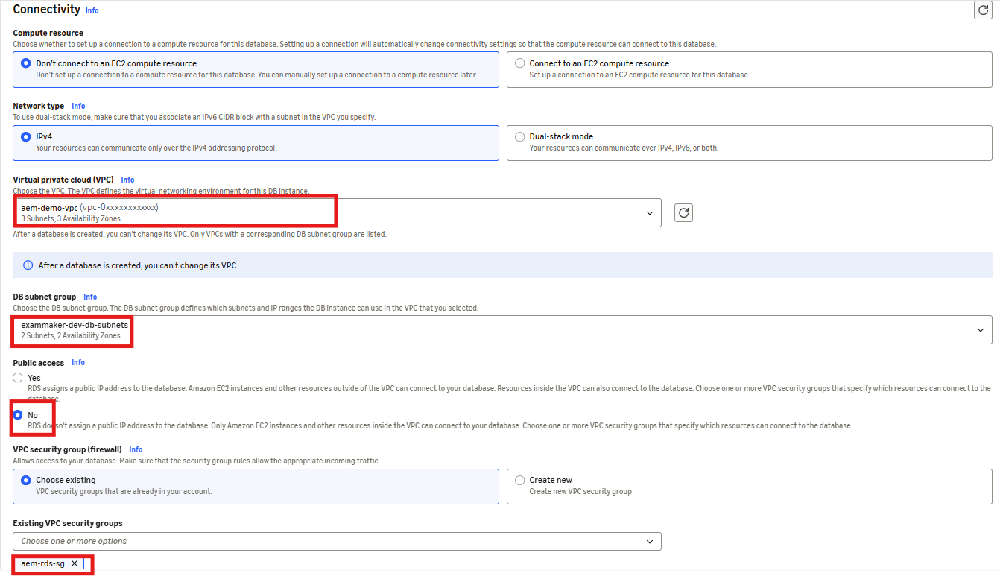
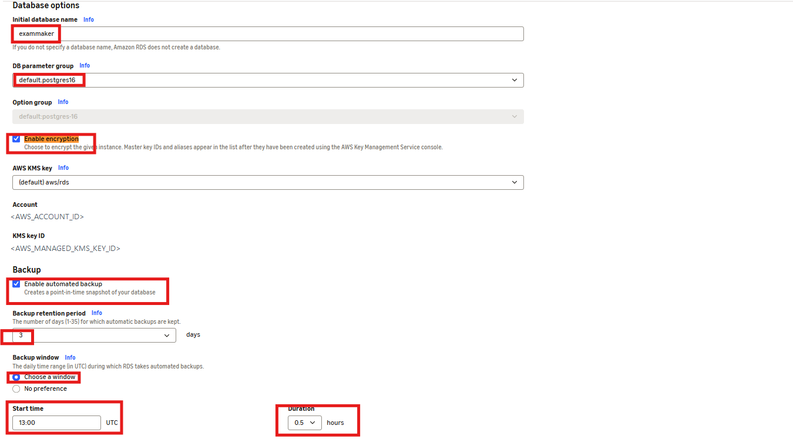

In this section, we deploy an **Amazon RDS PostgreSQL 16.13-R2** database (`exammaker-dev-pg`) isolated inside **2 Private Subnets** (`aem-private-a` and `aem-private-b`) of `aem-demo-vpc`, using the ARM64 Graviton `db.t4g.micro` instance class, `20 GiB gp3` storage, `aws/rds` encryption ($0), and 3-day automated backups.

---

### 1. Create DB Subnet Group

#### Step 1: Create a DB Subnet Group Across 2 Availability Zones

1. Open **Aurora and RDS** → select **Subnet groups → Create DB subnet group**.
2. Configure the subnet group settings:
  * *Name:* `exammaker-dev-db-subnets`
  * *Description:* `Private DB subnet group for AI Exam Maker (dev)`
  * *VPC:* `aem-demo-vpc` (`10.20.0.0/16` — 3 Subnets, 3 Availability Zones)
  * *Availability Zones:* select 2 AZs (`ap-southeast-1b` and `ap-southeast-1c`).

#### Step 2: Attach Only the 2 Private Subnets (Isolated from Internet)

Select strictly the **2 Private Subnets** with no Internet Gateway route (and zero NAT Gateways, saving over $32/month):
* *Private Subnet 1 (`aem-private-a`):* AZ `ap-southeast-1b` · CIDR `10.20.11.0/24`
* *Private Subnet 2 (`aem-private-b`):* AZ `ap-southeast-1c` · CIDR `10.20.12.0/24`

Click **Create** to finish.

---

### 2. Select PostgreSQL 16 Engine, Single-AZ & Credentials

#### Step 1: Choose Creation Method & Template

1. Open **Aurora and RDS → Databases → Create database**.
2. Select:
  * *Database creation method:* `Full configuration`
  * *Engine type:* `PostgreSQL`
  * *Templates:* `Dev/Test`

#### Step 2: Select Single-AZ Deployment for Cost Efficiency

Under **Availability and durability**, select `Single-AZ DB instance deployment (1 instance)` (**99.5% uptime**, `MultiAZ = false`) to avoid doubling hourly compute costs during dev/demo.

#### Step 3: Select PostgreSQL 16 Version & Master Credentials

* *Engine version:* `PostgreSQL 16.13-R2` (Disable **RDS Extended Support** to avoid extra extended-support fees).
* *DB instance identifier:* `exammaker-dev-pg`
* *Master username:* `exammaker_admin`
* *Credentials management:* `Self managed` (master password stored securely as a `SecureString` in SSM Parameter Store).

---

### 3. Configure db.t4g.micro, gp3 20 GiB & Private Network

#### Step 1: Select `db.t4g.micro` Instance Class & `gp3` Storage

1. **DB instance class:** select `Burstable classes (includes t classes)` → `db.t4g.micro` (**2 vCPUs, 1 GiB RAM**, EBS Bandwidth up to **2,085 Mbps**, Network up to **5 Gbps**, ~$0.020/hour).
2. **Storage type & Capacity:** `General Purpose SSD (gp3)`, **Allocated storage = `20` GiB** (Baseline **3,000 IOPS**, **125 MiBps**).
3. **Storage autoscaling:** `Enabled`, capped at **Maximum storage threshold = `40` GiB** to prevent runaway storage costs.

#### Step 2: Configure Private Connectivity & Security Group

* *VPC:* `aem-demo-vpc`
* *DB subnet group:* `exammaker-dev-db-subnets`
* *Public access:* `No` (never expose the database with a Public IP).
* *VPC security group:* select `aem-rds-sg` (allows TCP port `5432` strictly from the backend EC2 Security Group).

---

### 4. Configure Database exammaker, Encryption & Backup

#### Configure Initial Database, KMS Encryption & Automated Backups

Expand **Additional configuration** and set the security and backup parameters:
* *Initial database name:* `exammaker`
* *DB parameter group:* `default.postgres16` (enforces encrypted connections via `rds.force_ssl = 1`).
* *Encryption:* `Enable encryption` using the AWS managed KMS key `(default) aws/rds` (**$0**).
* *Automated Backup:* `Enabled`
  * *Backup retention period:* `3` days (stays well within the 20 GB free backup storage allocation).
  * *Backup window:* `13:00` UTC (`20:00` Vietnam time), **Duration = `0.5` hours** (30 minutes).

Click **Create database** to launch `exammaker-dev-pg`.

