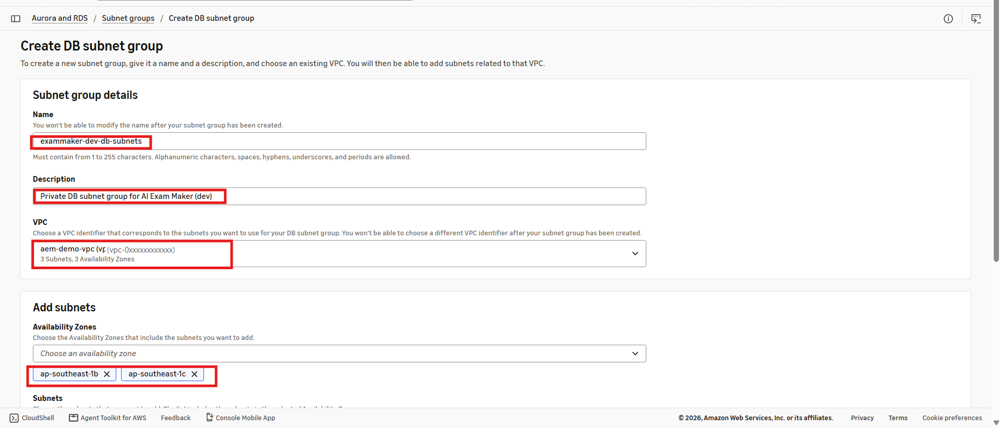
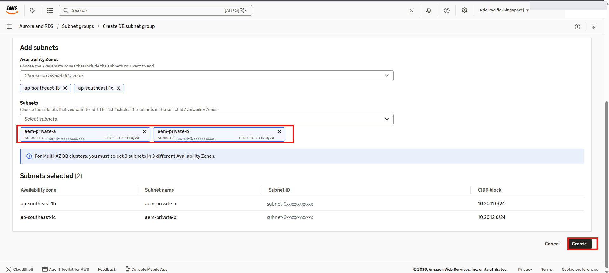
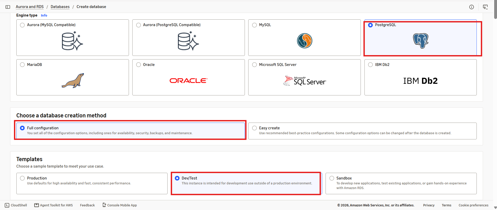
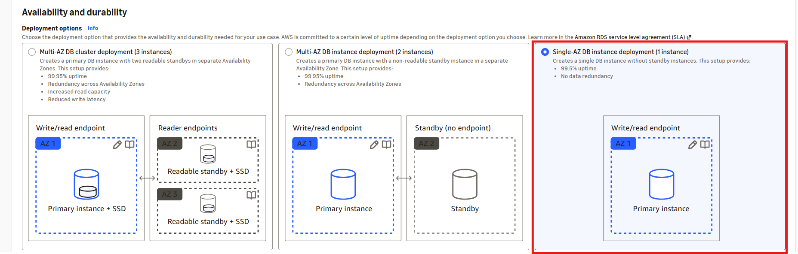
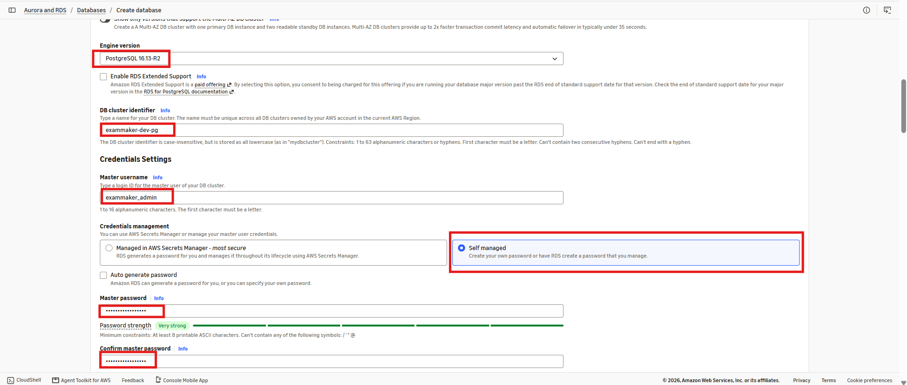
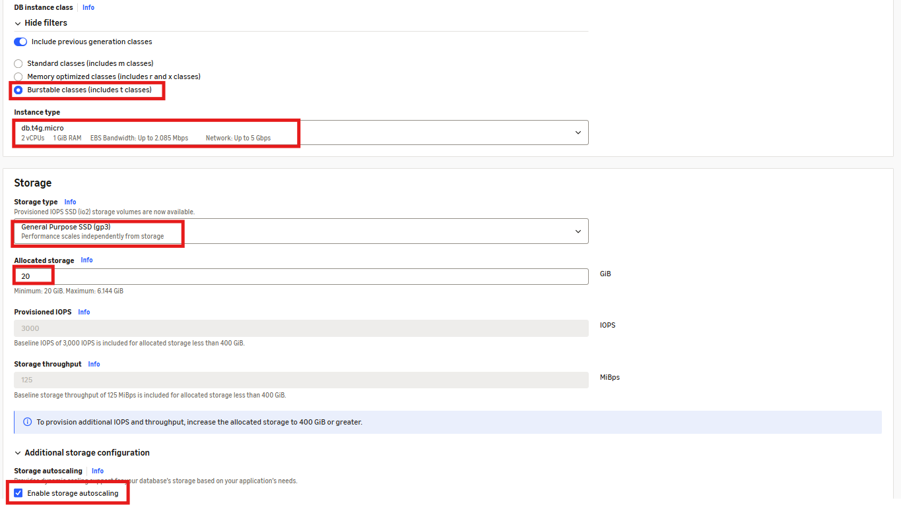
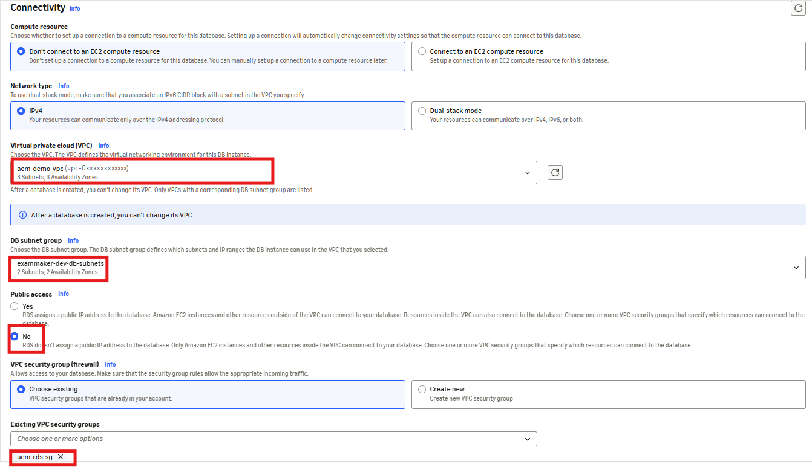
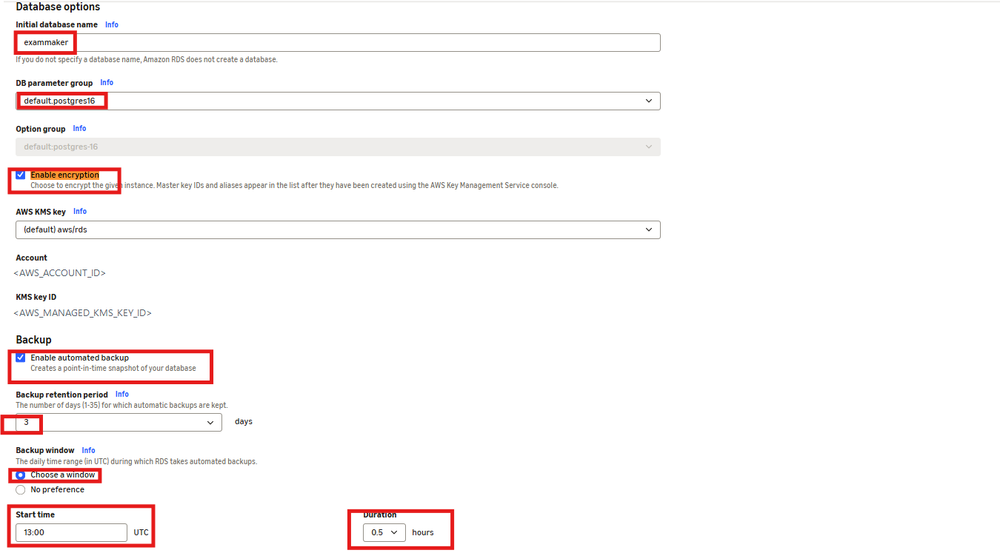

Trong phần này, chúng ta triển khai cơ sở dữ liệu **Amazon RDS PostgreSQL 16.13-R2** (`exammaker-dev-pg`) nằm hoàn toàn trong **2 Private Subnets** (`aem-private-a` và `aem-private-b`) thuộc VPC `aem-demo-vpc`, sử dụng dòng chip ARM64 Graviton `db.t4g.micro`, ổ đĩa `gp3` 20 GiB, mã hóa `aws/rds` ($0) và sao lưu tự động 3 ngày.

---

### 1. Khởi tạo DB Subnet Group

#### Bước 1: Tạo DB Subnet Group trải trên 2 Availability Zones

1. Mở **Aurora and RDS** → menu trái chọn **Subnet groups → Create DB subnet group**.
2. Cấu hình thông tin cơ bản:
  * *Name:* `exammaker-dev-db-subnets`
  * *Description:* `Private DB subnet group for AI Exam Maker (dev)`
  * *VPC:* `aem-demo-vpc` (`10.20.0.0/16` — 3 Subnets, 3 Availability Zones)
  * *Availability Zones:* chọn 2 AZ là `ap-southeast-1b` và `ap-southeast-1c`.

#### Bước 2: Gắn duy nhất 2 Private Subnets (Cô lập Internet)

Chọn chính xác **2 Private Subnets** không có route ra Internet Gateway (và không cần NAT Gateway để tiết kiệm hơn $32/tháng):
* *Private Subnet 1 (`aem-private-a`):* AZ `ap-southeast-1b` · CIDR `10.20.11.0/24`
* *Private Subnet 2 (`aem-private-b`):* AZ `ap-southeast-1c` · CIDR `10.20.12.0/24`

Bấm **Create** để hoàn tất.

---

### 2. Chọn Engine PostgreSQL 16, Single-AZ & Tài khoản

#### Bước 1: Chọn phương thức khởi tạo & Template

1. Vào **Aurora and RDS → Databases → Create database**.
2. Chọn:
  * *Database creation method:* `Full configuration`
  * *Engine type:* `PostgreSQL`
  * *Templates:* `Dev/Test`

#### Bước 2: Chọn chế độ Single-AZ tối ưu chi phí

Tại mục **Availability and durability**, chọn `Single-AZ DB instance deployment (1 instance)` (độ sẵn sàng **99.5% uptime**, `MultiAZ = false`) để tránh nhân đôi chi phí vận hành trong giai đoạn dev/demo.

#### Bước 3: Chọn phiên bản PostgreSQL 16 & Thông tin quản trị

* *Engine version:* `PostgreSQL 16.13-R2` (Tắt **RDS Extended Support** để không phát sinh phí gia hạn ngầm).
* *DB instance identifier:* `exammaker-dev-pg`
* *Master username:* `exammaker_admin`
* *Credentials management:* `Self managed` (mật khẩu được lưu bảo mật dưới dạng `SecureString` tại SSM Parameter Store).

---

### 3. Cấu hình db.t4g.micro, gp3 20 GiB & Mạng Private

#### Bước 1: Chọn cấu hình máy chủ `db.t4g.micro` & Ổ cứng `gp3`

1. **DB instance class:** chọn `Burstable classes (includes t classes)` → `db.t4g.micro` (**2 vCPUs, 1 GiB RAM**, EBS Bandwidth lên đến **2,085 Mbps**, Network lên đến **5 Gbps**, chi phí chỉ ~$0.020/giờ).
2. **Storage type & Capacity:** `General Purpose SSD (gp3)`, **Allocated storage = `20` GiB** (Baseline **3,000 IOPS**, **125 MiBps**).
3. **Storage autoscaling:** `Enabled`, khóa trần **Maximum storage threshold = `40` GiB** để phòng tránh phình dung lượng ngoài kiểm soát.

#### Bước 2: Thiết lập kết nối Private & Security Group

* *VPC:* `aem-demo-vpc`
* *DB subnet group:* `exammaker-dev-db-subnets`
* *Public access:* `No` (tuyệt đối không gán Public IP cho cơ sở dữ liệu).
* *VPC security group:* chọn `aem-rds-sg` (chỉ mở duy nhất cổng TCP `5432` cho Security Group của máy chủ EC2 backend).

---

### 4. Cấu hình Database exammaker, Mã hóa & Backup

#### Thiết lập cơ sở dữ liệu ban đầu, Mã hóa KMS & Sao lưu tự động

Mở mục **Additional configuration** và cấu hình các thông số bảo mật & sao lưu:
* *Initial database name:* `exammaker`
* *DB parameter group:* `default.postgres16` (mặc định ép kết nối mã hóa `rds.force_ssl = 1`).
* *Encryption:* `Enable encryption` với AWS managed KMS key `(default) aws/rds` (**$0**).
* *Automated Backup:* `Enabled`
  * *Backup retention period:* `3` days (nằm gọn trong hạn mức 20 GB backup miễn phí).
  * *Backup window:* `13:00` UTC (`20:00` giờ Việt Nam), **Duration = `0.5` hours** (30 phút).

Bấm **Create database** để khởi tạo instance `exammaker-dev-pg`.

