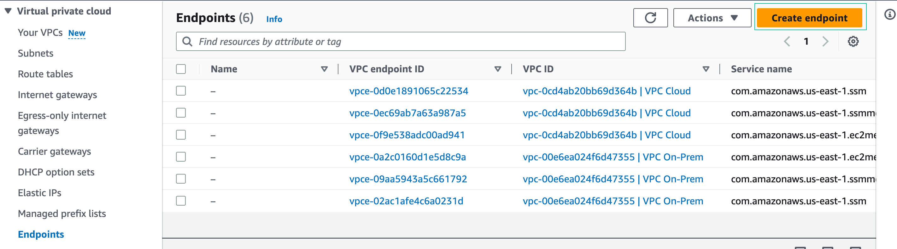
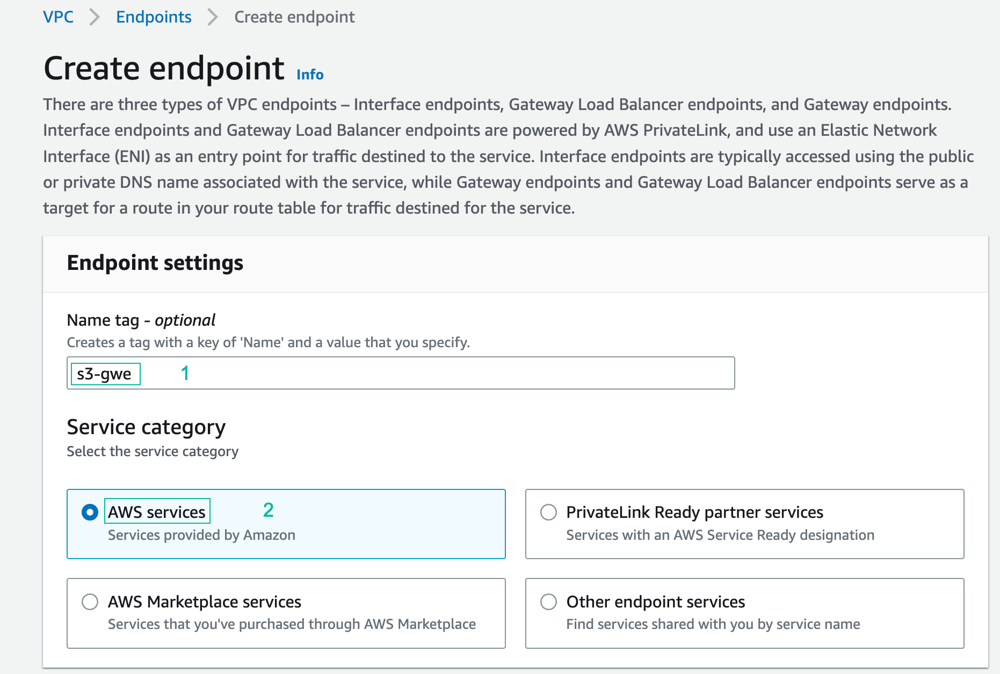
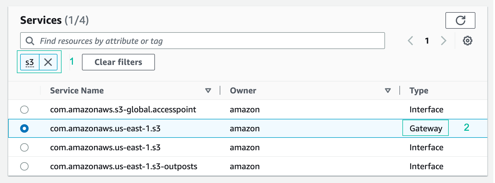
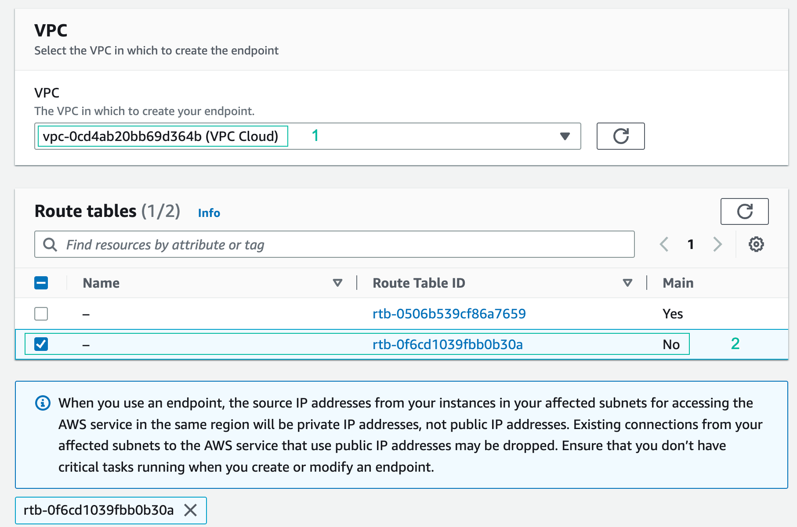
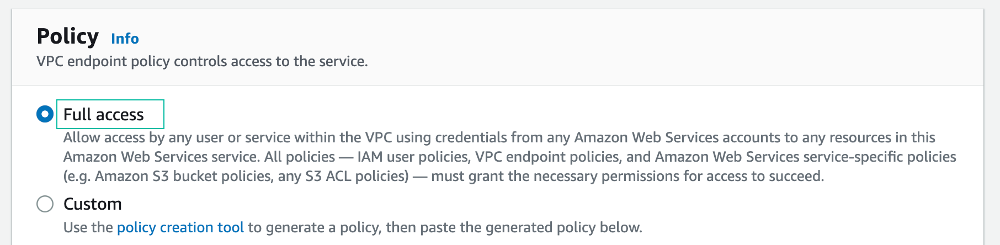
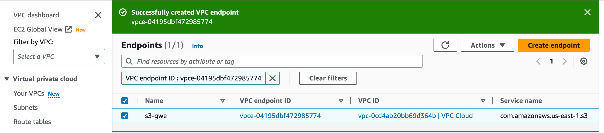

#### Step-by-Step Procedure:

1. Open the [Amazon VPC Management Console](https://us-east-1.console.aws.amazon.com/vpc/home?region=us-east-1#Home:) in the `us-east-1` (N. Virginia) region.
2. In the left navigation pane, select **Endpoints** and click **Create endpoint**.

> [!NOTE]
> The console already displays 6 existing VPC endpoints supporting AWS Systems Manager (SSM). These were deployed automatically by the prerequisite CloudFormation template to enable browser-based console access without SSH or bastion hosts.

3. Configure Endpoint Parameters:
   - **Name tag:** Enter `s3-gwe`
   - **Service category:** Select **AWS services**

4. Under **Services**, type `s3` into the filter box:
   - Select service: `com.amazonaws.us-east-1.s3`
   - Verify the **Type** column displays **Gateway**

5. Network & Routing Association:
   - **VPC:** Select **VPC Cloud** from the dropdown menu.
   - **Route tables:** Select the secondary route table associated with the two private subnets (provisioned by CloudFormation, not the default main route table).

6. Endpoint Policy Configuration:
   - Select **Full access** (default policy allowing open API access through the endpoint; custom access restrictions will be evaluated in step 5.5).

7. Click **Create endpoint**. Once the lifecycle status transitions to **Available**, proceed to connectivity testing.

