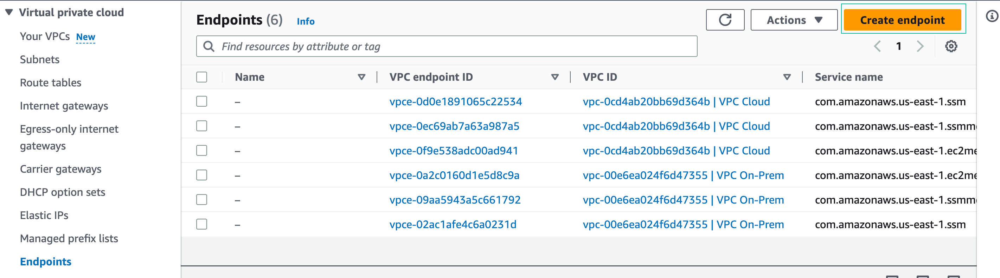
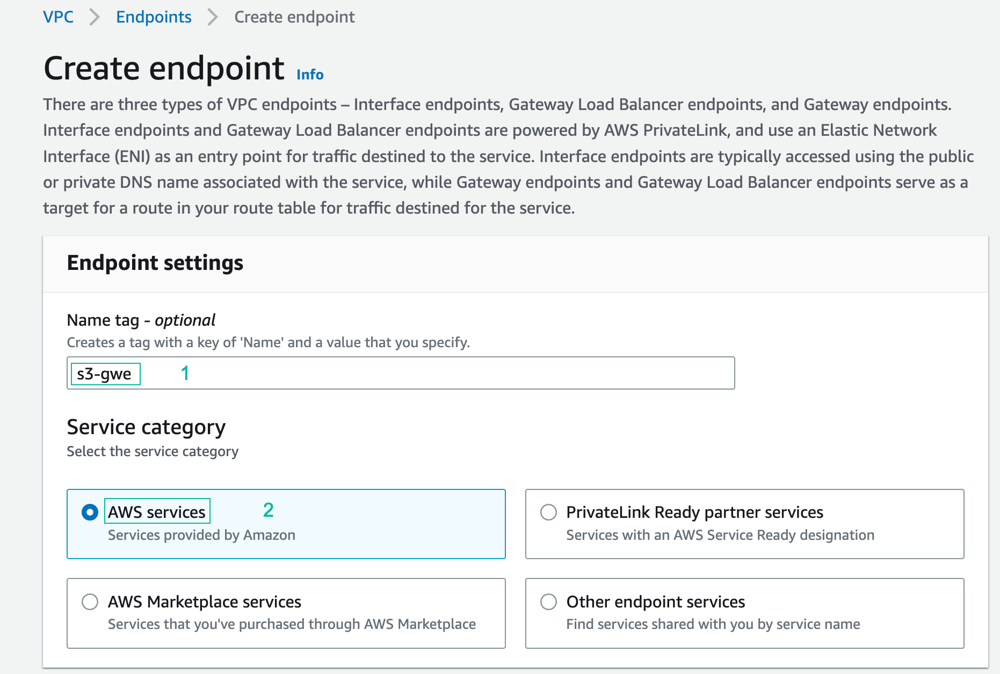
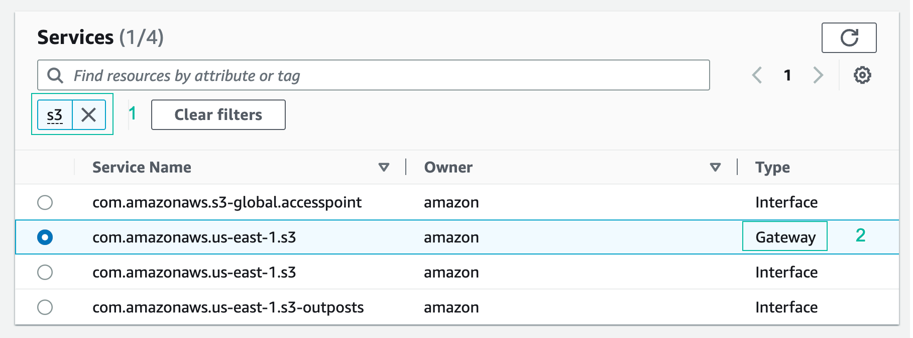
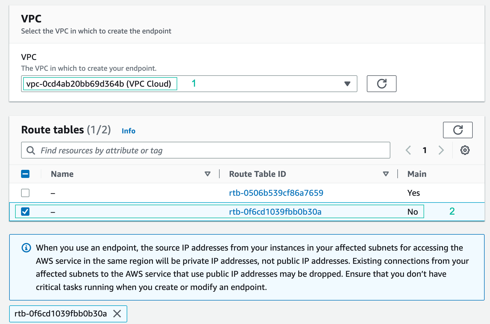
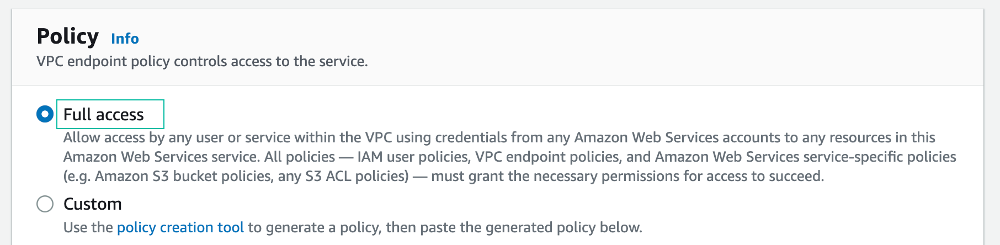
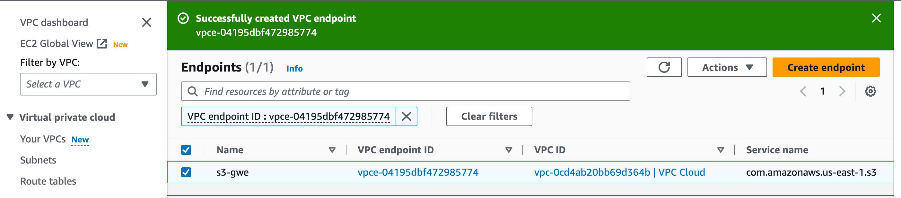

#### Các bước thực hiện:

1. Mở [Amazon VPC Console](https://us-east-1.console.aws.amazon.com/vpc/home?region=us-east-1#Home:) tại Region `us-east-1` (N. Virginia).
2. Tại thanh điều hướng bên trái, chọn **Endpoints** ➔ Nhấp chọn **Create endpoint**.

> [!NOTE]
> Danh sách hiện tại đã có sẵn 6 Interface Endpoints phục vụ kết nối cho AWS Systems Manager (SSM, `ssmmessages`, `ec2messages`). Các tài nguyên này được CloudFormation Stack khởi tạo sẵn để cho phép điều khiển máy ảo không cần SSH/Bastion Host.

3. Cấu hình thông số Endpoint:
   - **Name tag:** Nhập `s3-gwe`
   - **Service category:** Chọn **AWS services**

4. Tại mục **Services**, nhập từ khóa `s3` vào ô tìm kiếm:
   - Chọn service: `com.amazonaws.us-east-1.s3`
   - Kiểm tra cột **Type:** Phải hiển thị loại **Gateway**

5. Cấu hình VPC & Bảng định tuyến:
   - **VPC:** Chọn **VPC Cloud** từ menu thả xuống.
   - **Route tables:** Tích chọn Route Table thứ 2 (bảng định tuyến liên kết với 2 private subnets do CloudFormation tạo, không phải Main Route Table).

6. Thiết lập Chính sách truy cập (Policy):
   - Chọn **Full access** (cho phép toàn quyền truy cập dịch vụ, chính sách giới hạn chi tiết sẽ được kiểm thử ở mục 5.5).

7. Nhấp **Create endpoint**. Sau khi hệ thống thông báo trạng thái **Available**, chuyển sang bước kiểm thử.

