#### 1. Provision an Amazon S3 Bucket

1. Open the [Amazon S3 Management Console](https://s3.console.aws.amazon.com/s3/home?region=us-east-1).
2. Click **Create bucket**.

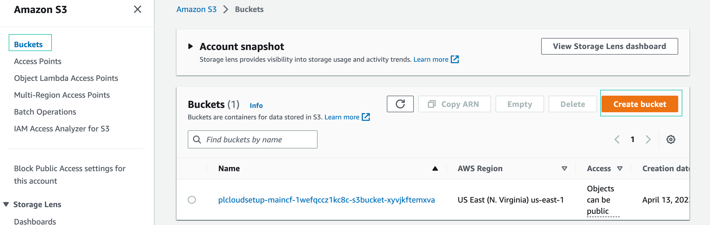

3. Configure General Settings:
   - **Bucket name:** Enter a globally unique name (e.g., `fcj-hybrid-s3-test-<your-name>`).
   - **AWS Region:** `us-east-1` (US East - N. Virginia).

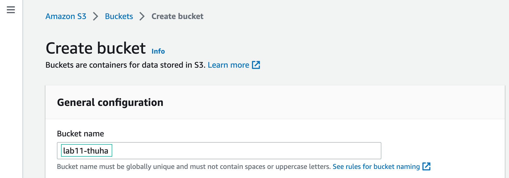

4. Retain all default security configurations (Block all public access enabled). Scroll to the bottom and click **Create bucket**.

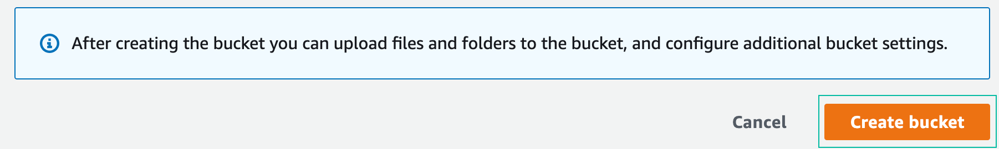    

5. Verify that the bucket status is confirmed in the S3 bucket list.

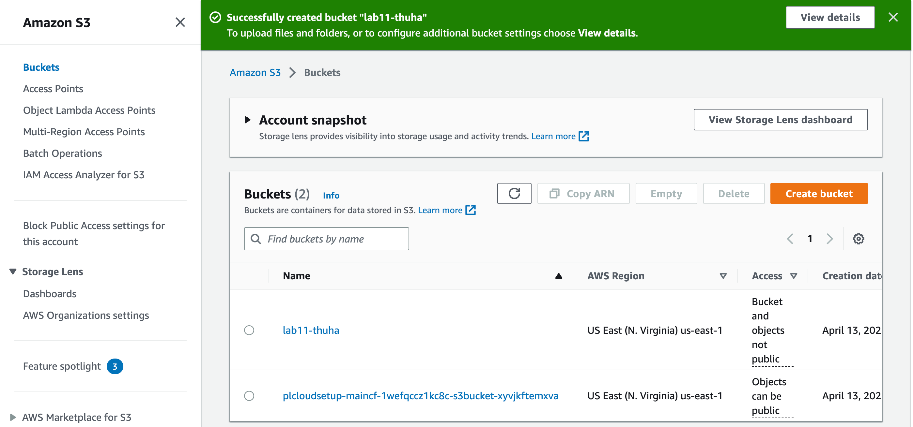

---

#### 2. Establish Session Manager Shell to EC2

1. In the AWS console search bar, type **Systems Manager** and open the service.

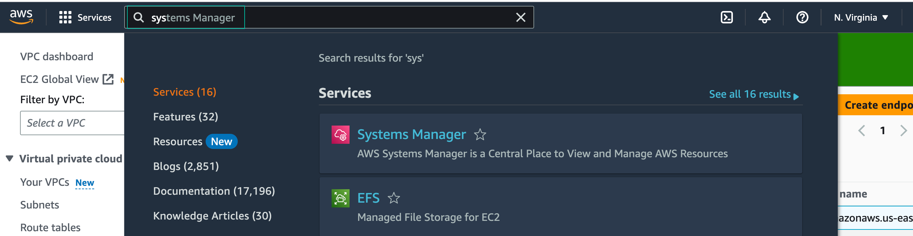

2. From the left navigation menu, locate **Node Management** and select **Session Manager**.

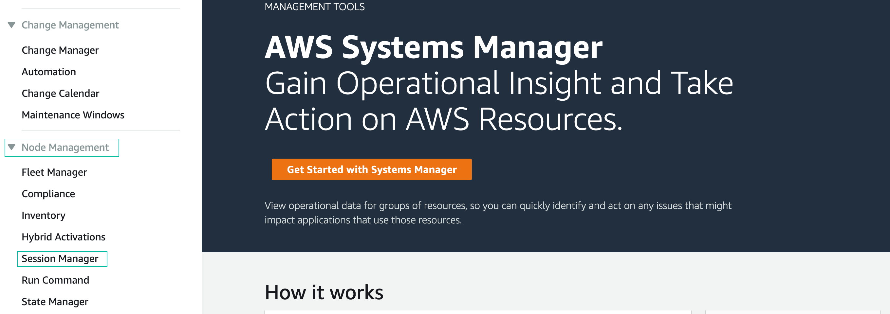

3. Click **Start session** and select the EC2 instance named **`Test-Gateway-Endpoint`**.

> [!NOTE]
> This EC2 instance runs in an isolated private subnet of `VPC Cloud` with zero public IP addresses and no Internet Gateway. The interactive terminal functions entirely over private Systems Manager interface endpoints.

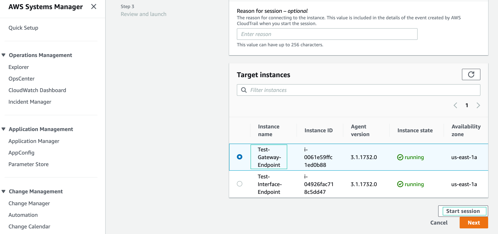

4. A new browser tab opens with the shell prompt: `sh-4.2$` (or `ssm-user@ip-10-0-x-x`).

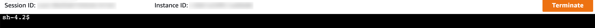

---

#### 3. Generate 1GB Test Payload and Upload via AWS CLI

1. Switch to the `ssm-user` home directory:
   ```bash
   cd ~
   pwd
   ```

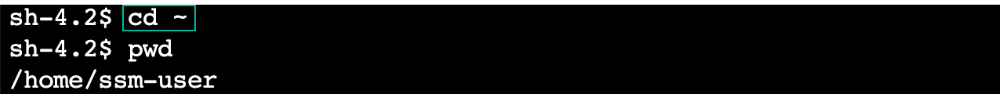

2. Generate a 1GB test file using the `fallocate` utility:
   ```bash
   fallocate -l 1G testfile.xyz
   ls -lh testfile.xyz
   ```

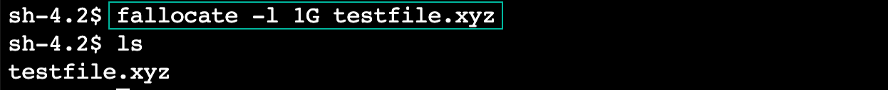

3. Upload the payload to the S3 bucket via AWS CLI (replace `<your-bucket-name>` with your actual bucket name):
   ```bash
   aws s3 cp testfile.xyz s3://<your-bucket-name>
   ```

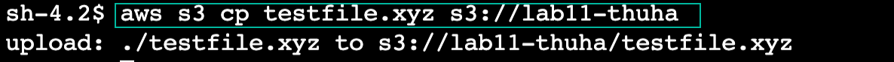

The upload finishes rapidly over the AWS internal software-defined network.

---

#### 4. Confirm Upload in S3 Console

1. Return to the Amazon S3 Console and click your bucket name.
2. Under the **Objects** tab, verify that `testfile.xyz` (1.0 GB) is stored successfully.

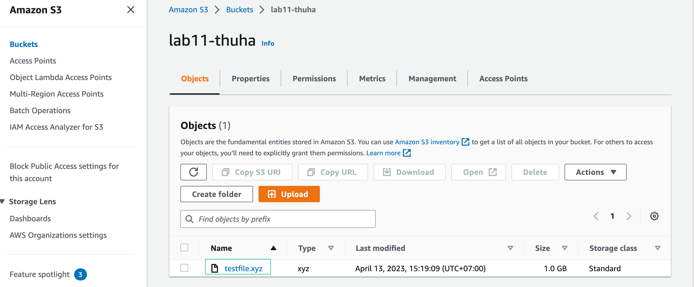

---

#### 5. Technical Validation Summary

The successful 1GB file transmission validates that VPC Cloud routes traffic to Amazon S3 strictly over the private AWS backbone via the **Gateway VPC Endpoint (`s3-gwe`)**. No NAT Gateway or Internet Gateway is traversed, ensuring maximum throughput, zero egress data charges across the public internet, and robust network isolation.
