#### 1. Khởi tạo Amazon S3 Bucket

1. Mở [Amazon S3 Console](https://s3.console.aws.amazon.com/s3/home?region=us-east-1).
2. Nhấp chọn **Create bucket**.

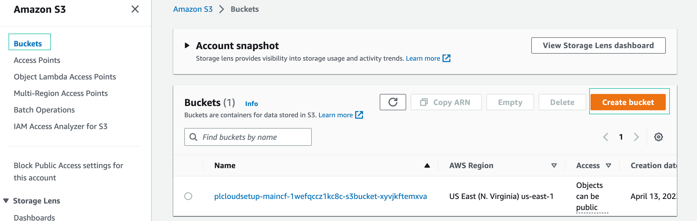

3. Cấu hình Bucket:
   - **Bucket name:** Đặt tên duy nhất trên toàn cầu (Ví dụ: `fcj-hybrid-s3-test-<your-name>`).
   - **AWS Region:** `us-east-1` (US East - N. Virginia).

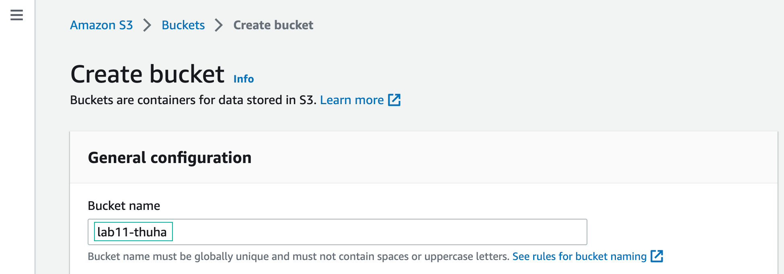

4. Giữ nguyên tất cả các tùy chọn bảo mật mặc định (Block all public access bật). Cuộn xuống cuối trang và nhấp **Create bucket**.

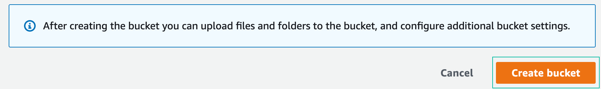    

5. Xác nhận S3 bucket được tạo thành công trong danh sách.

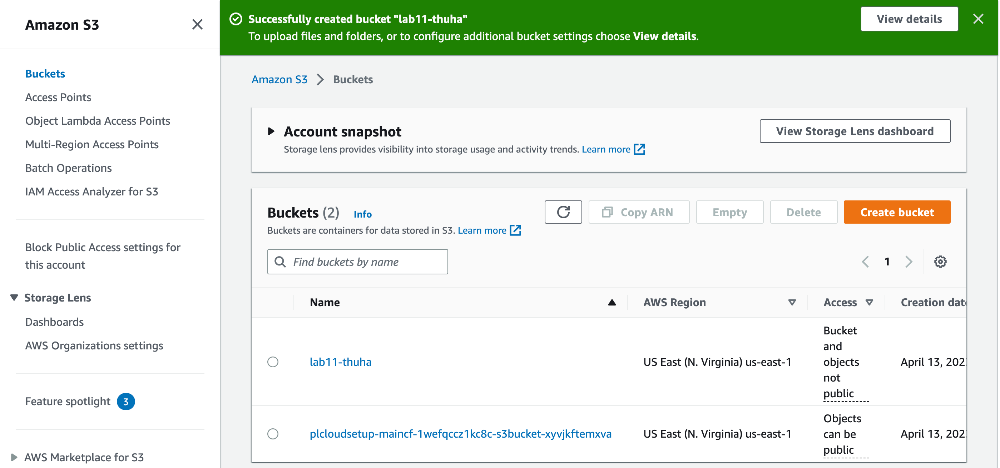

---

#### 2. Kết nối EC2 qua AWS Systems Manager Session Manager

1. Trong ô tìm kiếm trên thanh điều hướng AWS, nhập **Systems Manager** và chọn dịch vụ.

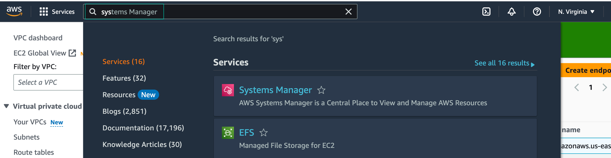

2. Tại thanh điều hướng bên trái, chọn **Node Management** ➔ Nhấp vào **Session Manager**.

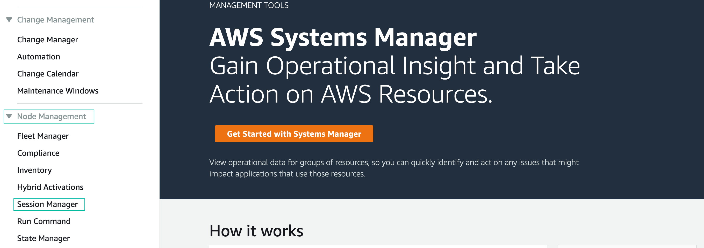

3. Nhấp chọn **Start session** ➔ Chọn máy chủ EC2 mang tên **`Test-Gateway-Endpoint`**.

> [!NOTE]
> Máy chủ này nằm hoàn toàn trong Subnet riêng biệt của `VPC Cloud`, không có Public IP và không có Internet Gateway. Kết nối Session Manager hoạt động hoàn toàn nhờ các Interface Endpoints nội bộ đã được cấu hình từ trước.

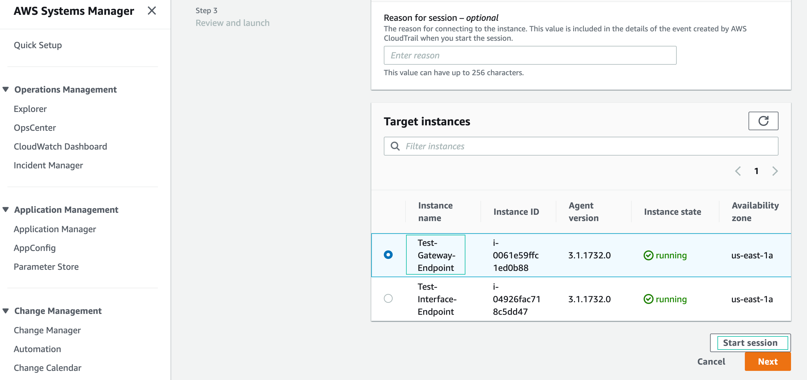

4. Trình duyệt mở tab terminal mới với dấu nhắc lệnh: `sh-4.2$` (hoặc `ssm-user@ip-10-0-x-x`).

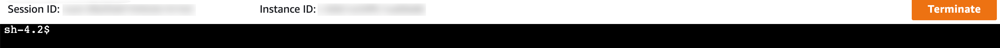

---

#### 3. Tạo Tệp Dữ liệu 1GB và Tải lên Amazon S3

1. Chuyển về thư mục người dùng `ssm-user`:
   ```bash
   cd ~
   pwd
   ```

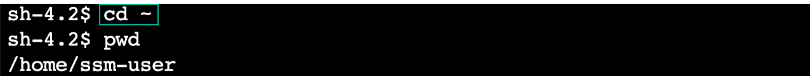

2. Khởi tạo một tệp dữ liệu thử nghiệm có dung lượng 1GB bằng tiện ích `fallocate`:
   ```bash
   fallocate -l 1G testfile.xyz
   ls -lh testfile.xyz
   ```

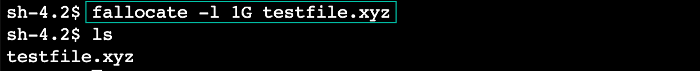

3. Tải tệp lên S3 Bucket thông qua AWS CLI (Thay thế `<your-bucket-name>` bằng tên bucket bạn vừa tạo):
   ```bash
   aws s3 cp testfile.xyz s3://<your-bucket-name>
   ```


Quá trình upload thành công với tốc độ cao qua hạ tầng mạng nội bộ AWS.

---

#### 4. Xác nhận Dữ liệu trên S3 Console

1. Quay lại giao diện quản trị Amazon S3 Console và nhấp vào tên bucket.
2. Kiểm tra danh sách Objects: Tệp `testfile.xyz` (kích thước 1.0 GB) đã xuất hiện đầy đủ trong bucket.

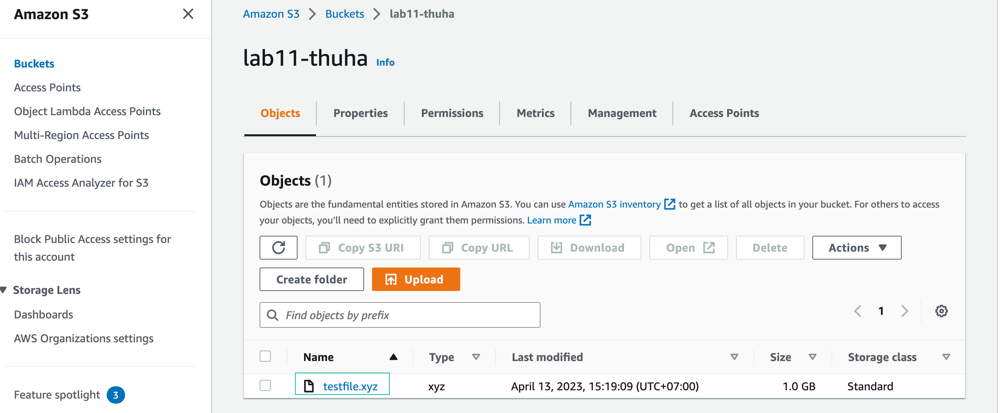

---

#### 5. Kết luận Kỹ thuật

Thao tác tải tệp 1GB từ EC2 `Test-Gateway-Endpoint` lên Amazon S3 thành công mà không cần gắn Internet Gateway vào `VPC Cloud`. Điều này chứng minh bảng định tuyến VPC đã bắt trọn gói tin có đích đến là dải địa chỉ S3 và đẩy thẳng qua **Gateway VPC Endpoint (`s3-gwe`)**, đảm bảo băng thông cao và an toàn tuyệt đối trước các nguy cơ tấn công từ mạng công cộng.
