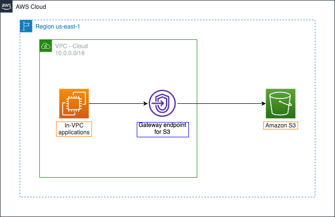

#### Technical Objective

This section covers configuring an Amazon S3 **Gateway VPC Endpoint** within **VPC Cloud**. 

The Gateway Endpoint modifies the VPC Route Table by inserting a managed prefix list target for `com.amazonaws.us-east-1.s3`. Traffic destined for S3 routes directly over the AWS private network backbone, bypassing the Internet Gateway entirely and eliminating NAT Gateway data processing fees.

#### Execution Steps:

1. [5.3.1 Create Gateway Endpoint](5.3.1-create-gwe/) — Select VPC Cloud, target the S3 gateway service, and associate private subnet route tables.
2. [5.3.2 Validate Payload Transfer via AWS Systems Manager](5.3.2-test-gwe/) — Create an S3 Bucket, establish an SSM Session Manager shell, generate a 1GB test payload, and upload it strictly via private routing.
