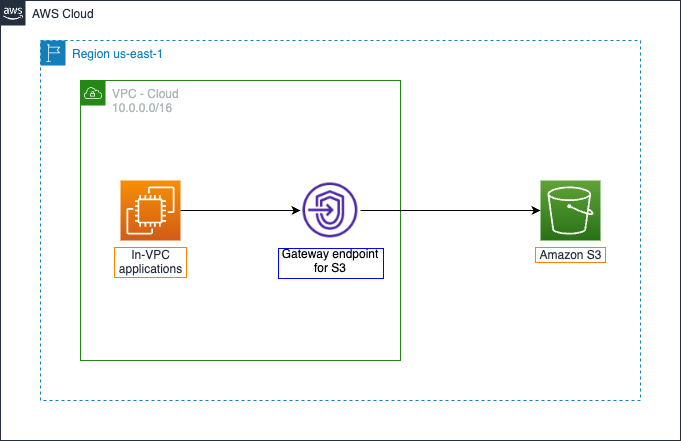

#### Mục tiêu Kỹ thuật

Trong phần này, chúng ta tiến hành khởi tạo và cấu hình một **Gateway VPC Endpoint** dành cho Amazon S3 trên **VPC Cloud**. 

Cơ chế này cập nhật bảng định tuyến (Route Table) của VPC để tự động chuyển tiếp tất cả các gói tin có địa chỉ đích thuộc dải IP công khai của dịch vụ Amazon S3 (`com.amazonaws.us-east-1.s3`) trực tiếp qua Gateway Endpoint nội bộ mà không cần đi qua Internet Gateway hay tiêu tốn băng thông NAT Gateway.

#### Các bước triển khai:

1. [5.3.1 Khởi tạo Gateway Endpoint](5.3.1-create-gwe/) — Chỉ định VPC Cloud, dịch vụ S3 và liên kết bảng định tuyến Subnet.
2. [5.3.2 Kiểm thử truyền tải dữ liệu qua AWS Systems Manager](5.3.2-test-gwe/) — Khởi tạo S3 Bucket, kết nối máy ảo qua Session Manager và tải tệp 1GB lên S3 qua mạng nội bộ.
