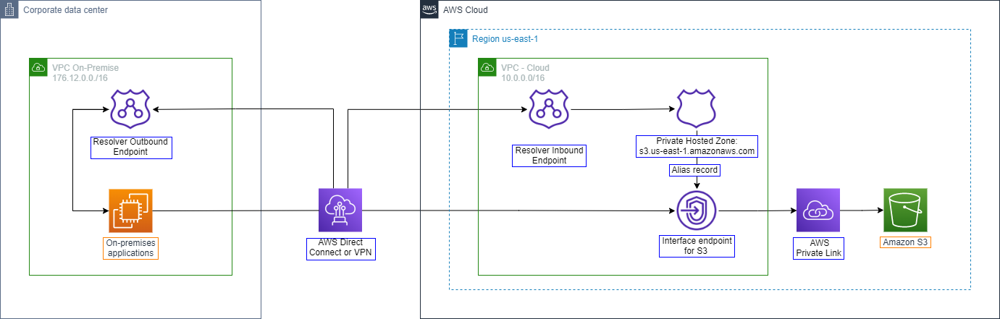
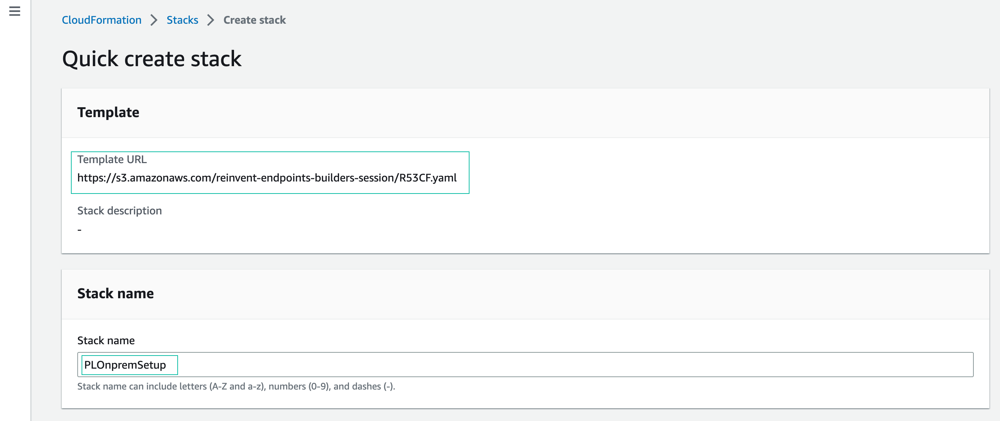
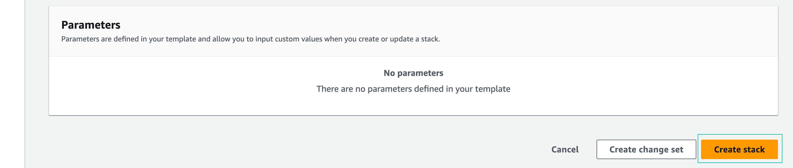
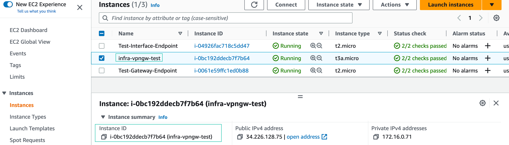
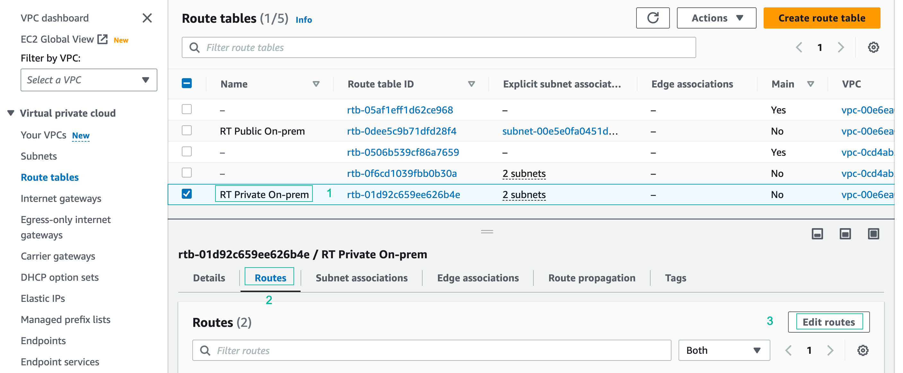

#### Preparation Objectives

This phase establishes the foundational routing and DNS components required for hybrid communication:
1. Deploy a CloudFormation stack provisioning Route 53 Resolver endpoints (Inbound/Outbound) and a Private Hosted Zone.
2. Update the `VPC On-Prem` route table to forward all cloud-bound packets through the StrongSwan IPsec VPN gateway.

---

#### 1. Deploy CloudFormation Stack (Route 53 Resolver Infrastructure)

The CloudFormation template provisions the advanced DNS architecture:
- **Route 53 Private Hosted Zone:** Hosts alias records pointing to the S3 PrivateLink Interface Endpoint.
- **Route 53 Inbound Resolver Endpoint:** Deployed in `VPC Cloud` to receive and process DNS resolution requests originating from on-premises.
- **Route 53 Outbound Resolver Endpoint:** Deployed in `VPC On-Prem` to forward S3 queries to the Cloud Inbound endpoint.

1. Open the [AWS CloudFormation Stack Launch Link](https://us-east-1.console.aws.amazon.com/cloudformation/home?region=us-east-1#/stacks/quickcreate?templateURL=https://s3.amazonaws.com/reinvent-endpoints-builders-session/R53CF.yaml&stackName=PLOnpremSetup).
2. Accept the pre-filled template parameters and click **Create stack**.

> [!TIP]
> Stack provisioning takes approximately 3-5 minutes. You can proceed directly to configuring the routing table below while CloudFormation runs in the background.

---

#### 2. Update On-Premises Route Table Target to VPN Gateway

The simulated on-premises network routes traffic destined for AWS through an EC2 instance running StrongSwan IPsec VPN named `infra-vpngw-test`. We must explicitly add a static route directing `10.0.0.0/16` traffic to this instance network interface.

1. Open the [Amazon EC2 Management Console](https://us-east-1.console.aws.amazon.com/ec2/home?region=us-east-1#Instances:).
2. Select the instance named **`infra-vpngw-test`**. In the **Details** pane, copy the **Instance ID** (e.g., `i-0123456789abcdef0`).

3. Navigate to the **VPC Console** ➔ Select **Route Tables**.
4. Select the route table named **`RT Private On-prem`** ➔ Click the **Routes** tab ➔ Click **Edit routes**.

5. Click **Add route**:
   - **Destination:** Enter the Cloud VPC CIDR: `10.0.0.0/16`
   - **Target:** Choose **Instance** and select the `infra-vpngw-test` instance ID copied earlier.
6. Click **Save changes**.

The simulated on-premises routing table is now configured to tunnel AWS-bound packets through the VPN gateway.
