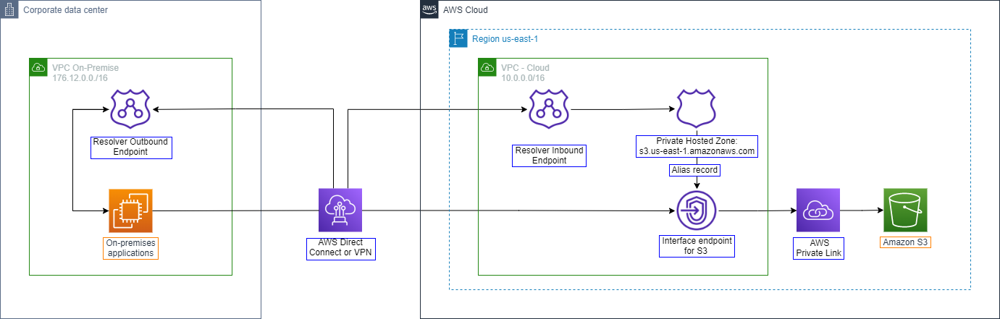
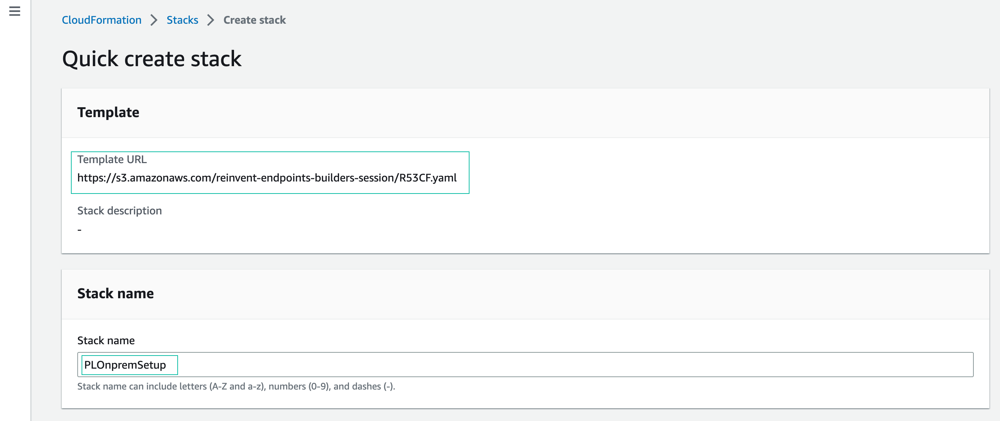
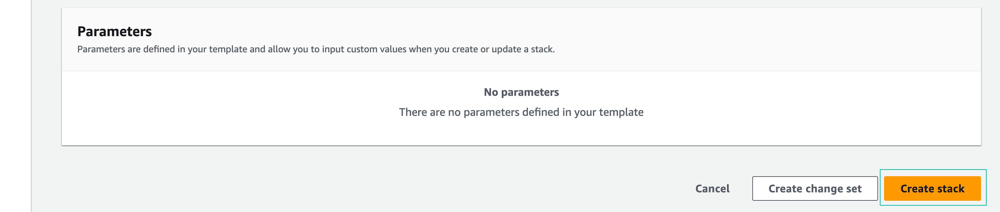
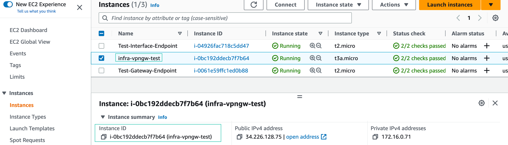
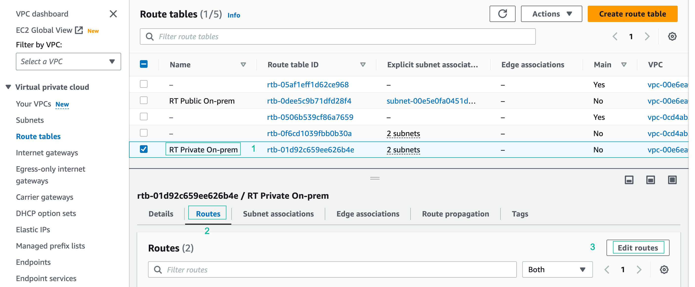

#### Mục tiêu chuẩn bị

Phần này hoàn thiện hạ tầng mạng để sẵn sàng cho mô hình kết nối Hybrid:
1. Triển khai CloudFormation Stack bổ sung các thành phần Route 53 Resolver (Inbound/Outbound Endpoints và Private Hosted Zone).
2. Cập nhật bảng định tuyến cho `VPC On-Prem` để chuyển tiếp gói tin tới `VPC Cloud` qua máy chủ VPN StrongSwan.

---

#### 1. Triển khai CloudFormation Stack (Hạ tầng DNS Route 53)

Mẫu CloudFormation khởi tạo các tài nguyên phân giải DNS nâng cao:
- **Route 53 Private Hosted Zone:** Lưu trữ các bản ghi Alias chỉ định tới S3 PrivateLink Interface Endpoint.
- **Route 53 Inbound Resolver Endpoint:** Đặt trong `VPC Cloud` để tiếp nhận và phân giải các truy vấn DNS gửi từ On-Premises.
- **Route 53 Outbound Resolver Endpoint:** Đặt trong `VPC On-Prem` để chuyển tiếp các truy vấn DNS miền S3 sang Inbound Endpoint của Cloud.

1. Mở liên kết triển khai [AWS CloudFormation Stack](https://us-east-1.console.aws.amazon.com/cloudformation/home?region=us-east-1#/stacks/quickcreate?templateURL=https://s3.amazonaws.com/reinvent-endpoints-builders-session/R53CF.yaml&stackName=PLOnpremSetup). Mẫu cấu hình đã được điền sẵn thông số.
2. Giữ nguyên các thiết lập mặc định và nhấp **Create stack**.

> [!TIP]
> Quá trình tạo stack mất khoảng 3 - 5 phút. Bạn có thể tiến hành cấu hình bảng định tuyến ở bước dưới đây mà không cần đợi stack hoàn tất.

---

#### 2. Cập nhật Bảng định tuyến On-Premises trỏ về VPN Gateway

Hệ thống sử dụng một máy ảo EC2 cài đặt phần mềm StrongSwan IPsec VPN mang tên `infra-vpngw-test` để thiết lập kết nối giữa trung tâm dữ liệu On-Premises và AWS Transit Gateway. Cần điều hướng toàn bộ lưu lượng hướng tới dải mạng `VPC Cloud` (`10.0.0.0/16`) đi qua máy ảo VPN này.

1. Mở [Amazon EC2 Console](https://us-east-1.console.aws.amazon.com/ec2/home?region=us-east-1#Instances:).
2. Chọn instance mang tên **`infra-vpngw-test`**. Tại tab **Details**, sao chép **Instance ID** (Ví dụ: `i-0123456789abcdef0`).

3. Điều hướng tới **VPC Management Console** ➔ Chọn mục **Route Tables**.
4. Chọn bảng định tuyến mang tên **`RT Private On-prem`** ➔ Chọn tab **Routes** ➔ Nhấp **Edit routes**.

5. Nhấp **Add route**:
   - **Destination:** Nhập CIDR của Cloud VPC: `10.0.0.0/16`
   - **Target:** Chọn **Instance** và chọn ID máy ảo `infra-vpngw-test` đã lưu ở bước trên.
6. Nhấp **Save changes**.

Bảng định tuyến On-Premises đã được liên kết thành công để truyền lưu lượng an toàn qua kênh VPN.
