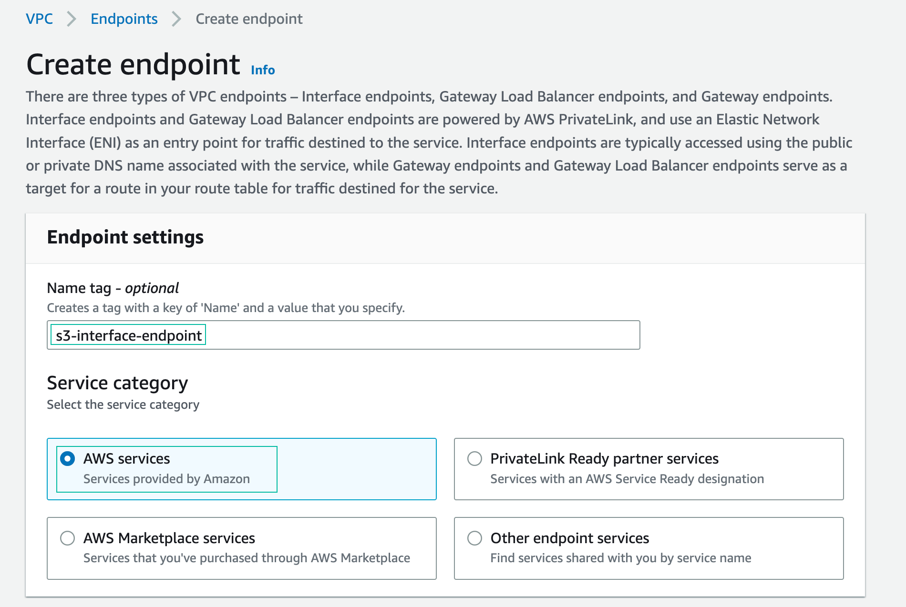
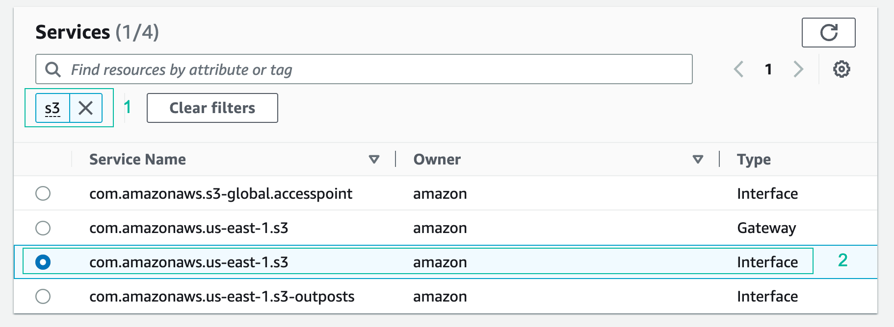
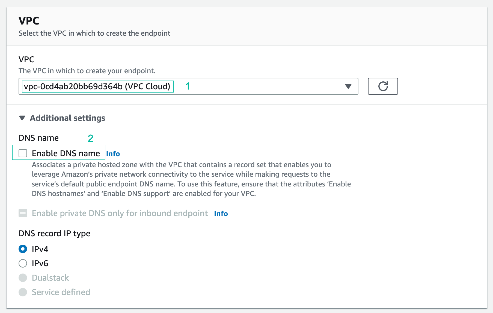
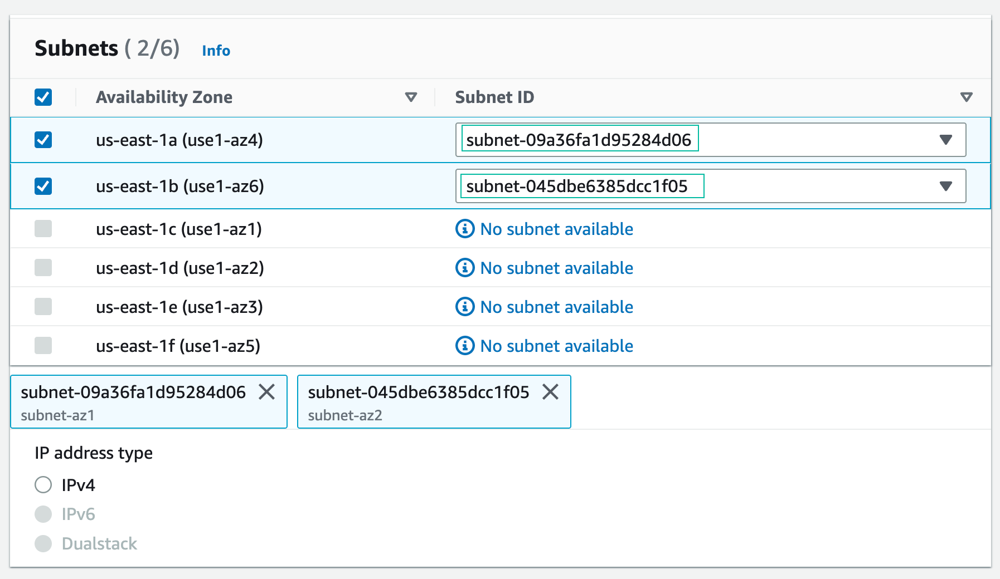
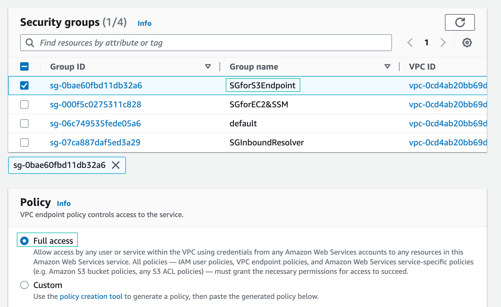
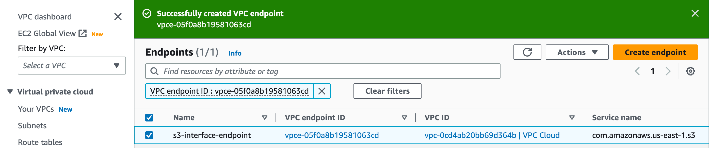

#### Step-by-Step Procedure:

1. Open the [Amazon VPC Management Console](https://us-east-1.console.aws.amazon.com/vpc/home?region=us-east-1#Home:) in region `us-east-1` (N. Virginia).
2. In the left navigation pane, select **Endpoints** and click **Create endpoint**.

3. Configure Endpoint Identity:
   - **Name tag:** Enter `s3-interface-endpoint`
   - **Service category:** Select **AWS services**

4. Service Selection:
   - In the **Services** search filter, type `s3` and hit Enter.
   - Select service: `com.amazonaws.us-east-1.s3`
   - **Verify the Type column:** Ensure the selected row indicates **Interface**.

5. Network Association:
   - **VPC:** Select **VPC Cloud** from the dropdown menu.

> [!WARNING]
> Verify you select **VPC Cloud**. Do not attach this interface endpoint to `VPC On-prem`.

   - Expand **Additional settings**: Ensure **Enable DNS name** is **UNCHECKED** (we will simulate custom corporate DNS routing in step 5.4.4).

6. Subnet Placement (Multi-AZ):
   - Select 2 private subnets across two distinct Availability Zones: **`us-east-1a`** and **`us-east-1b`** for fault tolerance.

7. Security Group Association:
   - Select Security Group: **`SGforS3Endpoint`** (configured to permit inbound HTTPS port 443 from internal network CIDRs).

8. Finalize Provisioning:
   - Retain default policy: **Full access**.
   - Click **Create endpoint**.

The console confirms endpoint creation. Wait approximately 1-2 minutes until status becomes **Available**.
