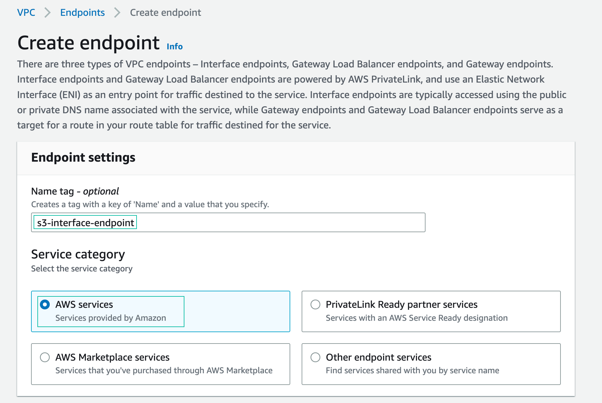
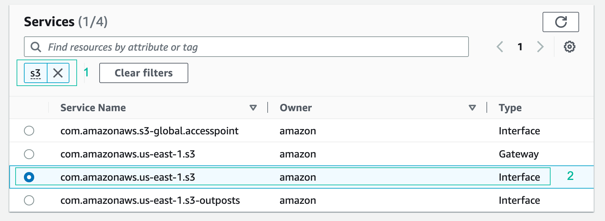
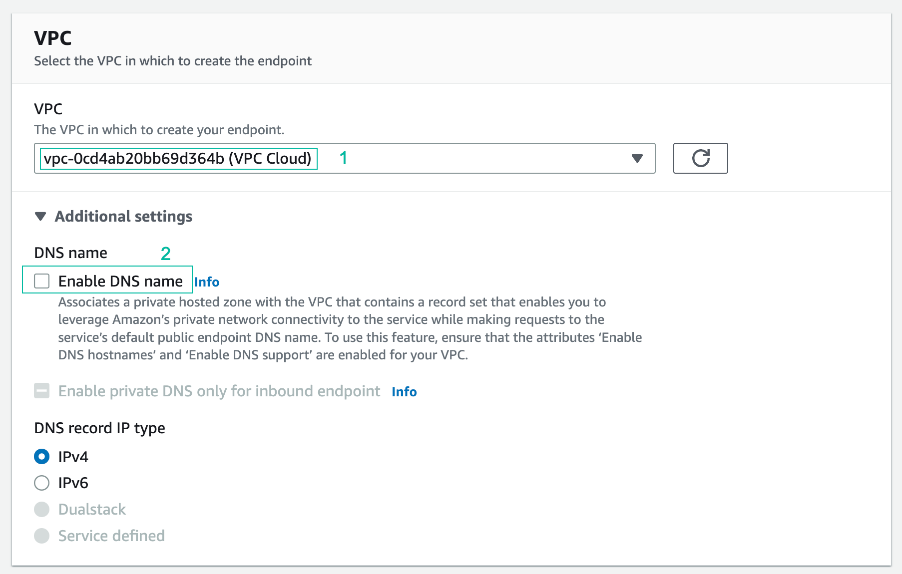
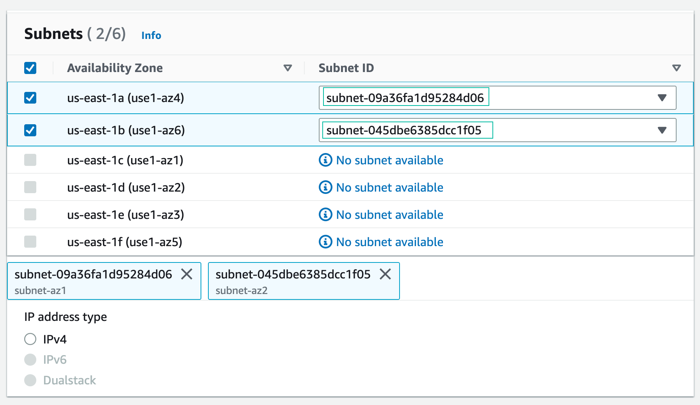
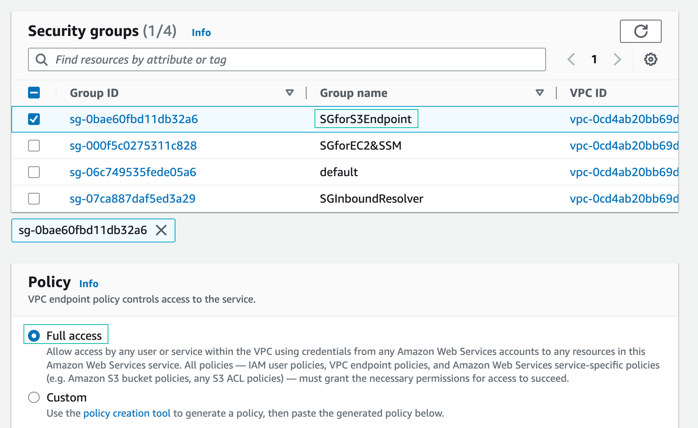
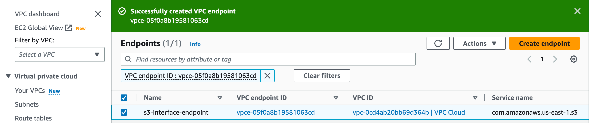

#### Các bước triển khai:

1. Mở [Amazon VPC Console](https://us-east-1.console.aws.amazon.com/vpc/home?region=us-east-1#Home:) tại Region `us-east-1` (N. Virginia).
2. Tại thanh điều hướng bên trái, chọn **Endpoints** ➔ Nhấp **Create endpoint**.

3. Cấu hình định danh Endpoint:
   - **Name tag:** Đặt tên `s3-interface-endpoint`
   - **Service category:** Chọn **AWS services**

4. Tìm kiếm dịch vụ:
   - Trong ô tìm kiếm **Services**, nhập `s3` và nhấn Enter.
   - Chọn service: `com.amazonaws.us-east-1.s3`
   - **Xác nhận cột Type:** Phải hiển thị giá trị **Interface** (không chọn nhầm Gateway).

5. Cấu hình mạng VPC & Subnet:
   - **VPC:** Chọn **VPC Cloud** từ danh sách thả xuống.

> [!WARNING]
> Lưu ý chọn chính xác **VPC Cloud** (nơi đặt dịch vụ đám mây), tuyệt đối không chọn nhầm sang `VPC On-prem`.

   - Mở rộng mục **Additional settings**: Đảm bảo tùy chọn **Enable DNS name** **CHƯA ĐƯỢC CHỌN** (chúng ta sẽ cấu hình DNS tùy biến qua Route 53 Resolver ở mục 5.4.4).

6. Phân bổ Subnet theo Availability Zones:
   - Tích chọn 2 Subnet thuộc 2 AZs độc lập: **`us-east-1a`** và **`us-east-1b`** để đảm bảo khả năng dự phòng lỗi cao (High Availability).

7. Gán Nhóm bảo mật (Security Group):
   - Chọn Security Group: **`SGforS3Endpoint`** (đã được cấu hình mở cổng HTTPS 443 cho dải mạng nội bộ).

8. Chính sách truy cập & Hoàn tất:
   - Giữ nguyên thiết lập mặc định: **Full access**.
   - Nhấp **Create endpoint**.

Giao diện thông báo Endpoint được khởi tạo thành công. Sau khoảng 1-2 phút, trạng thái sẽ chuyển sang **Available**.
