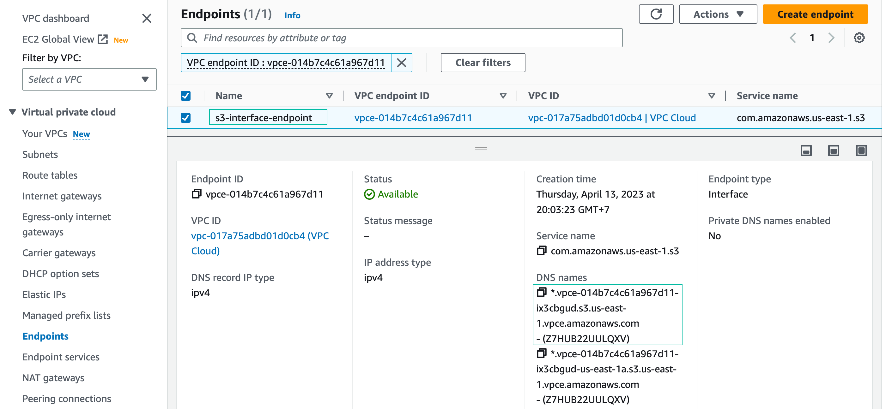
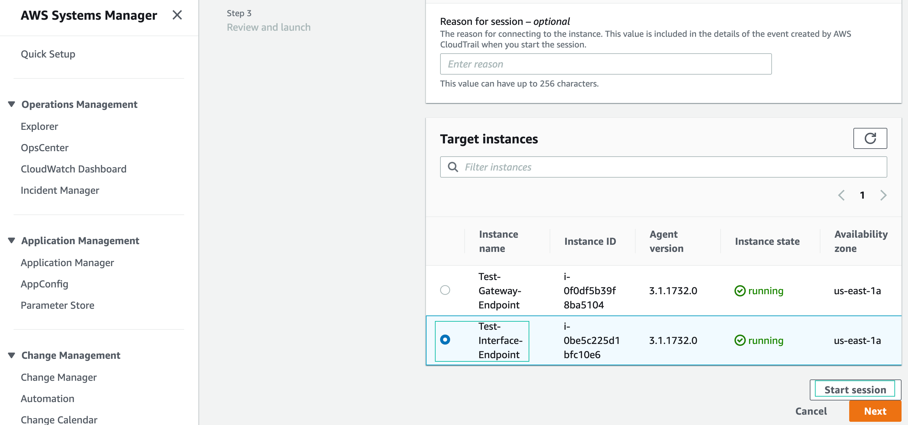
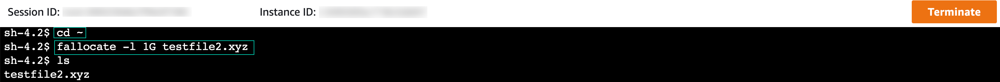
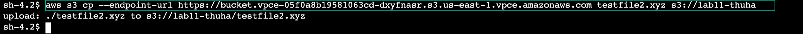
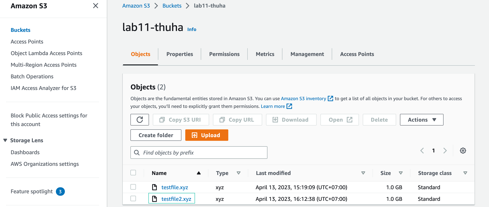

#### 1. Retrieve the Regional DNS Name of the S3 Interface Endpoint

1. In the **Amazon VPC Management Console**, select **Endpoints**.
2. Select the interface endpoint created in section 5.4.2: **`s3-interface-endpoint`** ➔ View the **Details** tab.
3. Locate the **DNS names** section and copy the **Regional DNS name** (the top record formatted as `vpce-xxxx-xxxx.s3.us-east-1.vpce.amazonaws.com`) into your local text editor.



---

#### 2. Establish Session Manager Shell to Simulated On-Premises Host

1. Navigate to **AWS Systems Manager Console** ➔ Select **Session Manager** ➔ Click **Start session**.
2. Select the instance named **`Test-Interface-Endpoint`**.
   - This EC2 instance resides in `VPC On-Prem`, simulating an on-premises host connected via VPN.
3. The browser terminal launches with the shell prompt: `sh-4.2$`.



---

#### 3. Generate Test Payload & Transfer via Explicit Endpoint URL

1. Switch to the `ssm-user` directory:
   ```bash
   cd ~
   pwd
   ```

2. Generate a 1GB test file named `testfile2.xyz`:
   ```bash
   fallocate -l 1G testfile2.xyz
   ls -lh testfile2.xyz
   ```



3. Upload the file to S3 using the AWS CLI `--endpoint-url` argument:
   ```bash
   aws s3 cp --endpoint-url https://bucket.<Regional-DNS-Name> testfile2.xyz s3://<your-bucket-name>
   ```

> [!IMPORTANT]
> - Replace `<Regional-DNS-Name>` with the exact string copied in Step 1 (e.g., `vpce-0123456789abcdef0-xxxx.s3.us-east-1.vpce.amazonaws.com`). Do not include wildcard asterisks `*`.
> - Replace `<your-bucket-name>` with your actual target S3 bucket name.
> - The `--endpoint-url` parameter is mandatory at this stage because the on-premises DNS has not yet been configured to conditionally resolve standard S3 domains to the interface endpoint ENI IPs.



The payload transfers successfully over the StrongSwan VPN tunnel into the VPC Interface Endpoint.

---

#### 4. Verify Payload in S3 Management Console

1. Return to the **Amazon S3 Console** and click your bucket name.
2. In the **Objects** tab, verify that `testfile2.xyz` is listed alongside `testfile.xyz`.


