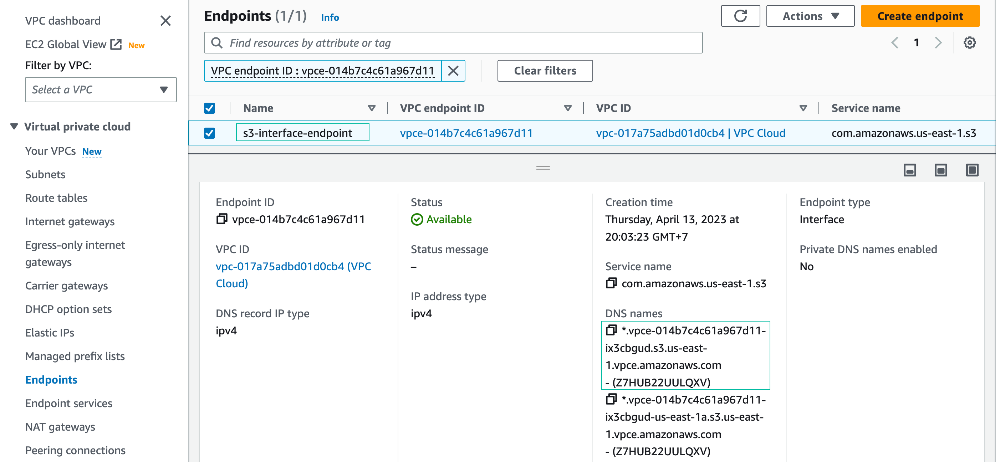
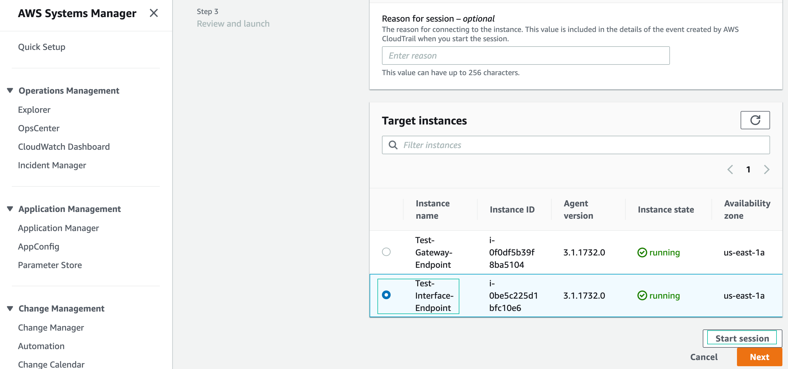
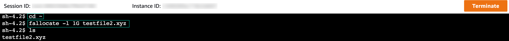
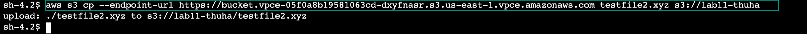
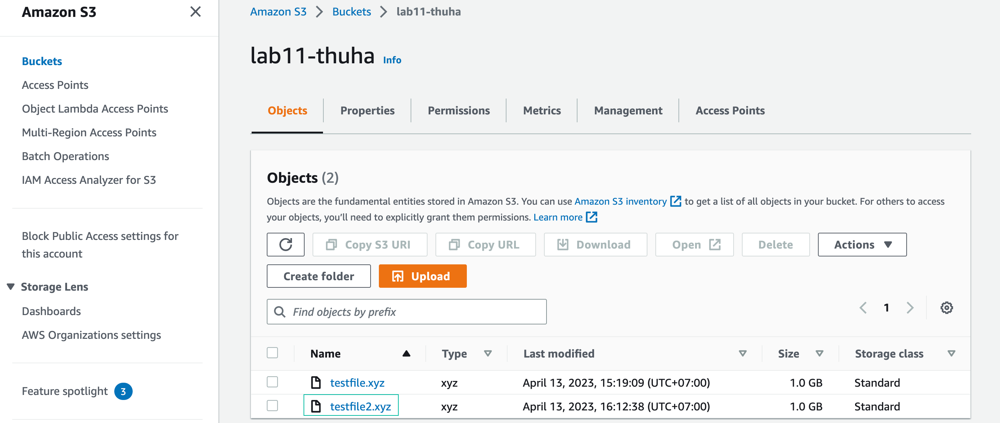

#### 1. Lấy Tên miền Regional DNS Name của Interface Endpoint

1. Trong **Amazon VPC Console**, chọn mục **Endpoints**.
2. Chọn endpoint vừa tạo: **`s3-interface-endpoint`** ➔ Xem tab **Details**.
3. Sao chép giá trị **Regional DNS name** (mục đầu tiên trong danh sách DNS names, có định dạng `vpce-xxxx-xxxx.s3.us-east-1.vpce.amazonaws.com`) và lưu lại vào trình soạn thảo.



---

#### 2. Kết nối tới Máy chủ On-Premises qua AWS Session Manager

1. Mở **AWS Systems Manager Console** ➔ Chọn **Session Manager** ➔ Nhấp **Start session**.
2. Chọn máy chủ EC2 mang tên **`Test-Interface-Endpoint`**. 
   - Máy chủ này đặt tại `VPC On-Prem`, đại diện cho máy chủ ứng dụng đặt tại trung tâm dữ liệu On-Premises của doanh nghiệp.
3. Trình duyệt mở tab terminal mới với dấu nhắc lệnh: `sh-4.2$`.



---

#### 3. Khởi tạo Tệp Dữ liệu và Truyền tải qua Tham số `--endpoint-url`

1. Chuyển về thư mục người dùng `ssm-user`:
   ```bash
   cd ~
   pwd
   ```

2. Tạo tệp kiểm thử 1GB mang tên `testfile2.xyz`:
   ```bash
   fallocate -l 1G testfile2.xyz
   ls -lh testfile2.xyz
   ```



3. Tải tệp lên S3 Bucket thông qua Interface Endpoint (AWS PrivateLink):
   ```bash
   aws s3 cp --endpoint-url https://bucket.<Regional-DNS-Name> testfile2.xyz s3://<your-bucket-name>
   ```

> [!IMPORTANT]
> - Thay thế `<Regional-DNS-Name>` bằng giá trị đã lưu ở Bước 1 (Ví dụ: `vpce-0123456789abcdef0-xxxx.s3.us-east-1.vpce.amazonaws.com`). Lưu ý không lấy ký tự `*` nếu có.
> - Thay thế `<your-bucket-name>` bằng tên bucket S3 bạn đã khởi tạo.
> - Tham số `--endpoint-url` bắt buộc phải có vì máy chủ On-Premises chưa được cấu hình phân giải tên miền tự động, nên cần chỉ định endpoint URL cụ thể để gói tin định tuyến qua ENI PrivateLink.



Tệp dữ liệu 1GB được truyền tải thành công qua đường hầm IPsec VPN và đẩy lên S3 qua Interface Endpoint nội bộ.

---

#### 4. Xác nhận Dữ liệu trên S3 Console

1. Mở lại **Amazon S3 Console** ➔ Nhấp vào tên bucket của bạn.
2. Tại danh sách Objects: Xác nhận tệp `testfile2.xyz` đã xuất hiện đầy đủ bên cạnh `testfile.xyz`.


