#### Hybrid DNS Architecture Objectives

AWS PrivateLink Interface Endpoints allocate static private IP addresses (ENIs) across selected Availability Zones. Requiring application workloads to pass an explicit `--endpoint-url` argument is cumbersome and lacks automated failover if an ENI becomes unreachable.

The enterprise architecture solution pairs **Amazon Route 53 Private Hosted Zones** with **Route 53 Resolver Conditional Forwarding Rules**:
- **On-Premises DNS Server:** Forwards queries for `s3.us-east-1.amazonaws.com` across the VPN to a Route 53 Inbound Resolver Endpoint in the VPC.
- **Route 53 Private Hosted Zone:** Resolves the query to the private IP addresses of the S3 Interface Endpoint.
- On-premises applications can use default AWS CLI commands and SDK clients **without specifying custom `--endpoint-url` parameters**.

---

#### 1. Create DNS Alias Records in Private Hosted Zone

1. Open the [Route 53 Hosted Zones Console](https://us-east-1.console.aws.amazon.com/route53/v2/hostedzones?region=us-east-1#).
2. Select the Private Hosted Zone named **`s3.us-east-1.amazonaws.com`** (provisioned earlier via CloudFormation).

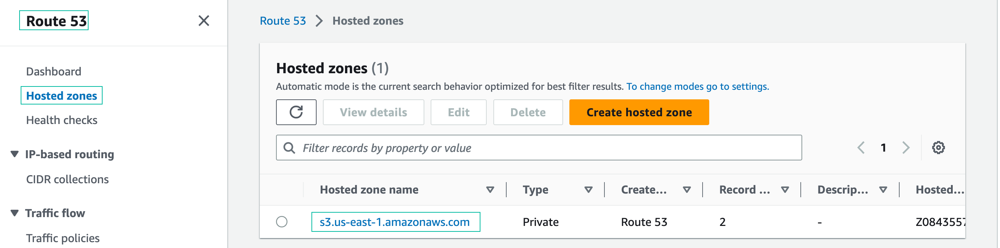

3. Create the Apex Alias Record:
   - Click **Create record**.
   - **Record name:** Leave blank (targets the zone apex `s3.us-east-1.amazonaws.com`).
   - **Record type:** `A - Routes traffic to an IPv4 address and some AWS resources`.
   - **Alias toggle:** Set to **Enabled**.
   - **Route traffic to:** Select **Alias to VPC Endpoint**.
   - **Region:** `US East (N. Virginia) [us-east-1]`.
   - **Choose endpoint:** Paste the **Regional VPC Endpoint DNS** copied in step 5.4.3.

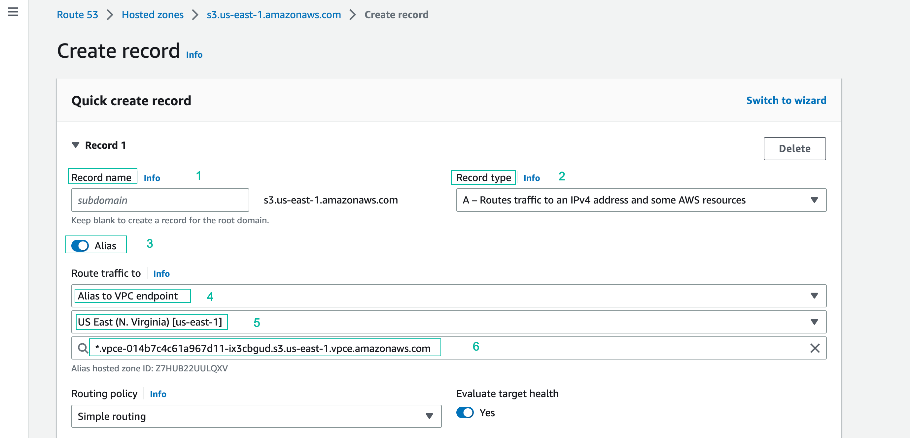

4. Create the Wildcard Alias Record:
   - Click **Add another record**.
   - **Record name:** Enter `*` (enables virtual-hosted-style bucket requests: `*.s3.us-east-1.amazonaws.com`).
   - **Record type:** `A`
   - **Alias toggle:** **Enabled** ➔ **Alias to VPC Endpoint** ➔ Region `us-east-1` ➔ Paste Regional VPC Endpoint DNS.
   - Click **Create records**.

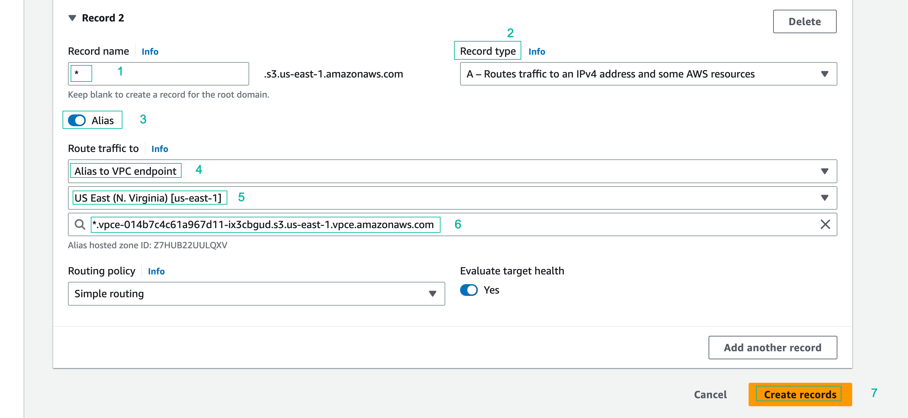

Both records are now populated in the Private Hosted Zone.

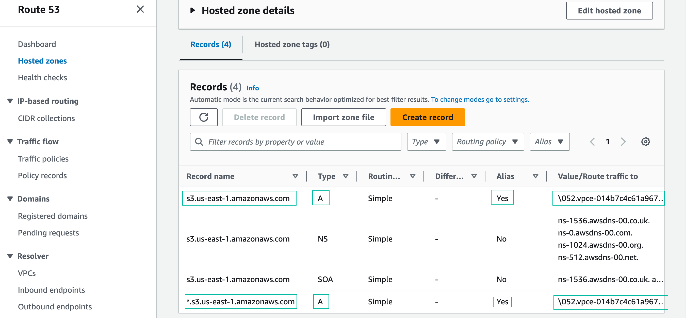

---

#### 2. Configure Route 53 Resolver Forwarding Rule

Configure a forwarding rule so queries from `VPC On-Prem` resolve against the `VPC Cloud` Inbound Endpoint:

1. In the Route 53 left navigation pane, select **Inbound endpoints**.
2. Click the Inbound Endpoint and copy both assigned IPv4 addresses (e.g., `10.0.1.x` and `10.0.2.x`).

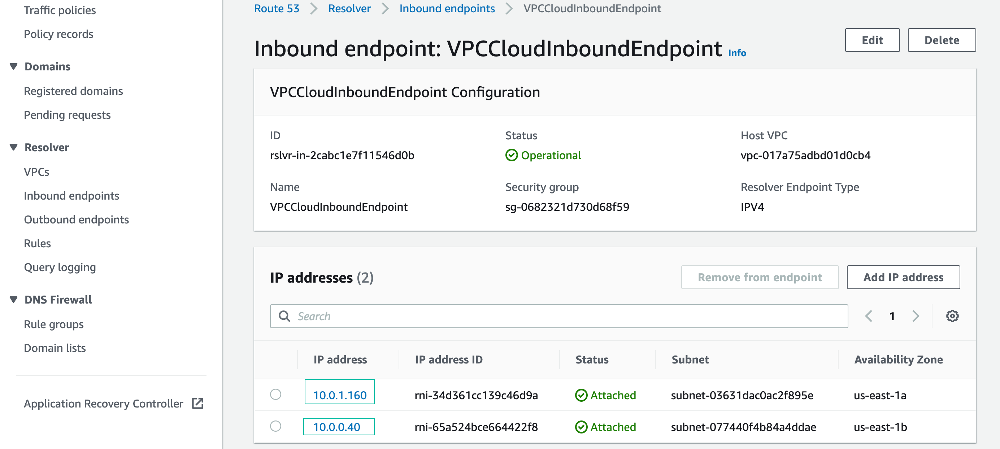

3. In the navigation pane, select **Resolver** ➔ **Rules** ➔ Click **Create rule**.

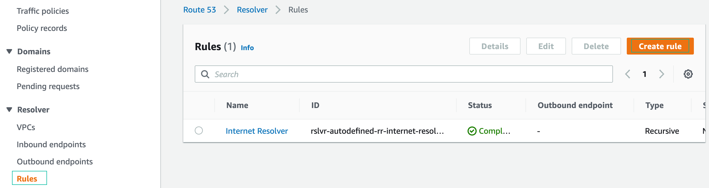

4. Configure Rule Parameters:
   - **Name:** `myS3Rule`
   - **Rule type:** **Forward**
   - **Domain name:** `s3.us-east-1.amazonaws.com`

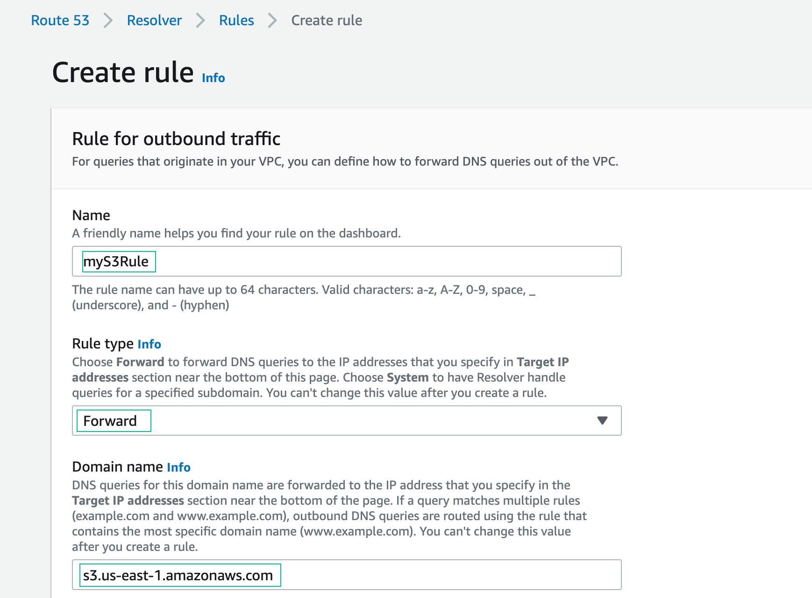

   - **VPC:** Select **VPC On-prem**.
   - **Outbound endpoint:** Select `VPCOnpremOutboundEndpoint`.

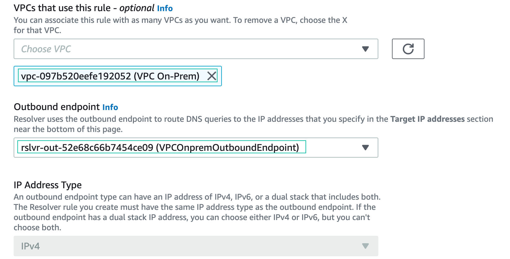

   - **Target IP addresses:** Add both Inbound Endpoint IP addresses recorded in Step 2.
   - Click **Submit**.

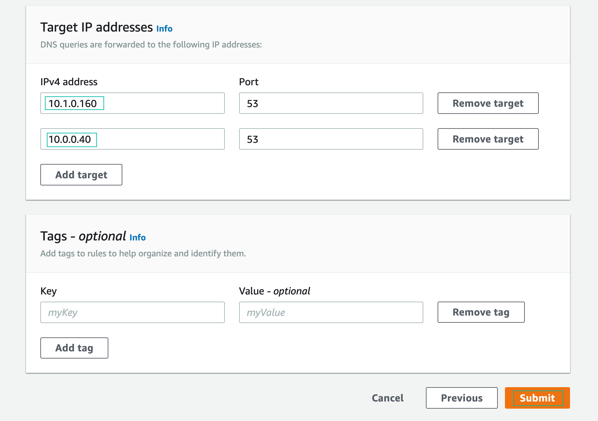

The resolver forwarding rule transitions to status **Complete**.

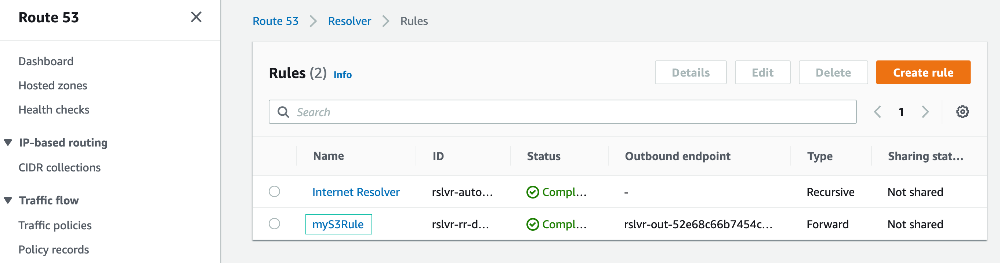

---

#### 3. Validate DNS Resolution from On-Premises Host

1. Reconnect to the **`Test-Interface-Endpoint`** EC2 instance via **Session Manager**.

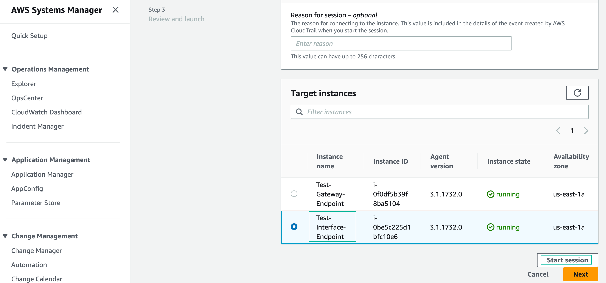

2. Execute DNS lookup using the `dig` command:
   ```bash
   dig +short s3.us-east-1.amazonaws.com
   ```

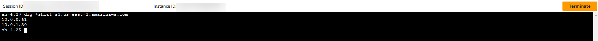

> [!NOTE]
> The DNS query returns the private IP addresses belonging to the `VPC Cloud` interface endpoints (`10.0.x.x`), proving that conditional DNS forwarding functions across the VPN link.

3. Cross-Check with VPC Console: Inspect the **Subnets** tab of `s3-interface-endpoint`; the returned IPs match the assigned ENI private IPs exactly.

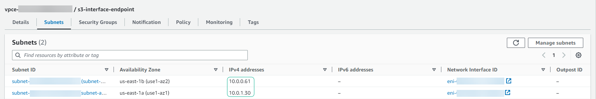

4. Query S3 using standard regional endpoint addressing:
   ```bash
   aws s3 ls --endpoint-url https://s3.us-east-1.amazonaws.com
   ```
   The bucket inventory returns immediately without errors.

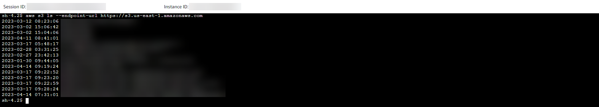

5. Type `exit` to close the terminal session.

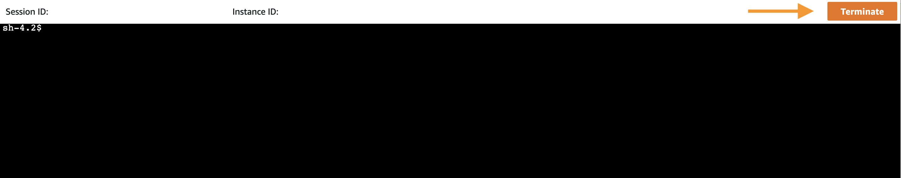

---

#### 4. Engineering Takeaways

Pairing Route 53 Resolver with Private Hosted Zones delivers three architectural benefits:
1. **Application Transparency:** On-premises applications require zero SDK code adjustments or hardcoded endpoint overrides.
2. **Resilience & High Availability:** DNS automatically round-robins across multiple Availability Zone ENIs.
3. **End-to-End Privacy:** 100% of network traffic travels across the IPsec VPN tunnel and AWS private backbone.
