#### Mục tiêu Kiến trúc DNS

AWS PrivateLink Interface Endpoint gán địa chỉ IP Private cố định (ENI) trên từng Availability Zone. Tuy nhiên, việc cấu hình thủ công tham số `--endpoint-url` trong ứng dụng thực tế rất bất tiện và không tự động chuyển đổi dự phòng nếu một ENI gặp sự cố. 

Giải pháp tiêu chuẩn của AWS là thiết lập **Conditional DNS Forwarding** qua **Route 53 Resolver**:
- **On-Premises DNS Server:** Tự động chuyển tiếp (forward) các yêu cầu phân giải miền `s3.us-east-1.amazonaws.com` sang Route 53 Inbound Endpoint.
- **Route 53 Private Hosted Zone:** Trả về danh sách IP Private của Interface Endpoint.
- Ứng dụng phía On-Premises có thể sử dụng các lệnh AWS CLI hoặc SDK tiêu chuẩn mà **không cần truyền thêm cờ `--endpoint-url`**.

---

#### 1. Tạo Bản ghi DNS Alias trên Route 53 Private Hosted Zone

1. Mở [Route 53 Hosted Zones Console](https://us-east-1.console.aws.amazon.com/route53/v2/hostedzones?region=us-east-1#). 
2. Nhấp chọn Private Hosted Zone mang tên: **`s3.us-east-1.amazonaws.com`** (đã được tạo bởi CloudFormation).

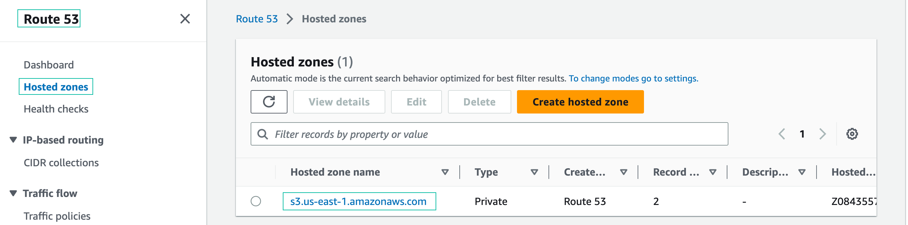

3. Tạo bản ghi Alias Record thứ nhất (Apex Record):
   - Nhấp **Create record**.
   - **Record name:** Để trống (đại diện cho miền gốc `s3.us-east-1.amazonaws.com`).
   - **Record type:** `A - Routes traffic to an IPv4 address and some AWS resources`.
   - **Alias:** Gạt nút sang chế độ **Enabled**.
   - **Route traffic to:** Chọn **Alias to VPC Endpoint**.
   - **Region:** `US East (N. Virginia) [us-east-1]`.
   - **Choose endpoint:** Dán tên **Regional VPC Endpoint DNS** đã sao chép ở mục 5.4.3.

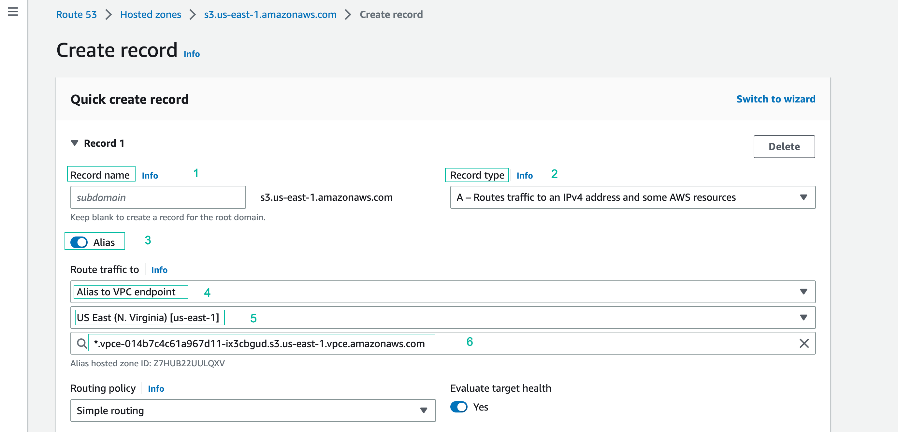

4. Tạo bản ghi Alias Record thứ hai (Wildcard Record):
   - Nhấp **Add another record**.
   - **Record name:** Nhập ký tự đại diện `*` (để hỗ trợ truy cập dạng bucket URL: `*.s3.us-east-1.amazonaws.com`).
   - **Record type:** `A`
   - **Alias:** **Enabled** ➔ **Alias to VPC Endpoint** ➔ Region `us-east-1` ➔ Dán tên Regional VPC Endpoint DNS.
   - Nhấp **Create records**.

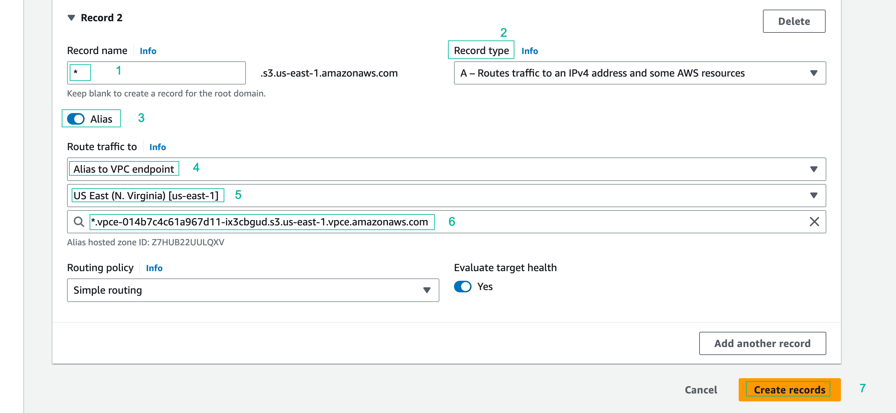

Hai bản ghi Alias xuất hiện hoàn tất trong Hosted Zone.

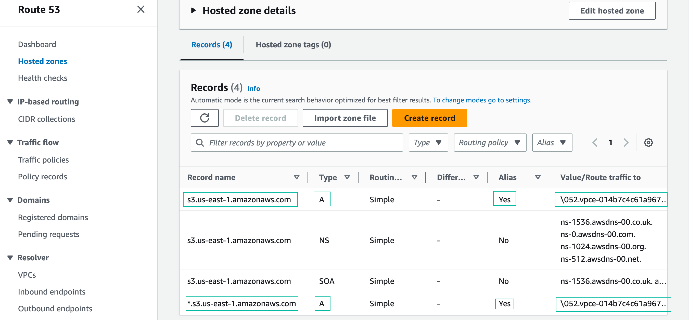

---

#### 2. Cấu hình Route 53 Resolver Forwarding Rule

Thiết lập quy tắc chuyển tiếp DNS để các truy vấn từ `VPC On-Prem` được gửi sang Inbound Endpoint của `VPC Cloud`:

1. Tại thanh điều hướng bên trái Route 53, chọn **Inbound endpoints**.
2. Nhấp vào Inbound Endpoint và sao chép 2 địa chỉ IPv4 hiển thị trong danh sách ENIs (Ví dụ: `10.0.1.x` và `10.0.2.x`).

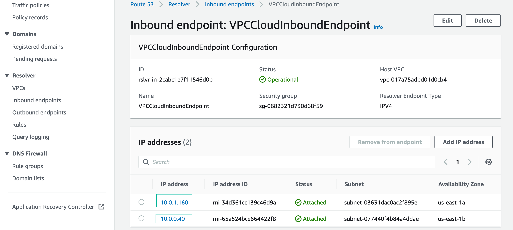

3. Tại thanh điều hướng bên trái, chọn **Resolver** ➔ **Rules** ➔ Nhấp **Create rule**.

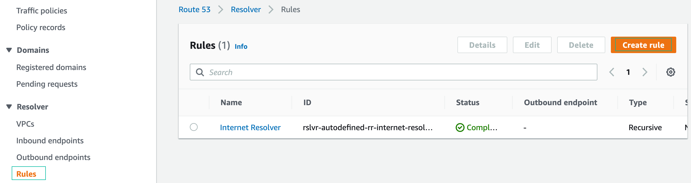

4. Điền thông số Resolver Rule:
   - **Name:** `myS3Rule`
   - **Rule type:** **Forward**
   - **Domain name:** `s3.us-east-1.amazonaws.com`

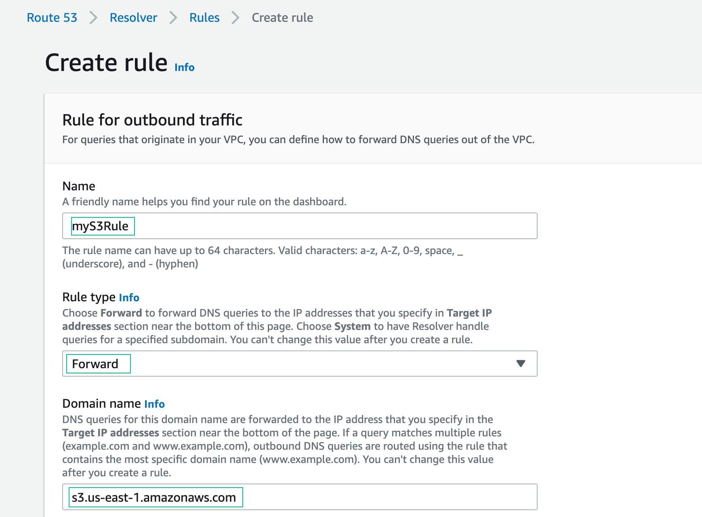

   - **VPC:** Chọn **VPC On-prem** (VPC mô phỏng mạng On-Premises).
   - **Outbound endpoint:** Chọn `VPCOnpremOutboundEndpoint`.

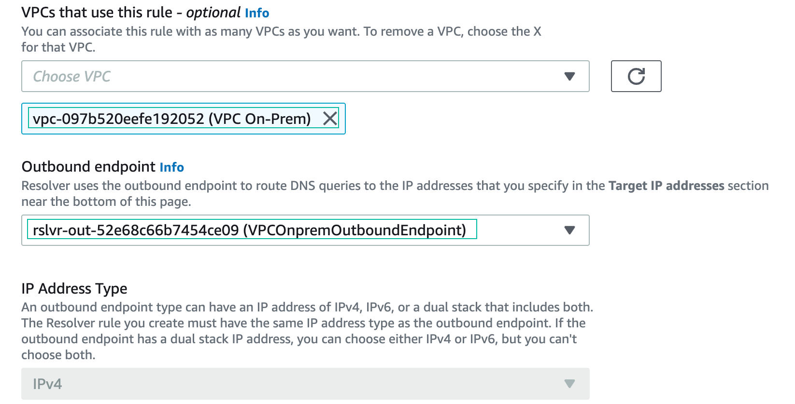

   - **Target IP addresses:** Thêm 2 địa chỉ IP của Inbound Endpoint đã sao chép ở Bước 2.
   - Nhấp **Submit**.

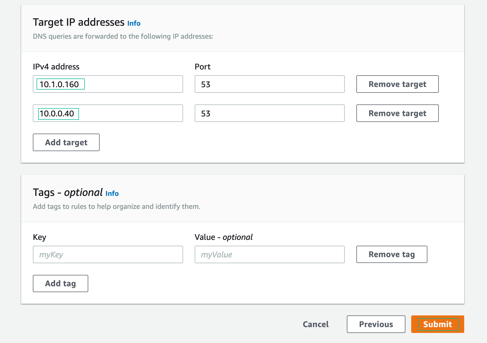

Quy tắc Forwarding Rule được kích hoạt thành công.

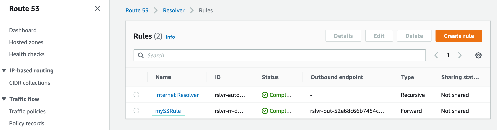

---

#### 3. Kiểm tra Thực tế trên Máy chủ On-Premises

1. Mở lại phiên **Session Manager** trên máy chủ **`Test-Interface-Endpoint`**.

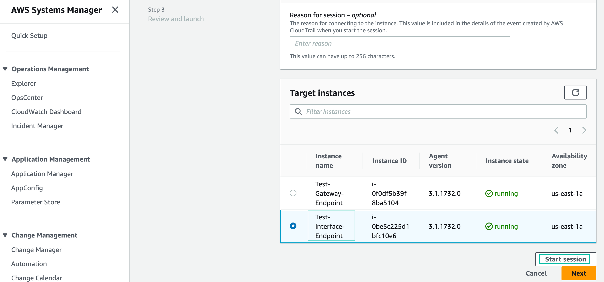

2. Thực thi lệnh phân giải DNS bằng `dig`:
   ```bash
   dig +short s3.us-east-1.amazonaws.com
   ```

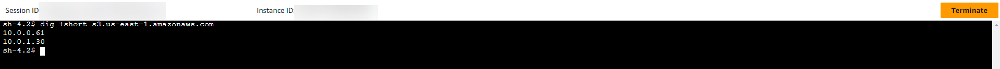

> [!NOTE]
> Kết quả trả về trực tiếp các địa chỉ IP Private thuộc dải mạng `10.0.x.x` của Interface Endpoint trong `VPC Cloud`. Điều này chứng minh quá trình chuyển tiếp truy vấn qua Route 53 Resolver hoạt động chính xác.

3. Đối chiếu kiểm tra: Mở VPC Endpoints Console ➔ Tab **Subnets** của `s3-interface-endpoint`, các IP trả về từ lệnh `dig` trùng khớp 100% với IP của 2 Interface ENIs.

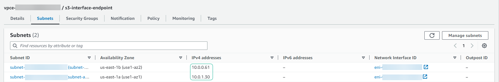

4. Kiểm tra truy vấn S3 bằng tên miền chuẩn:
   ```bash
   aws s3 ls --endpoint-url https://s3.us-east-1.amazonaws.com
   ```
   Lệnh thực thi ngay lập tức và liệt kê đầy đủ các S3 Bucket.

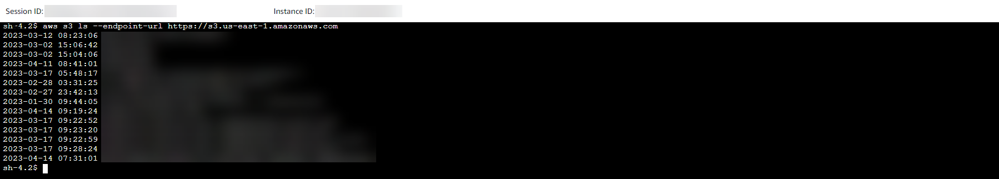

5. Gõ lệnh `exit` để đóng phiên Session Manager.

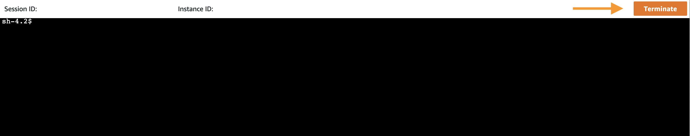

---

#### 4. Tổng kết Kỹ thuật

Cấu hình Route 53 Resolver Forwarding kết hợp cùng Private Hosted Zone cho phép các máy chủ On-Premises tự động phân giải tên miền tiêu chuẩn của Amazon S3 về địa chỉ IP PrivateLink qua đường truyền VPN. Mô hình này mang lại 3 ưu điểm vượt trội:
1. **Minh bạch ứng dụng (Application Transparency):** Ứng dụng On-Premises không cần sửa đổi mã nguồn hay cấu hình endpoint URL phức tạp.
2. **Tính sẵn sàng cao (High Availability):** DNS tự động luân phiên giữa các IP ENI phân bổ trên nhiều AZs.
3. **Bảo mật tuyệt đối:** 100% lưu lượng truyền tải đi qua đường hầm IPsec VPN và mạng backbone AWS, không chạm vào Internet công cộng.
