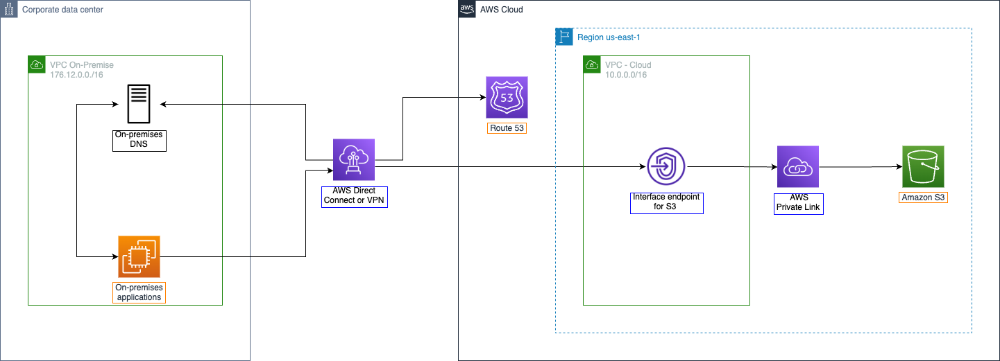

#### Hybrid Cloud Architecture Overview

When workloads hosted inside on-premises corporate datacenters require low-latency, private connectivity to Amazon S3, **Gateway VPC Endpoints** cannot serve this requirement because gateway endpoints are restricted to the local VPC route table.

AWS solves this hybrid connectivity challenge via **Interface VPC Endpoints powered by AWS PrivateLink**:
1. **Elastic Network Interfaces (ENIs):** Allocates private IP addresses from your VPC subnets (`10.0.x.x`) to act as entry points for S3 traffic.
2. **Hybrid Network Extension:** Because ENIs carry private routable IP addresses, on-premises systems can reach them over an **AWS Site-to-Site VPN** tunnel or **AWS Direct Connect** dedicated circuit.
3. **Seamless DNS Integration:** Leverages Amazon Route 53 Resolver conditional forwarding to resolve standard S3 endpoints (`s3.us-east-1.amazonaws.com`) directly to the private interface endpoint IPs.

#### Execution Roadmap:

1. [5.4.1 Infrastructure Preparation & VPN Routing](5.4.1-prepare/) — Configure StrongSwan VPN routing table target and deploy Route 53 Resolver endpoints.
2. [5.4.2 Create S3 Interface Endpoint](5.4.2-create-interface-enpoint/) — Provision multi-AZ interface endpoints with dedicated security groups.
3. [5.4.3 Test Direct Connectivity via Endpoint URL](5.4.3-test-endpoint/) — Execute AWS CLI transfer commands with the `--endpoint-url` flag from simulated on-premises hosts.
4. [5.4.4 Configure Route 53 Conditional DNS Forwarding](5.4.4-dns-simulation/) — Configure Private Hosted Zone alias records and resolver rules for transparent DNS resolution.
