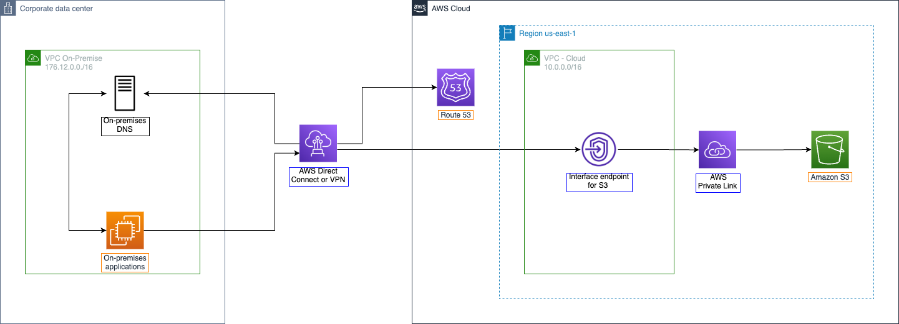

#### Tổng quan Giải pháp Hybrid Cloud

Khi các ứng dụng đặt tại trung tâm dữ liệu On-Premises của doanh nghiệp cần sao lưu hoặc truy xuất dữ liệu trên Amazon S3, **Gateway VPC Endpoint** không thể đáp ứng được vì Gateway Endpoint chỉ hoạt động nội bộ bên trong bảng định tuyến của một VPC cụ thể.

Để giải quyết bài toán này, AWS cung cấp giải pháp **Interface VPC Endpoint (AWS PrivateLink)**:
1. **Khởi tạo Card mạng Ảo (ENI):** Gán các địa chỉ IP private trực tiếp từ Subnet của VPC Cloud (`10.0.x.x`).
2. **Mở rộng phạm vi qua VPN / Direct Connect:** Vì ENI mang địa chỉ IP private trong dải mạng nội bộ, các máy chủ On-Premises có thể định tuyến lưu lượng qua đường hầm **AWS Site-to-Site VPN** hoặc kết nối cáp quang chuyên dụng **AWS Direct Connect** tới địa chỉ IP private này để truy cập S3.
3. **Phân giải DNS Linh hoạt:** Kết hợp cùng Route 53 Resolver để tự động điều hướng các truy vấn tên miền S3 (`s3.us-east-1.amazonaws.com`) về đúng IP của Interface Endpoint.

#### Các bước triển khai chi tiết:

1. [5.4.1 Chuẩn bị tài nguyên & Định tuyến VPN](5.4.1-prepare/) — Cập nhật bảng định tuyến cho máy ảo StrongSwan VPN và triển khai Route 53 Inbound/Outbound Endpoints.
2. [5.4.2 Khởi tạo S3 Interface Endpoint](5.4.2-create-interface-enpoint/) — Cấu hình Endpoint loại Interface đa AZs và gán Security Group bảo vệ.
3. [5.4.3 Kiểm tra kết nối từ On-Premises qua Endpoint URL](5.4.3-test-endpoint/) — Sử dụng tham số `--endpoint-url` trong AWS CLI từ máy chủ On-Premises để upload file.
4. [5.4.4 Mô phỏng Conditional DNS Forwarding](5.4.4-dns-simulation/) — Cấu hình Alias Records trên Private Hosted Zone và Resolver Forwarding Rules để máy chủ On-Premises tự động phân giải tên miền S3 tiêu chuẩn.
