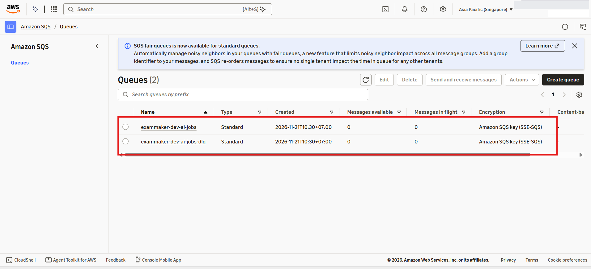

#### Confirm `Queues (2)` Are Provisioned and Clean

Inspect the **Amazon SQS → Queues** overview to confirm both queues (`exammaker-dev-ai-jobs` and `exammaker-dev-ai-jobs-dlq`) are created and clean (`Messages available = 0`, `Messages in flight = 0`):

