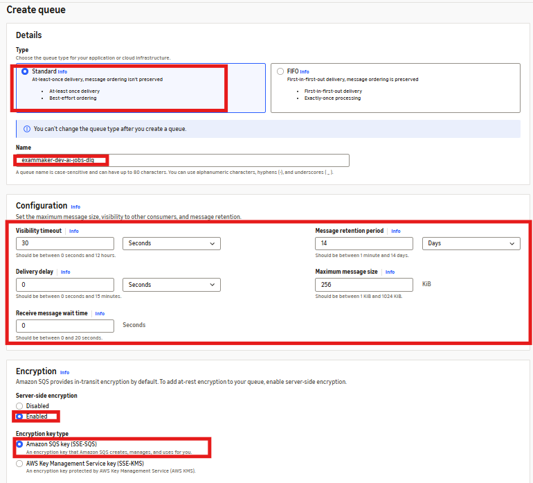
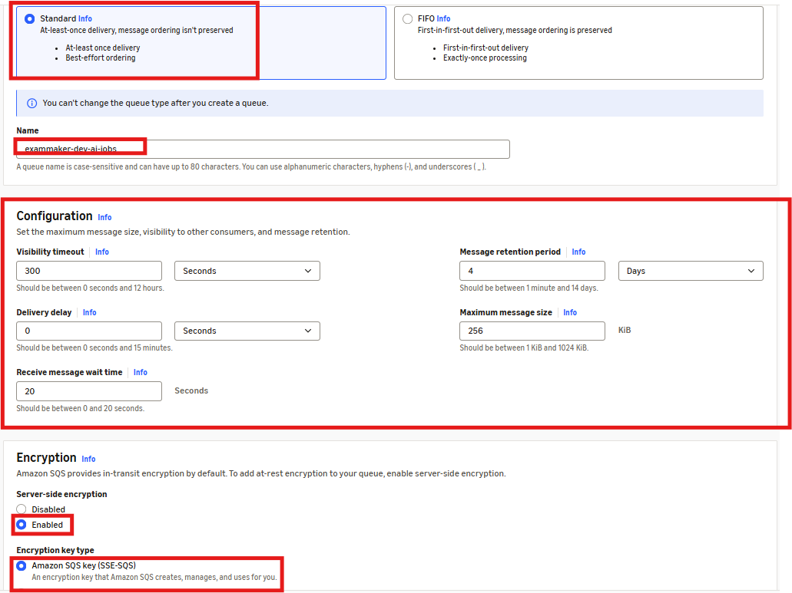
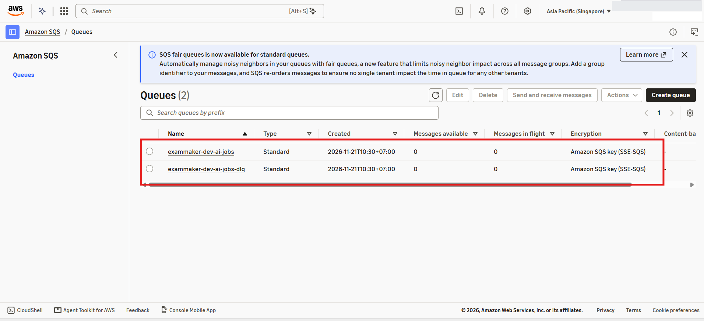

In this section, we set up asynchronous processing with **Amazon SQS** for AI question generation and validation jobs (15–45 seconds per job), consisting of a **Dead-Letter Queue** (`exammaker-dev-ai-jobs-dlq`) and a **Main Queue** (`exammaker-dev-ai-jobs`) configured with a **300-second visibility timeout**, **20-second Long Polling**, and a **Redrive Policy (`maxReceiveCount = 3`)**.

---

### 1. Create Dead-Letter Queue (DLQ)

#### Create the Dead-Letter Queue (`exammaker-dev-ai-jobs-dlq`) First

1. Open **Amazon SQS** in `ap-southeast-1` → click **Create queue**.
2. Configure the queue parameters:
  * *Type:* `Standard`
  * *Name:* `exammaker-dev-ai-jobs-dlq`
  * *Visibility timeout:* `30` Seconds
  * *Message retention period:* `14` Days (retains failed job payloads long enough for engineering root-cause analysis)
  * *Delivery delay:* `0` Seconds
  * *Maximum message size:* `256` KiB
  * *Receive message wait time:* `0` Seconds
  * *Encryption:* `Enabled` — `Amazon SQS key (SSE-SQS)` (**$0**).
3. Click **Create queue**.

---

### 2. Create Main Queue

#### Create the Main Queue (`exammaker-dev-ai-jobs`) with Long Polling & Redrive Policy

1. In **Amazon SQS**, click **Create queue**.
2. Configure optimal settings for the Amazon Bedrock AI Worker:
  * *Type:* `Standard`
  * *Name:* `exammaker-dev-ai-jobs`
  * *Visibility timeout:* `300` Seconds (5 minutes) — safely exceeds the maximum Worker execution duration so SQS does not redeliver an in-progress job.
  * *Message retention period:* `4` Days
  * *Delivery delay:* `0` Seconds
  * *Maximum message size:* `256` KiB
  * *Receive message wait time (Long Polling):* `20` Seconds — eliminates ~99% of empty polling requests, staying well within the 1M free requests/month tier.
  * *Encryption:* `Amazon SQS key (SSE-SQS)` (**$0**).
  * *Dead-letter queue (Redrive policy):* attach `exammaker-dev-ai-jobs-dlq` with **Maximum receives = `3`**.
3. Click **Create queue**.

---

### 3. Verify 2 SQS Queues

#### Confirm `Queues (2)` Are Provisioned and Clean

Inspect the **Amazon SQS → Queues** overview to confirm both queues (`exammaker-dev-ai-jobs` and `exammaker-dev-ai-jobs-dlq`) are created and clean (`Messages available = 0`, `Messages in flight = 0`):

