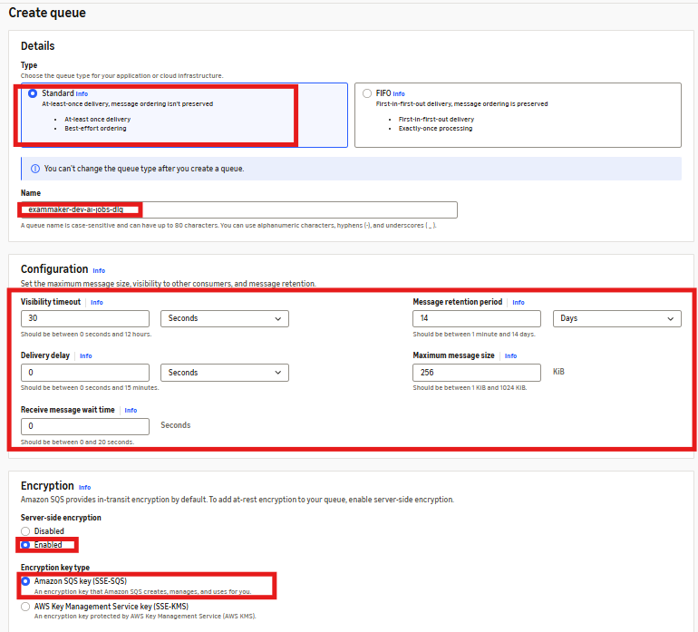
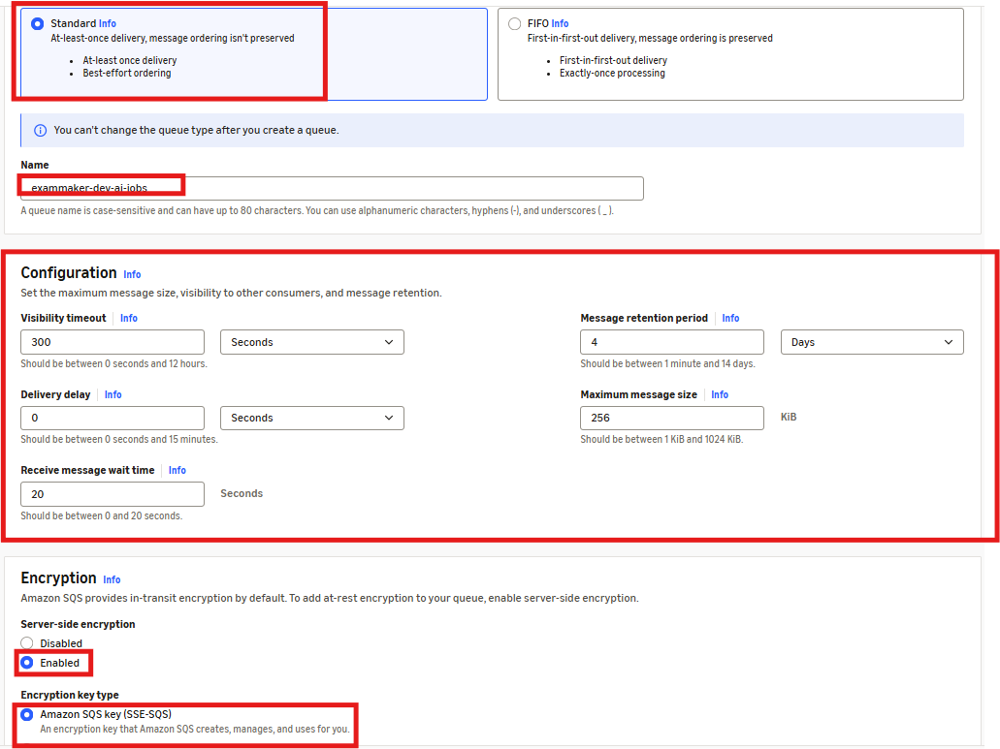
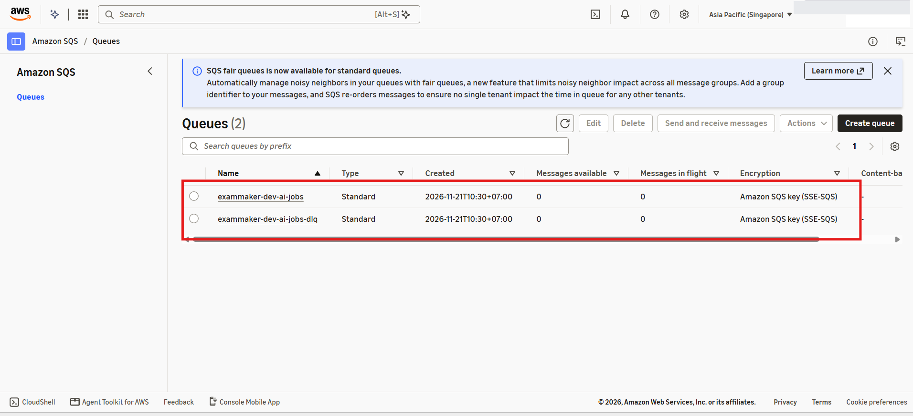

Trong phần này, chúng ta thiết lập kiến trúc xử lý bất đồng bộ bằng **Amazon SQS** cho các tác vụ sinh câu hỏi và thẩm định đáp án bằng AI (kéo dài 15–45 giây), bao gồm hàng đợi thư chết **Dead-Letter Queue** (`exammaker-dev-ai-jobs-dlq`) và hàng đợi chính (`exammaker-dev-ai-jobs`) với **Visibility timeout 300 giây**, **Long Polling 20 giây** và **Redrive Policy (`maxReceiveCount = 3`)**.

---

### 1. Khởi tạo Hàng đợi Thư chết (DLQ)

#### Tạo Dead-Letter Queue (`exammaker-dev-ai-jobs-dlq`) trước hàng đợi chính

1. Mở **Amazon SQS** tại region `ap-southeast-1` → bấm **Create queue**.
2. Cấu hình các thông số:
  * *Type:* `Standard`
  * *Name:* `exammaker-dev-ai-jobs-dlq`
  * *Visibility timeout:* `30` Seconds
  * *Message retention period:* `14` Days (lưu giữ tối đa các job lỗi để đội kỹ thuật phân tích nguyên nhân)
  * *Delivery delay:* `0` Seconds
  * *Maximum message size:* `256` KiB
  * *Receive message wait time:* `0` Seconds
  * *Encryption:* `Enabled` — `Amazon SQS key (SSE-SQS)` (**$0**).
3. Bấm **Create queue**.

---

### 2. Khởi tạo Hàng đợi Chính (Main Queue)

#### Tạo Main Queue (`exammaker-dev-ai-jobs`) kèm Long Polling & Redrive Policy

1. Trong **Amazon SQS**, bấm **Create queue**.
2. Thiết lập cấu hình tối ưu cho Worker gọi Amazon Bedrock:
  * *Type:* `Standard`
  * *Name:* `exammaker-dev-ai-jobs`
  * *Visibility timeout:* `300` Seconds (5 phút) — lớn hơn thời gian xử lý tối đa của Worker để SQS không giao trùng cùng một job.
  * *Message retention period:* `4` Days
  * *Delivery delay:* `0` Seconds
  * *Maximum message size:* `256` KiB
  * *Receive message wait time (Long Polling):* `20` Seconds — giảm 99% số lượng empty receive requests, nằm trọn trong 1 triệu request miễn phí/tháng.
  * *Encryption:* `Amazon SQS key (SSE-SQS)` (**$0**).
  * *Dead-letter queue (Redrive policy):* chọn `exammaker-dev-ai-jobs-dlq` với **Maximum receives = `3`**.
3. Bấm **Create queue**.

---

### 3. Kiểm tra Kết quả 2 Hàng đợi SQS

#### Xác nhận danh sách `Queues (2)` sẵn sàng tiếp nhận AI Jobs

Kiểm tra màn hình tổng quan **Amazon SQS → Queues** xác nhận đã có đủ **2 hàng đợi** (`exammaker-dev-ai-jobs` và `exammaker-dev-ai-jobs-dlq`) ở trạng thái sạch (`Messages available = 0`, `Messages in flight = 0`):

