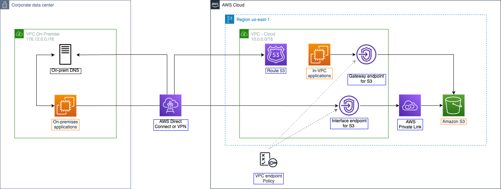
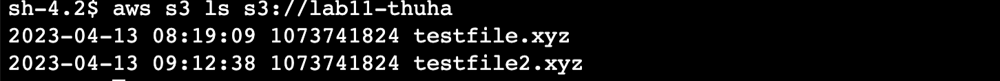
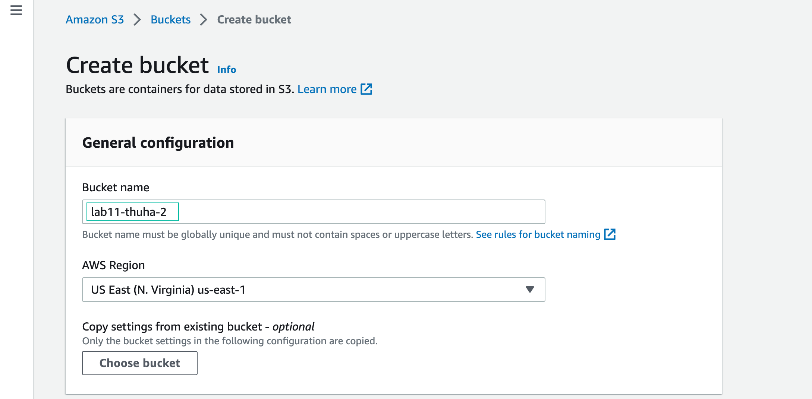
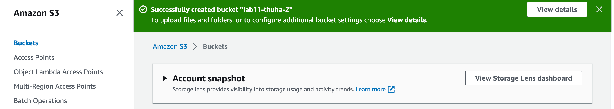
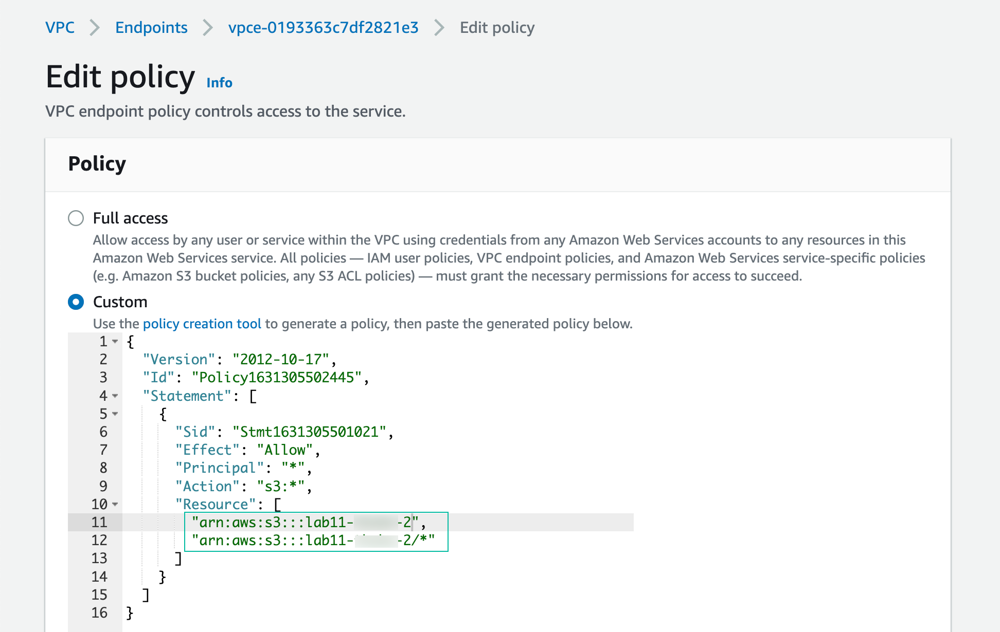
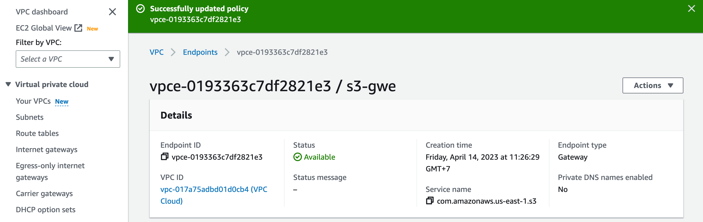
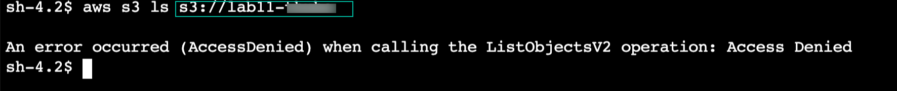
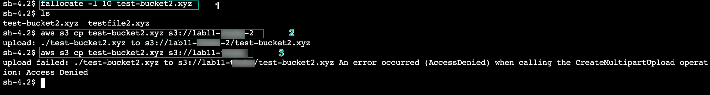
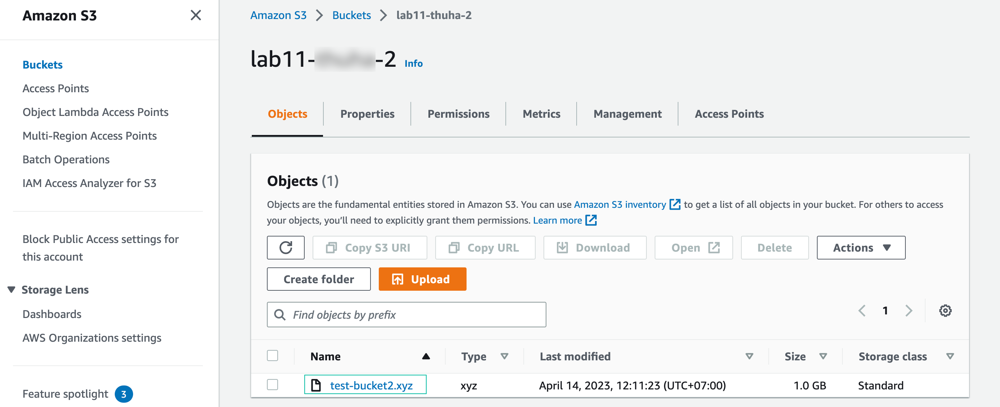
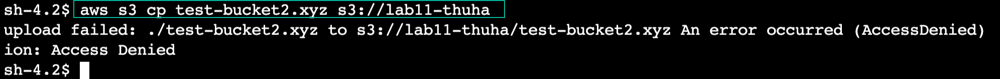

#### Technical Objective

By default, VPC Endpoints ship with a **Full Access** policy allowing any workload in the VPC to communicate with any Amazon S3 bucket across any AWS account worldwide. In enterprise production environments, this unrestricted access creates a data exfiltration risk if an internal actor or compromised instance attempts to offload corporate intellectual property into an external bucket.

A **VPC Endpoint Policy** is a resource-based policy attached directly to the endpoint that functions as an infrastructure-level perimeter guardrail, restricting data transfers exclusively to explicitly authorized corporate S3 buckets.



---

#### 1. Baseline Verification & Creating a Second S3 Bucket

1. Open the **Session Manager** console session on `Test-Gateway-Endpoint`. Query the initial bucket created in step 5.3:
   ```bash
   aws s3 ls s3://<your-first-bucket-name>
   ```
   The 1GB `testfile.xyz` object returns successfully.



2. Create a second S3 Bucket:
   - In the S3 Management Console, click **Create bucket**.
   - **Bucket name:** Follow your existing naming scheme appended with `-2` (e.g., `fcj-hybrid-s3-test-<your-name>-2`).
   - Leave other settings at default values and click **Create bucket**.





---

#### 2. Apply Custom Restriction on Gateway Endpoint Policy

1. Open the **Amazon VPC Console** ➔ Select **Endpoints** ➔ Select **`s3-gwe`**.
2. Select the **Policy** tab ➔ Click **Edit policy** ➔ Select **Custom**.
3. Paste the following JSON policy (replace `<yourbucketname-2>` with your second bucket name):

```json
{
  "Id": "Policy1631305502445",
  "Version": "2012-10-17",
  "Statement": [
    {
      "Sid": "RestrictAccessToSpecificBucketOnly",
      "Effect": "Allow",
      "Principal": "*",
      "Action": "s3:*",
      "Resource": [
        "arn:aws:s3:::<yourbucketname-2>",
        "arn:aws:s3:::<yourbucketname-2>/*"
      ]
    }
  ]
}
```



4. Click **Save changes**. The perimeter restriction takes effect immediately.



---

#### 3. Empirical Security Testing

1. In the `Test-Gateway-Endpoint` terminal session, attempt to query the first bucket again:
   ```bash
   aws s3 ls s3://<your-first-bucket-name>
   ```
   **Result:** The command fails immediately with: `An error occurred (AccessDenied) when calling the ListObjectsV2 operation: Access Denied`.



2. Create a second 1GB test file and upload it to the whitelisted second bucket:
   ```bash
   cd ~
   fallocate -l 1G test-bucket2.xyz
   aws s3 cp test-bucket2.xyz s3://<your-2nd-bucket-name>
   ```
   **Result:** The transfer completes successfully at full speed.





3. Attempt to upload the same file into the unauthorized first bucket:
   ```bash
   aws s3 cp test-bucket2.xyz s3://<your-1st-bucket-name>
   ```
   **Result:** Operation rejected with an immediate `AccessDenied` error.



---

#### 4. Security Engineering Takeaway

This experiment demonstrates that **VPC Endpoint Policies** evaluate requests as an independent authorization boundary. Even if the EC2 instance role possesses unrestricted `AdministratorAccess`, any API call traversing the VPC endpoint that targets a non-whitelisted resource is denied at the network layer. This provides an effective guardrail against accidental or malicious data exfiltration.
