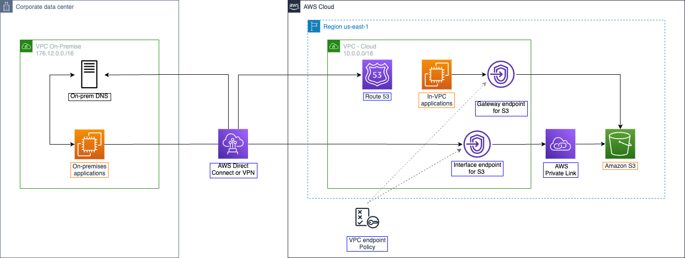
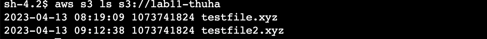
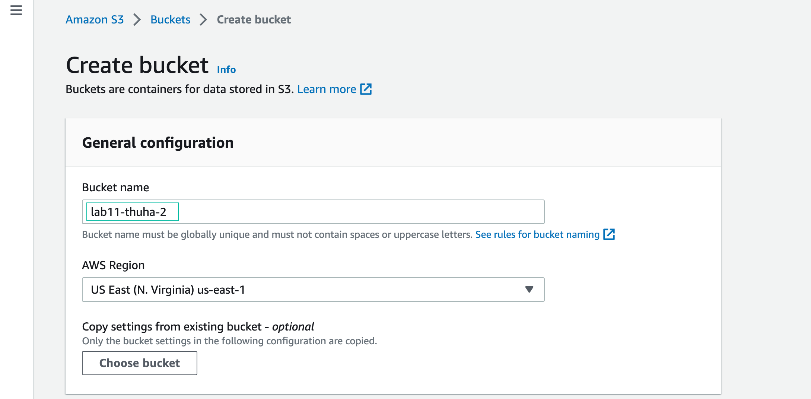
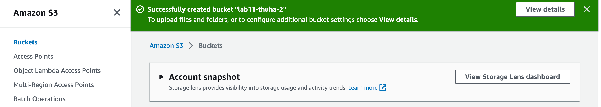
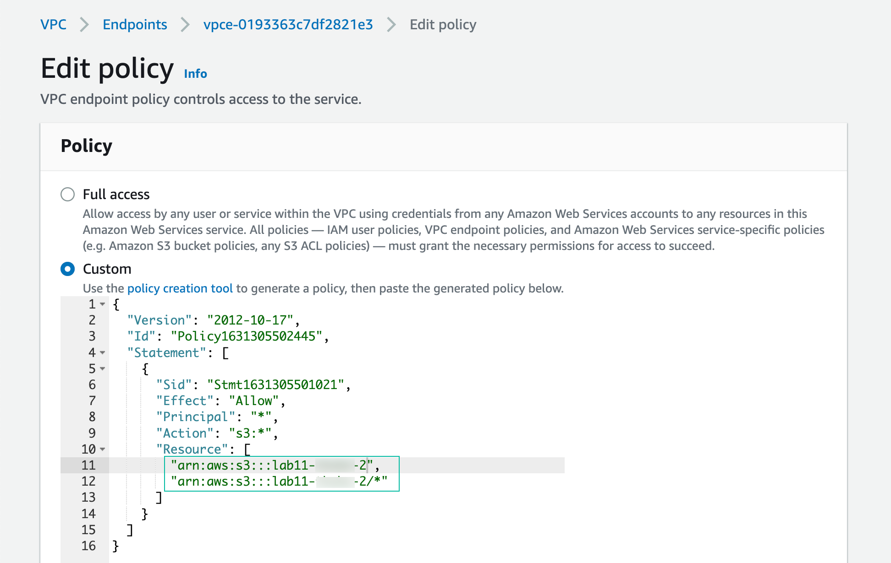
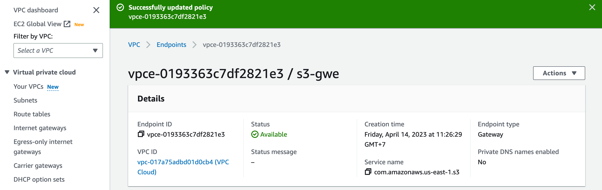
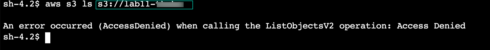
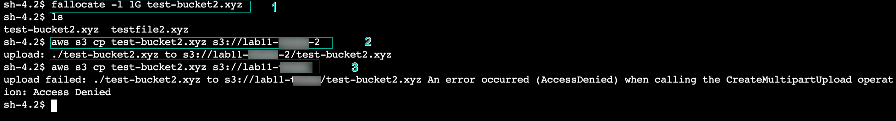
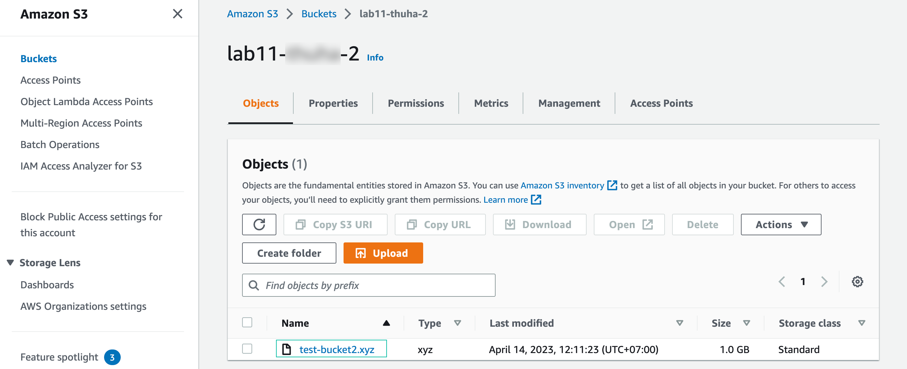
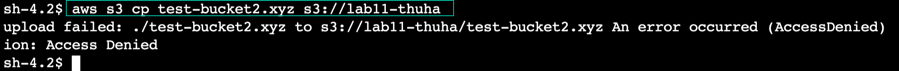

#### Mục tiêu Kỹ thuật

Mặc định, VPC Endpoint đi kèm chính sách **Full Access** cho phép các máy chủ trong VPC tương tác với bất kỳ S3 Bucket nào trên toàn cầu của AWS. Trong môi trường doanh nghiệp, cấu hình này tiềm ẩn nguy cơ rò rỉ dữ liệu (Data Exfiltration) nếu kẻ tấn công tải dữ liệu bí mật lên một S3 Bucket cá nhân ngoài tổ chức.

**VPC Endpoint Policy** là một Resource-based Policy được gắn trực tiếp vào Endpoint để thiết lập rào chắn kiểm soát (Guardrail), giới hạn chỉ cho phép truy cập vào các S3 Bucket thuộc quyền sở hữu của tổ chức.



---

#### 1. Kiểm tra Quyền truy cập Ban đầu & Tạo Bucket thứ 2

1. Mở phiên **Session Manager** trên máy chủ **`Test-Gateway-Endpoint`**. Kiểm tra nội dung của Bucket thứ nhất (tạo ở mục 5.3):
   ```bash
   aws s3 ls s3://<your-first-bucket-name>
   ```
   Kết quả liệt kê đầy đủ tệp `testfile.xyz` (1GB).



2. Khởi tạo thêm một S3 Bucket thứ hai:
   - Vào S3 Console ➔ **Create bucket**.
   - Đặt tên bucket: Sử dụng quy tắc đặt tên như bucket đầu nhưng thêm hậu tố `-2` (Ví dụ: `fcj-hybrid-s3-test-<your-name>-2`).
   - Giữ nguyên các thiết lập mặc định và nhấp **Create bucket**.





---

#### 2. Cấu hình Giới hạn Quyền trên Gateway Endpoint Policy

1. Mở **Amazon VPC Console** ➔ Mục **Endpoints** ➔ Chọn **`s3-gwe`**.
2. Chọn tab **Policy** ➔ Nhấp **Edit policy** ➔ Chọn chế độ **Custom**.
3. Dán đoạn JSON Policy bên dưới (Thay thế `<yourbucketname-2>` bằng tên bucket thứ hai):

```json
{
  "Id": "Policy1631305502445",
  "Version": "2012-10-17",
  "Statement": [
    {
      "Sid": "RestrictAccessToSpecificBucketOnly",
      "Effect": "Allow",
      "Principal": "*",
      "Action": "s3:*",
      "Resource": [
        "arn:aws:s3:::<yourbucketname-2>",
        "arn:aws:s3:::<yourbucketname-2>/*"
      ]
    }
  ]
}
```



4. Nhấp **Save changes**. Policy mới có hiệu lực ngay lập tức.



---

#### 3. Thực nghiệm Kiểm chứng Chính sách Bảo mật

1. Quay lại terminal Session Manager của `Test-Gateway-Endpoint`, thử liệt kê lại Bucket đầu tiên:
   ```bash
   aws s3 ls s3://<your-first-bucket-name>
   ```
   **Kết quả:** Lệnh bị chặn với thông báo lỗi: `An error occurred (AccessDenied) when calling the ListObjectsV2 operation: Access Denied`.



2. Tạo một tệp dữ liệu mới 1GB và tải lên Bucket thứ 2 (được phép trong Policy):
   ```bash
   cd ~
   fallocate -l 1G test-bucket2.xyz
   aws s3 cp test-bucket2.xyz s3://<your-2nd-bucket-name>
   ```
   **Kết quả:** Quá trình tải lên thành công 100%.





3. Thử tải tệp `test-bucket2.xyz` vào Bucket đầu tiên:
   ```bash
   aws s3 cp test-bucket2.xyz s3://<your-1st-bucket-name>
   ```
   **Kết quả:** Hệ thống lập tức trả về lỗi `AccessDenied`.



---

#### 4. Tổng kết Kỹ thuật

Thực nghiệm chứng minh **VPC Endpoint Policy** hoạt động như một tầng kiểm soát độc lập với IAM Policy của máy chủ EC2. Ngay cả khi IAM Role của EC2 có quyền `AdministratorAccess`, nếu VPC Endpoint Policy không cấp phép quyền thao tác trên tài nguyên tương ứng, toàn bộ yêu cầu API đi qua Endpoint đều bị chặn đứng (`AccessDenied`). Đây là giải pháp hữu hiệu nhất để ngăn chặn rò rỉ dữ liệu ra bên ngoài trong kiến trúc bảo mật nhiều lớp (Defense-in-Depth).
