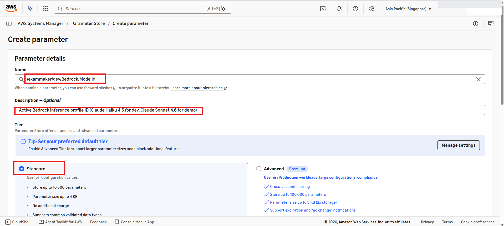
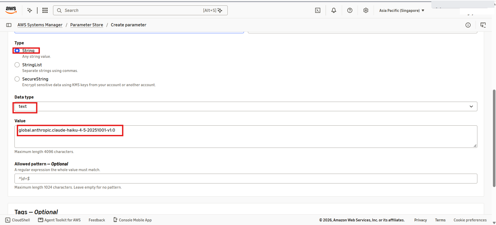

#### Step 1: Create Hierarchical Parameters Under `/exammaker/dev/*`

1. Open **AWS Systems Manager → Parameter Store → Create parameter**.
2. Create the sample parameter `/exammaker/dev/Bedrock/ModelId` (automatically loaded into .NET 10 `IConfiguration` at startup):
  * *Name:* `/exammaker/dev/Bedrock/ModelId`
  * *Description:* `Active Bedrock inference profile ID (Claude Haiku 4.5 for dev, Claude Sonnet 4.6 for demo)`
  * *Tier:* `Standard` (up to 10,000 parameters, ≤ 4 KB each, **$0**)

#### Step 2: Select Parameter Type (`String` / `SecureString`) & Value

* *Type:* `String` (for sensitive values such as DB credentials, use `SecureString` encrypted with default KMS key `alias/aws/ssm` at $0 cost).
* *Data type:* `text`
* *Value:* `global.anthropic.claude-haiku-4-5-20251001-v1:0` (switch seamlessly to `global.anthropic.claude-sonnet-4-6` for live demos without code changes).
- Click **Create parameter**.

