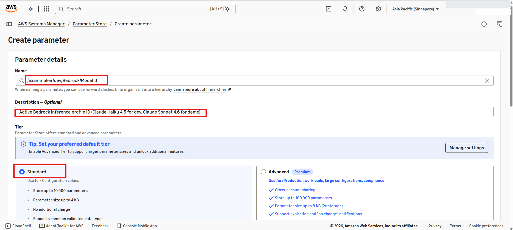
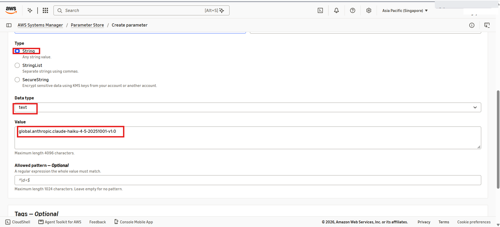

#### Bước 1: Khai báo Tên Tham số Phân cấp & Chọn Phân tầng Standard () (Hình 11)

1. Mở **AWS Systems Manager Console** (p-southeast-1) → menu trái chọn **Parameter Store** → bấm **Create parameter**.
2. Tại mục **Parameter details**:
   - **Name:** Điền tên tham số theo cấu trúc phân cấp /exammaker/dev/<Section>/<Key> để .NET tự động nạp qua AddSystemsManager (ví dụ: **/exammaker/dev/Bedrock/ModelId**).
   - **Description - Optional:** Điền Active Bedrock inference profile ID (Claude Haiku 4.5 for dev, Claude Sonnet 4.6 for demo).
   - **Tier:** Tích chọn **Standard** (miễn phí **** cho tối đa 10.000 tham số).

---

#### Bước 2: Chọn Kiểu Dữ liệu & Điền Giá trị Tham số (Hình 11.2)

1. Kéo xuống mục **Type**, **Data type** và **Value**:
   - **Type:** Chọn **String** cho các tham số cấu hình thông thường *(hoặc chọn **SecureString** với KMS key mặc định lias/aws/ssm =  cho các biến bí mật như /exammaker/dev/ConnectionStrings/ExamMaker, /exammaker-ops/dev/Rds/MasterPassword, /exammaker-ops/dev/Origin/VerifySecret)*.
   - **Data type:** Chọn **	ext**.
   - **Value:** Điền **global.anthropic.claude-haiku-4-5-20251001-v1:0**.
2. Bấm **Create parameter** ở cuối trang.

