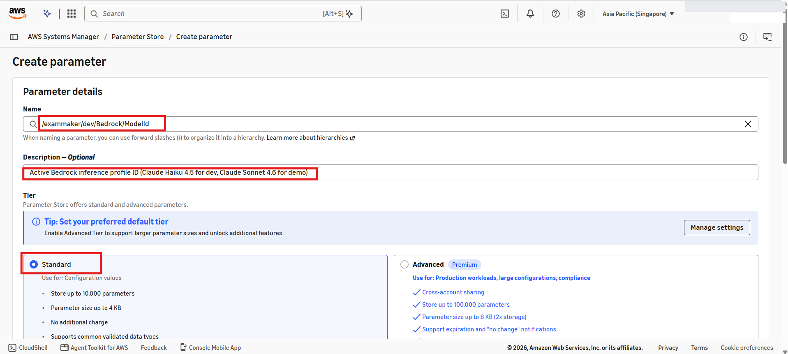
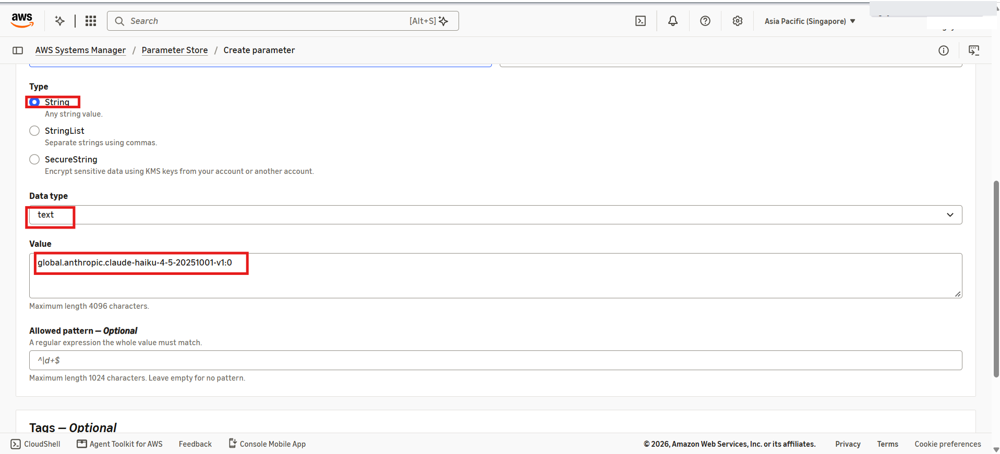
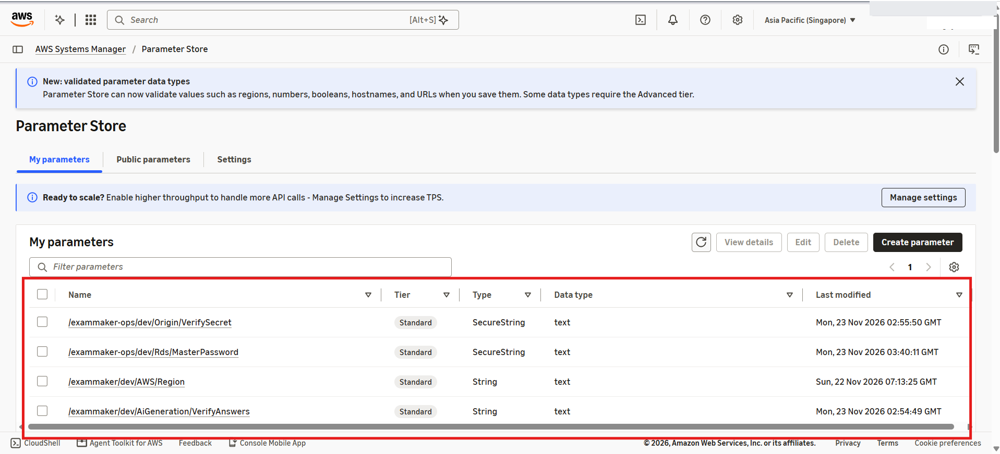

In this section, we centralize all **33 application parameters and operational secrets** in **AWS Systems Manager Parameter Store** on the **Standard tier ($0/month)** — eliminating hardcoded secrets in source code and avoiding plaintext `.env` files on the EC2 instance.

---

### 1. Create Configuration Parameter

#### Step 1: Create Hierarchical Parameters Under `/exammaker/dev/*`

1. Open **AWS Systems Manager → Parameter Store → Create parameter**.
2. Create the sample parameter `/exammaker/dev/Bedrock/ModelId` (automatically loaded into .NET 10 `IConfiguration` at startup):
  * *Name:* `/exammaker/dev/Bedrock/ModelId`
  * *Description:* `Active Bedrock inference profile ID (Claude Haiku 4.5 for dev, Claude Sonnet 4.6 for demo)`
  * *Tier:* `Standard` (up to 10,000 parameters, ≤ 4 KB each, **$0**)

#### Step 2: Select Parameter Type (`String` / `SecureString`) & Value

* *Type:* `String` (for sensitive values such as DB credentials, use `SecureString` encrypted with default KMS key `alias/aws/ssm` at $0 cost).
* *Data type:* `text`
* *Value:* `global.anthropic.claude-haiku-4-5-20251001-v1:0` (switch seamlessly to `global.anthropic.claude-sonnet-4-6` for live demos without code changes).
- Click **Create parameter**.

---

### 2. Verify All 33 Parameters

#### Verify `My parameters` (33 Parameters Split Across 2 Namespaces)

Confirm all **33 parameters** are provisioned cleanly:
- **31 application parameters** under `/exammaker/dev/*` (RDS connection, Cognito, SQS, Bedrock, AI quotas, and rate limits).
- **2 operational secret parameters (`SecureString`)** isolated under `/exammaker-ops/dev/*` so the EC2 runtime role cannot read administrative DB credentials.

Key AI cost-guardrail parameters stored in SSM:
* *AI Quotas (`AiQuota`):* 
  - `JobsPerUserPerDay = 10` · `MaxQuestionsPerJob = 10`
  - `TokensPerUserPerDay = 100,000` · `SystemTokensPerDay = 500,000`
  - `MaxNoteLength = 1,000` · `MaxAttempts = 3`
* *Rate Limiting (`AiRateLimit`):* 
  - `PermitLimit = 5` requests / `Window = 00:01:00` (1 minute)

