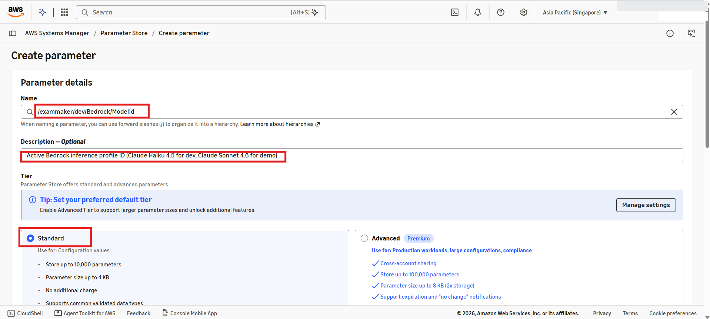
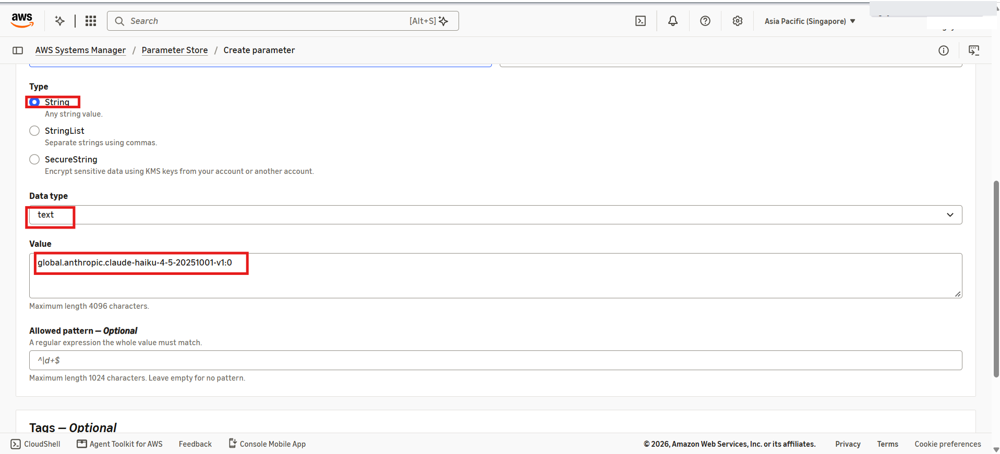
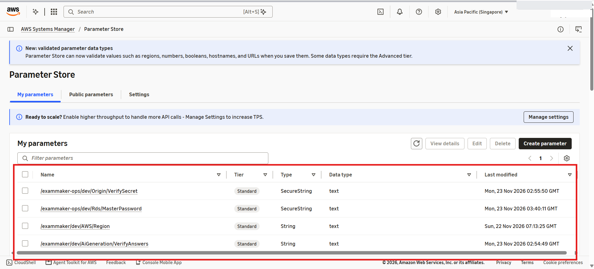

Trong phần này, chúng ta quản trị tập trung toàn bộ **33 tham số cấu hình và thông tin bí mật** trên **AWS Systems Manager Parameter Store** ở phân tầng **Standard ($0/tháng)** — không hardcode secret trong mã nguồn và không lưu file `.env` nhạy cảm trên máy chủ EC2.

---

### 1. Khởi tạo Tham số Cấu hình Chuẩn

#### Bước 1: Tạo tham số theo cấu trúc đường dẫn `/exammaker/dev/*`

1. Mở **AWS Systems Manager → Parameter Store → Create parameter**.
2. Cấu hình tham số mẫu `/exammaker/dev/Bedrock/ModelId` (cho phép ứng dụng .NET 10 nạp tự động vào `IConfiguration` lúc khởi động):
  * *Name:* `/exammaker/dev/Bedrock/ModelId`
  * *Description:* `Active Bedrock inference profile ID (Claude Haiku 4.5 for dev, Claude Sonnet 4.6 for demo)`
  * *Tier:* `Standard` (tối đa 10.000 parameters, kích thước ≤ 4 KB, chi phí **$0**)

#### Bước 2: Chọn Type (`String` / `SecureString`) & Giá trị

* *Type:* `String` (đối với các biến nhạy cảm như mật khẩu DB, chọn `SecureString` kèm KMS key mặc định `alias/aws/ssm` — chi phí $0).
* *Data type:* `text`
* *Value:* `global.anthropic.claude-haiku-4-5-20251001-v1:0` (chuyển sang `global.anthropic.claude-sonnet-4-6` khi demo mà không cần sửa mã nguồn).
- Bấm **Create parameter**.

---

### 2. Kiểm tra Danh sách 33 Tham số

#### Kiểm tra danh sách `My parameters` (33 tham số phân tách 2 nhánh)

Hệ thống được nạp đầy đủ **33 tham số**:
- **31 tham số ứng dụng** dưới nhánh `/exammaker/dev/*` (kết nối RDS, Cognito, SQS, Bedrock, hạn ngạch AI & giới hạn tần suất).
- **2 tham số mật khẩu vận hành (`SecureString`)** cô lập riêng dưới nhánh `/exammaker-ops/dev/*` để máy chủ EC2 runtime không đọc được mật khẩu admin DB.

Các thông số kiểm soát chi phí AI quan trọng trong SSM:
* *Hạn ngạch AI (`AiQuota`):* 
  - `JobsPerUserPerDay = 10` · `MaxQuestionsPerJob = 10`
  - `TokensPerUserPerDay = 100,000` · `SystemTokensPerDay = 500,000`
  - `MaxNoteLength = 1,000` · `MaxAttempts = 3`
* *Giới hạn tần suất (`AiRateLimit`):* 
  - `PermitLimit = 5` requests / `Window = 00:01:00` (1 phút)

