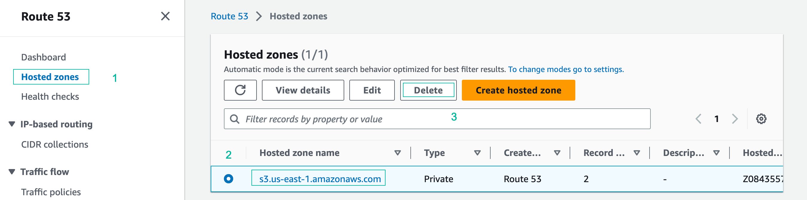
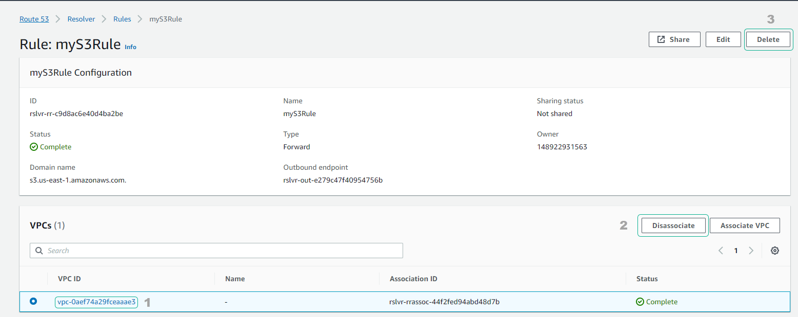
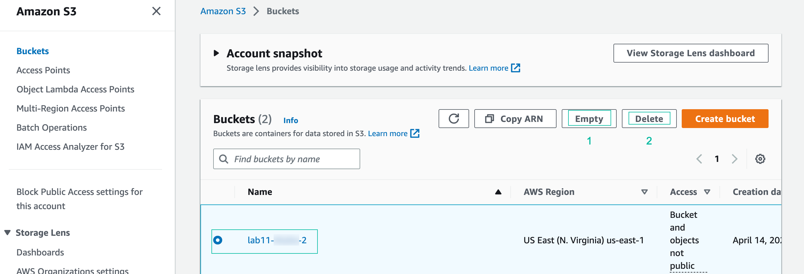
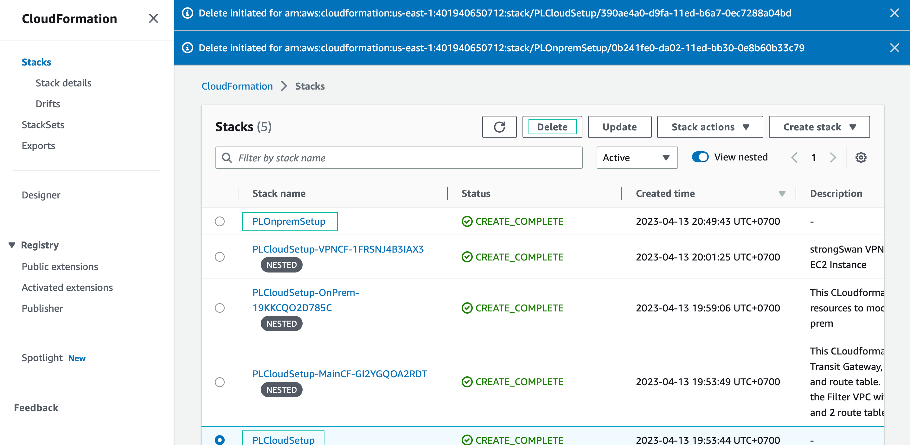

#### Resource De-provisioning Procedure

To prevent recurring hourly charges from idle resources—particularly Interface Endpoints, Route 53 Resolver Endpoints, Transit Gateway attachments, and StrongSwan VPN EC2 instances—execute teardown following strict dependency order:

---

#### 1. Delete Route 53 Private Hosted Zone & Resolver Rules

1. Open the **Amazon Route 53 Management Console** ➔ Navigate to **Hosted zones**.
2. Select the Private Hosted Zone **`s3.us-east-1.amazonaws.com`** ➔ Click **Delete** ➔ Type `delete` to confirm.

3. In the left navigation pane, select **Resolver** ➔ **Rules**.
4. Select rule **`myS3Rule`** ➔ Click **Disassociate** to detach it from `VPC On-prem` ➔ Click **Delete** to permanently remove the rule.

---

#### 2. Delete Manually Created VPC Endpoints

1. Open the **Amazon VPC Management Console** ➔ Select **Endpoints**.
2. Select both endpoints created during the workshop:
   - `s3-gwe` (Gateway Endpoint)
   - `s3-interface-endpoint` (Interface Endpoint)
3. Click **Actions** ➔ Select **Delete VPC endpoints** ➔ Type `delete` to confirm.

---

#### 3. Empty and Delete Test S3 Buckets

1. Open the **Amazon S3 Management Console**.
2. Select each test bucket (`fcj-hybrid-s3-test-...` and `fcj-hybrid-s3-test-...-2`).
3. Click **Empty** ➔ Type `permanently delete` to erase the uploaded 1GB test payloads.
4. Once emptied, click **Delete** ➔ Type the bucket name to confirm deletion.

---

#### 4. Delete CloudFormation Stacks

1. Open the **AWS CloudFormation Management Console** in region `us-east-1`.
2. Select and initiate deletion for the two stacks in sequence:
   - **`PLOnpremSetup`** (Resolver endpoints and simulated on-premises DNS)
   - **`PLCloudSetup`** (Cloud VPC, Transit Gateway, and EC2 instances)

Wait approximately 5-10 minutes for CloudFormation to fully de-provision all VPCs, subnets, route tables, and release associated Elastic IP addresses.

---

#### 5. Architectural Comparison Summary

| Dimension | Gateway Endpoint | Interface Endpoint (PrivateLink) |
| :--- | :--- | :--- |
| **Network Isolation** | Route Table prefix list injection | Dedicated ENIs with private IPs and Security Groups |
| **Ideal Use Case** | EC2, ECS, and Lambda inside the same VPC needing zero-cost S3 access | On-premises datacenters or peered VPCs connecting over VPN/Direct Connect |
| **Access Control** | VPC Endpoint Policy scoped to bucket ARNs | Endpoint Policy + Network Security Group firewall rules |
| **DNS Requirements** | Managed automatically by AWS route table engine | Requires Route 53 Resolver conditional forwarding for seamless FQDN resolution |
