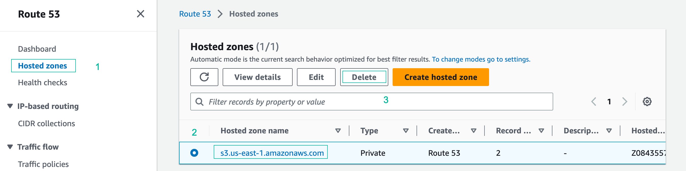
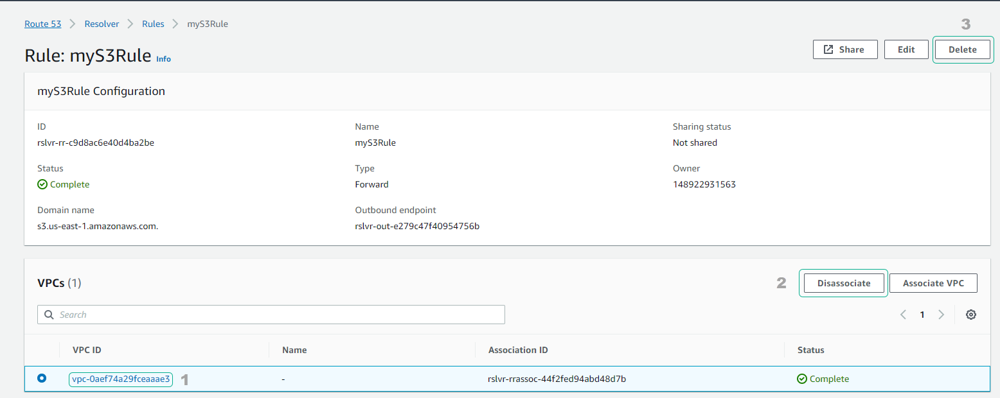
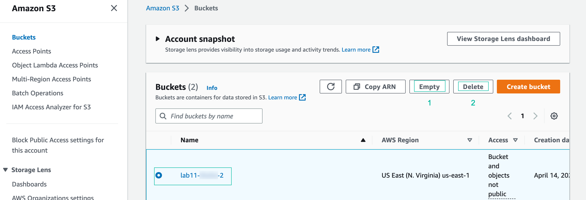
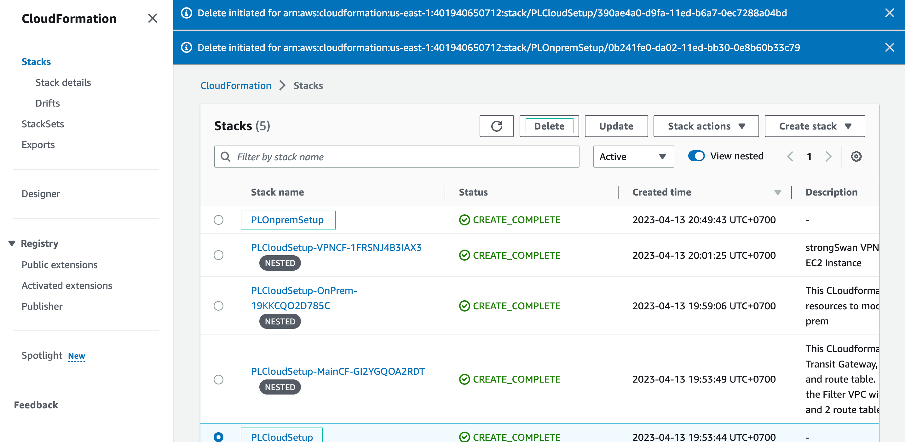

#### Quy trình Giải phóng Tài nguyên Tránh Phát sinh Chi phí

Để bảo vệ hạn mức tài khoản AWS và tránh phát sinh chi phí duy trì tài nguyên chạy ngầm (đặc biệt là các Interface Endpoints, Route 53 Resolver Endpoints và máy ảo EC2 VPN), cần tiến hành hủy tài nguyên theo đúng trình tự phụ thuộc:

---

#### 1. Xóa Route 53 Private Hosted Zone & Resolver Rules

1. Mở **Route 53 Management Console** ➔ Chọn mục **Hosted zones**.
2. Chọn Private Hosted Zone **`s3.us-east-1.amazonaws.com`** ➔ Nhấp **Delete** ➔ Nhập từ khóa `delete` để xác nhận.

3. Tại thanh điều hướng bên trái, chọn **Resolver** ➔ **Rules**.
4. Chọn quy tắc **`myS3Rule`** ➔ Nhấp **Disassociate** để hủy liên kết khỏi `VPC On-prem` ➔ Sau đó nhấp **Delete** để xóa hoàn toàn rule.

---

#### 2. Xóa các VPC Endpoints đã Tạo Thủ công

1. Mở **Amazon VPC Console** ➔ Chọn **Endpoints**.
2. Chọn cả 2 endpoint đã tạo trong bài thực hành:
   - `s3-gwe` (Gateway Endpoint)
   - `s3-interface-endpoint` (Interface Endpoint)
3. Nhấp menu **Actions** ➔ Chọn **Delete VPC endpoints** ➔ Nhập `delete` để xác nhận xóa.

---

#### 3. Xóa các S3 Buckets Thử nghiệm

1. Mở **Amazon S3 Console**.
2. Chọn lần lượt từng bucket thử nghiệm (`fcj-hybrid-s3-test-...` và `fcj-hybrid-s3-test-...-2`).
3. Nhấp chọn **Empty** ➔ Nhập `permanently delete` để xóa sạch toàn bộ các tệp 1GB đã upload.
4. Sau khi bucket rỗng, nhấp **Delete** ➔ Nhập tên bucket để xác nhận xóa hoàn tất.

---

#### 4. Hủy CloudFormation Stacks

1. Mở **AWS CloudFormation Console** tại Region `us-east-1`.
2. Chọn lần lượt và nhấp **Delete** cho 2 stacks (theo đúng thứ tự):
   - **`PLOnpremSetup`** (Stack tài nguyên DNS và On-Premises)
   - **`PLCloudSetup`** (Stack mạng chính, Transit Gateway và các máy ảo EC2)

Đợi khoảng 5 - 10 phút để CloudFormation tự động thu hồi toàn bộ VPCs, Subnets, Transit Gateway và giải phóng địa chỉ Elastic IP.

---

#### 5. Đánh giá Tổng thể & Bài học Kỹ thuật (Key Takeaways)

| Hạng mục | Gateway Endpoint | Interface Endpoint (PrivateLink) |
| :--- | :--- | :--- |
| **Bảo mật mạng** | Cách ly lưu lượng trong Route Table nội bộ VPC | Cách ly lưu lượng qua ENI Private IP, bảo vệ bằng Security Group |
| **Kịch bản phù hợp** | EC2, ECS, Lambda trong cùng VPC truy cập S3 miễn phí | Hệ thống On-Premises hoặc VPC khác truy cập qua VPN / Direct Connect |
| **Kiểm soát truy cập** | VPC Endpoint Policy giới hạn theo Resource ARN | VPC Endpoint Policy kết hợp Security Group Inbound/Outbound rules |
| **Tích hợp DNS** | AWS tự động phân giải qua Public S3 IP prefix list | Cần kết hợp Route 53 Resolver Conditional Forwarding để trong suốt với ứng dụng |
