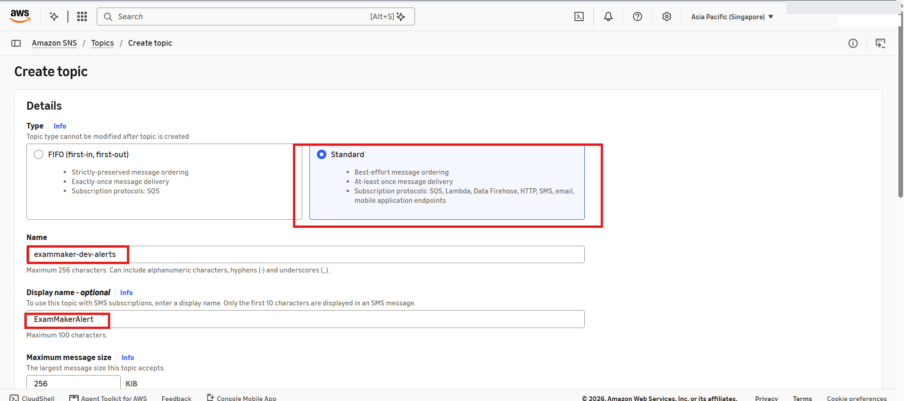
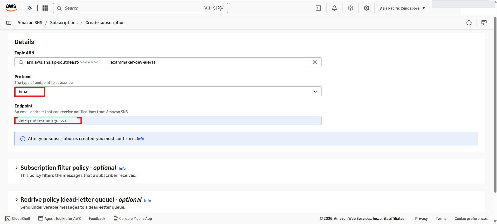

#### Step 1: Create the `exammaker-dev-alerts` SNS Topic

1. Open **Amazon SNS** in `ap-southeast-1` → select **Topics → Create topic**.
2. Configure:
  * *Type:* `Standard`
  * *Name:* `exammaker-dev-alerts`
  * *Display name:* `ExamMakerAlert` (Max message size: `256` KiB)
3. Click **Create topic**.

#### Step 2: Subscribe Operations Team Emails

1. Inside the `exammaker-dev-alerts` topic, click **Create subscription**.
2. Select **Protocol:** `Email` and enter the engineering team email addresses (**4 email subscribers**).
3. Click **Confirm subscription** in each confirmation email so the status transitions to `Confirmed`.

